# Détection des intrusions réseau par Machine Learning et Deep Learning

## Document 01 — Présentation du projet et fondements théoriques

> **À qui s'adresse ce document ?** Ce document s'adresse à une personne qui découvre l'Intelligence Artificielle (IA) et le Machine Learning (ML). Aucune connaissance préalable n'est supposée. Chaque concept est introduit progressivement, avec des exemples simples, et chaque terme anglais est expliqué lors de sa première apparition.
>
> **Comment le lire ?** Les sections 1 à 5 présentent le projet. Les sections 6 à 9 construisent les fondements théoriques et techniques nécessaires pour le réaliser. Un glossaire récapitulatif figure en annexe.

---

## Table des matières

1. [Présentation générale du projet](#1-présentation-générale-du-projet)
2. [Contexte et problématique](#2-contexte-et-problématique)
3. [Objectifs généraux et spécifiques](#3-objectifs-généraux-et-spécifiques)
4. [Résultats attendus](#4-résultats-attendus)
5. [Périmètre et limites](#5-périmètre-et-limites)
6. [Introduction pédagogique : IA, ML et DL](#6-introduction-pédagogique--ia-ml-et-dl)
7. [Le Machine Learning supervisé en détail](#7-le-machine-learning-supervisé-en-détail)
8. [Les modèles et techniques utilisés](#8-les-modèles-et-techniques-utilisés)
9. [Les outils du projet](#9-les-outils-du-projet)
10. [Annexe : glossaire](#annexe--glossaire)

---

## 1. Présentation générale du projet

### 1.1 Intitulé et idée centrale

Le projet consiste à concevoir un **système de détection des intrusions réseau** (en anglais : *Network Intrusion Detection System*, abrégé **NIDS**) fondé sur le **Machine Learning** (apprentissage automatique) et le **Deep Learning** (apprentissage profond).

En termes simples : on apprend à un programme informatique à **reconnaître, parmi des échanges de données sur un réseau, ceux qui sont normaux et ceux qui sont des attaques**, et à préciser de quel **type d'attaque** il s'agit.

### 1.2 Principe de fonctionnement en une image

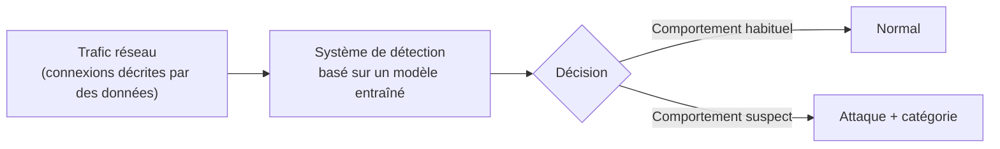

### 1.3 Ce que le projet produit concrètement

Le projet ne s'arrête pas à un simple entraînement de modèle. Il couvre l'ensemble de la chaîne, de la donnée brute jusqu'à une application démontrable :

| Étape | Description simple |
|---|---|
| Préparation des données | Obtenir un jeu de données de trafic réseau, le vérifier, le nettoyer et le structurer |
| Entraînement | Apprendre à plusieurs modèles (Random Forest, MLP, 1D-CNN) à classer le trafic |
| Évaluation | Mesurer scientifiquement la qualité de chaque modèle |
| Interprétation | Comprendre pourquoi le modèle prend ses décisions (explicabilité) |
| Application | Construire une interface (Streamlit) permettant d'importer des données et d'obtenir des résultats |
| Documentation | Rédiger un rapport scientifique de 10 à 15 pages et préparer une soutenance |

### 1.4 Organisation dans le temps

Le projet est organisé en **4 semaines (28 jours)**, chaque semaine ayant un objectif précis.

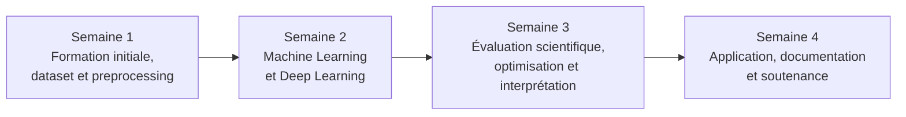

| Semaine | Thème | Objectif |
|---|---|---|
| 1 | Formation initiale, dataset et preprocessing | Obtenir des données prêtes pour l'entraînement |
| 2 | Machine Learning et Deep Learning | Comprendre et entraîner plusieurs modèles |
| 3 | Évaluation scientifique, optimisation et interprétation | Démontrer que le modèle est réellement performant |
| 4 | Application, documentation et soutenance | Transformer le modèle en produit démontrable |

---

## 2. Contexte et problématique

### 2.1 Qu'est-ce qu'un réseau informatique et pourquoi le protéger ?

Un **réseau informatique** relie des ordinateurs, des serveurs et d'autres appareils afin qu'ils échangent des données. Chaque échange (par exemple, ouvrir une page web ou envoyer un fichier) est appelé ici une **connexion** ou un **flux** (en anglais : *flow*).

Comme ces échanges transitent par des canaux accessibles, des personnes malveillantes peuvent essayer de :

- perturber un service pour le rendre indisponible ;
- explorer un réseau pour y découvrir des failles ;
- obtenir un accès non autorisé à des machines ou à des données.

Ces actions sont appelées des **attaques** ou **intrusions**.

### 2.2 Qu'est-ce qu'un système de détection d'intrusions ?

Un **IDS** (*Intrusion Detection System*, système de détection d'intrusions) est un dispositif qui **surveille le trafic** et **signale les comportements suspects**. On peut le comparer à un **agent de sécurité qui observe des caméras** : il ne bloque pas forcément l'intrus, mais il déclenche une alerte.

### 2.3 Pourquoi utiliser l'apprentissage automatique ?

Les approches classiques s'appuient souvent sur des **règles écrites à la main** (par exemple : « si telle condition est remplie, alors c'est une attaque »). Ces règles ont une limite : il faut les écrire, les maintenir et les adapter à chaque nouvelle forme d'attaque.

Le Machine Learning propose une autre démarche : au lieu d'écrire les règles, on **fournit au programme de nombreux exemples** (du trafic normal et des attaques déjà identifiées) et il **découvre lui-même les régularités** qui permettent de les distinguer.


### 2.4 Problématique

La problématique du projet peut se formuler ainsi :

> **Comment entraîner et évaluer des modèles de Machine Learning et de Deep Learning capables de classer du trafic réseau en cinq catégories, de façon fiable, y compris pour les attaques rares, et comment rendre ce résultat exploitable dans une application ?**

Cette problématique contient plusieurs difficultés que le projet traite explicitement :

| Difficulté | Explication simple | Traitée dans le projet par |
|---|---|---|
| Qualité des données | Des données mal préparées rendent tous les résultats suivants inutiles | Audit du dataset, nettoyage, preprocessing (Semaine 1) |
| Déséquilibre des classes | Certaines attaques sont rares : un modèle peut les ignorer tout en paraissant performant | Pondération des classes, éventuellement SMOTE (Jours 6 et 18) |
| Fuite de données | Si le modèle « voit » le test par avance, les résultats sont faussés | Séparation stricte entraînement / validation / test (Jour 5) |
| Évaluation trompeuse | Une exactitude (*Accuracy*) élevée peut cacher de mauvais résultats sur les classes rares | Métriques adaptées : Recall, F1, Macro F1 (Semaine 3) |
| Boîte noire | Un modèle qui décide sans qu'on comprenne pourquoi inspire peu confiance | Explicabilité (feature importance, SHAP) (Jour 19) |
| Utilisabilité | Un modèle seul, dans un notebook, n'est pas un produit | Application Streamlit (Semaine 4) |

---

## 3. Objectifs généraux et spécifiques

### 3.1 Objectif général

Développer, évaluer et présenter un **système de détection d'intrusions réseau** basé sur le Machine Learning et le Deep Learning, en passant de la formation initiale à une **application démontrable**, accompagnée d'un **rapport scientifique** et d'une **soutenance**.

### 3.2 Objectifs spécifiques

Les objectifs spécifiques sont regroupés par semaine.

#### Semaine 1 — Données

- Comprendre les bases du Machine Learning et de Python pour la manipulation de données.
- Acquérir et auditer le dataset (dataset initial envisagé : **NSL-KDD**).
- Nettoyer les données, encoder les variables catégorielles et normaliser les variables numériques.
- Séparer les données en trois ensembles : **70 % entraînement, 15 % validation, 15 % test**.
- Éviter la fuite de données (*Data Leakage*).
- Mesurer et traiter le déséquilibre entre les classes.

#### Semaine 2 — Modèles

- Comprendre ce qu'est un modèle, comment il apprend et ce qu'est une prédiction.
- Entraîner un modèle de référence : **Random Forest**.
- Comprendre le Deep Learning et entraîner un **MLP** (*Multi-Layer Perceptron*).
- Optimiser le MLP (surapprentissage, arrêt anticipé, réglage des hyperparamètres).
- Construire et entraîner un **1D-CNN** (réseau convolutif à une dimension) et le comparer au MLP.

#### Semaine 3 — Évaluation

- Maîtriser les métriques : Accuracy, Precision, Recall, F1-score, Macro F1, Weighted F1, taux de faux positifs.
- Produire une **matrice de confusion** par modèle.
- Comparer les configurations (taux d'apprentissage, taille de lot, paramètres du Random Forest, configurations du MLP) en s'appuyant sur la **validation** et **jamais sur le test**.
- Analyser en particulier les classes minoritaires (**R2L** et **U2R**).
- Expliquer les décisions du modèle (feature importance, SHAP).
- Établir un tableau comparatif final et **figer** le modèle retenu.

#### Semaine 4 — Produit et communication

- Comprendre le déploiement d'un modèle (sauvegarde, chargement, pipeline d'inférence).
- Construire une application **Streamlit** : accueil, import CSV, analyse, résultats.
- Ajouter une page d'analyse des attaques (*Attack Analytics*) et une page d'évaluation du modèle (*Model Evaluation*).
- Tester la fiabilité de l'application.
- Rédiger un rapport de **10 à 15 pages** conforme à la fiche officielle.
- Préparer la soutenance et la démonstration.

### 3.3 Lien entre les objectifs et la démarche scientifique

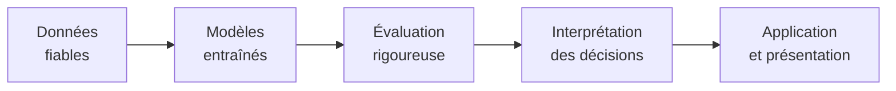

---

## 4. Résultats attendus

### 4.1 Livrables par semaine

| Semaine | Livrables attendus |
|---|---|
| **1** | Dataset identifié et audité ; analyse exploratoire (EDA, *Exploratory Data Analysis*) ; graphiques de distribution ; pipeline de preprocessing ; séparation Training / Validation / Testing ; stratégie de gestion du déséquilibre |
| **2** | Random Forest entraîné ; MLP entraîné ; 1D-CNN entraîné ; courbes d'entraînement ; hyperparamètres documentés ; première comparaison des performances |
| **3** | Tableau comparatif ; matrices de confusion ; rapports de classification ; analyse des classes minoritaires ; expériences d'optimisation ; explications SHAP si réalisables ; modèle final et artefacts sauvegardés |
| **4** | Application Streamlit fonctionnelle ; modèle intégré ; tests de validation ; rapport PDF de 10 à 15 pages ; présentation orale ; archive complète du projet |

> **Explication des termes** : un **livrable** (en anglais : *deliverable*) est un résultat concret, vérifiable, que le projet doit produire. Un **artefact** désigne un fichier produit pendant le projet et nécessaire plus tard (par exemple le modèle sauvegardé, le *scaler* ou les encodeurs).

### 4.2 Tableau expérimental final

Un tableau comparatif sera construit au Jour 20. **Ses valeurs ne seront renseignées qu'après les expérimentations** : aucun résultat n'est présupposé dans ce document.

| Modèle | Accuracy | Macro F1 | Temps d'inférence |
|---|---|---|---|
| Random Forest | *À mesurer* | *À mesurer* | *À mesurer* |
| MLP | *À mesurer* | *À mesurer* | *À mesurer* |
| 1D-CNN | *À mesurer* | *À mesurer* | *À mesurer* |

Le choix du meilleur modèle reposera sur un **compromis** entre :

- la détection des différentes attaques ;
- le nombre de fausses alertes ;
- le temps de prédiction ;
- la complexité du modèle.

### 4.3 Critère d'évaluation connu

Le fichier source indique que la partie **« Modeling & Results » représente 7 points** dans l'évaluation. C'est pourquoi la Semaine 3 (évaluation scientifique) est considérée comme particulièrement importante.

---

## 5. Périmètre et limites

### 5.1 Ce qui est inclus dans le projet

- Classification du trafic réseau en **cinq catégories** (vérifiées lors de l'audit du dataset, Jour 3).
- Trois familles de modèles : **Random Forest**, **MLP**, **1D-CNN**.
- Évaluation sur un jeu de test indépendant avec des métriques adaptées.
- Interprétation des décisions (feature importance ; SHAP si réalisable).
- Application **Streamlit** : import d'un fichier CSV, classification, statistiques, évaluation.
- Rapport de 10 à 15 pages et soutenance.

### 5.2 Choix techniques et précautions méthodologiques retenus

Le fichier source fixe plusieurs règles qui structurent tout le projet :

| Règle | Justification |
|---|---|
| Ne jamais choisir un modèle en regardant les résultats du **test set** | Le test doit rester une évaluation honnête, comme un examen final dont on ne connaît pas les questions |
| Ajuster les transformations **uniquement sur le training set** | Évite la fuite de données (*Data Leakage*) |
| Garder le test set **sans suréchantillonnage** | Le test doit refléter la réalité, pas des données artificielles |
| Ne pas supprimer automatiquement toutes les valeurs extrêmes | Certaines valeurs aberrantes peuvent représenter de **véritables comportements d'attaque** |
| Traiter les variables tabulaires comme une **séquence de colonnes** pour le 1D-CNN, sans prétendre qu'elles ont naturellement une structure spatiale | Honnêteté scientifique sur l'usage d'un CNN pour des données tabulaires |
| Remplir les résultats **uniquement après** les expérimentations | Aucune valeur inventée |
| Utiliser le **même preprocessing** à l'entraînement et à la prédiction | Sinon, les prédictions de l'application seraient incohérentes |

### 5.3 Éléments facultatifs ou conditionnels

| Élément | Condition |
|---|---|
| **LSTM** (réseau récurrent) | Développé seulement si les modèles principaux sont terminés **et** si son utilisation est méthodologiquement justifiée |
| **SMOTE** (suréchantillonnage des classes rares) | Comparaison « éventuelle » avec la pondération des classes |
| **SHAP** | Explications réalisées « si réalisables » |
| Fonctionnement **hors connexion** de l'application | Testé « si possible » |

### 5.4 Limites générales à garder en tête

- Le dataset envisagé (**NSL-KDD**) est un jeu de données **de référence pédagogique et de recherche**. Il est qualifié d'« initial » dans le plan : les résultats obtenus ne doivent pas être présentés comme garantis dans un environnement réseau réel. Cette limite sera discutée dans le rapport et la soutenance (« limites et perspectives »).
- Le projet vise la **classification de données déjà décrites sous forme de tableau** (features), et non la capture ou l'analyse en direct de paquets réseau. Le plan prévoit l'import de fichiers CSV dans l'application.
- La durée du projet (4 semaines) impose de **prioriser** : les modèles principaux passent avant les extensions facultatives.

---

## 6. Introduction pédagogique : IA, ML et DL

### 6.1 Trois notions emboîtées

On confond souvent **Intelligence Artificielle**, **Machine Learning** et **Deep Learning**. Ce sont trois notions qui s'emboîtent comme des poupées russes.

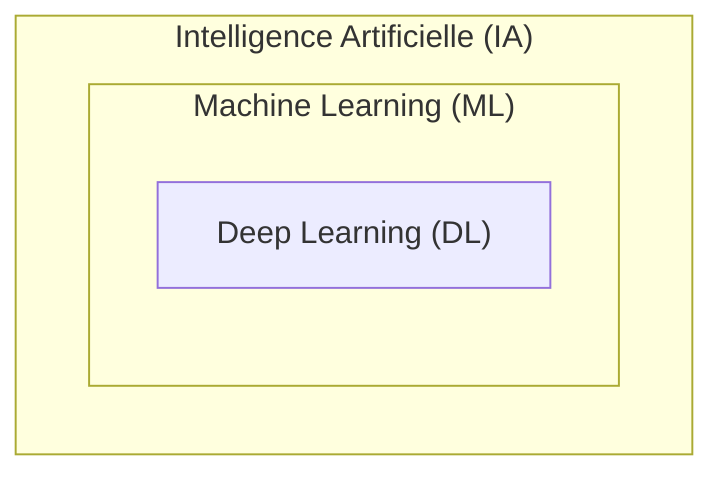

| Notion | Terme anglais | Définition simple | Exemple |
|---|---|---|---|
| **Intelligence Artificielle** | *Artificial Intelligence* (AI) | Ensemble des techniques permettant à une machine de réaliser des tâches qui demandent habituellement de l'intelligence humaine | Un programme qui joue aux échecs |
| **Machine Learning** (apprentissage automatique) | *Machine Learning* (ML) | Sous-domaine de l'IA où la machine **apprend à partir d'exemples** au lieu de suivre des règles écrites à la main | Un programme qui apprend à distinguer des courriels légitimes des courriels indésirables |
| **Deep Learning** (apprentissage profond) | *Deep Learning* (DL) | Sous-domaine du ML qui utilise des **réseaux de neurones artificiels à plusieurs couches** | Un réseau de neurones qui classe du trafic réseau |

### 6.2 Un exemple pour comprendre l'apprentissage

Imaginons que l'on veuille apprendre à un enfant à reconnaître des **fruits**. On ne lui donne pas une liste de règles ; on lui **montre des exemples** : « ceci est une pomme », « ceci est une banane ». Après suffisamment d'exemples, il reconnaît un fruit qu'il n'a jamais vu.

Le Machine Learning fonctionne de la même façon :

1. on présente beaucoup d'exemples ;
2. le programme repère des régularités ;
3. il peut ensuite traiter de **nouveaux** exemples.

### 6.3 Apprentissage supervisé et non supervisé

Il existe deux grandes familles d'apprentissage.

| Critère | Apprentissage supervisé (*Supervised Learning*) | Apprentissage non supervisé (*Unsupervised Learning*) |
|---|---|---|
| Données | Les exemples sont **étiquetés** (la bonne réponse est connue) | Les exemples ne sont **pas étiquetés** |
| But | Prédire la bonne réponse pour de nouveaux exemples | Découvrir des structures ou des groupes dans les données |
| Exemple | « Ce flux réseau est une attaque de type DoS » | Regrouper automatiquement des flux qui se ressemblent |

Dans ce projet, nous utilisons l'**apprentissage supervisé**, car les données du dataset sont accompagnées de leur catégorie (normal ou type d'attaque).

### 6.4 Classification et régression

Dans l'apprentissage supervisé, on distingue deux grands types de problèmes.

| Type | Terme anglais | Ce que l'on prédit | Exemple |
|---|---|---|---|
| **Classification** | *Classification* | Une **catégorie** parmi un ensemble fini | Normal, DoS, Probe, R2L, U2R |
| **Régression** | *Regression* | Une **valeur numérique** | Le prix d'une maison, une température |

Le projet est un problème de **classification multiclasse** (plus de deux catégories possibles).

### 6.5 Du ML classique au Deep Learning

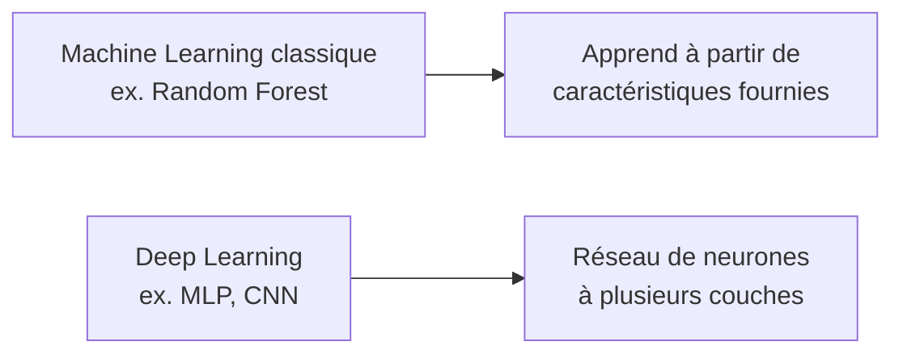

Dans ce projet, nous comparons **les deux approches** : un modèle de Machine Learning classique (Random Forest) et deux modèles de Deep Learning (MLP et 1D-CNN).

---

## 7. Le Machine Learning supervisé en détail

### 7.1 Vocabulaire fondamental

Pour rendre ces notions concrètes, nous utilisons un exemple fil rouge : **décider si un flux réseau est normal ou malveillant**.

| Terme | Terme anglais | Définition | Exemple dans le projet |
|---|---|---|---|
| **Jeu de données** | *Dataset* | Collection d'exemples utilisée pour l'apprentissage et l'évaluation | Le fichier NSL-KDD |
| **Observation** (ou exemple) | *Sample* / *Instance* | Une ligne du tableau de données | Une connexion réseau |
| **Caractéristique** (ou variable) | *Feature* | Une information qui décrit une observation (une colonne) | La durée de la connexion, le type de protocole |
| **Étiquette** (ou cible) | *Label* | La réponse à prédire pour une observation | « Normal » ou le nom d'une catégorie d'attaque |
| **Modèle** | *Model* | Le programme qui, une fois entraîné, associe des features à un label | Un Random Forest entraîné |
| **Entraînement** | *Training* | Phase où le modèle apprend à partir des exemples étiquetés | Ajuster le modèle sur le training set |
| **Prédiction** | *Prediction* / *Inference* | Réponse fournie par le modèle pour une nouvelle observation | « Ce flux est une attaque Probe » |

### 7.2 Un dataset vu comme un tableau

Un dataset tabulaire ressemble à un tableur : **chaque ligne** est une observation, **chaque colonne** est une feature, et **une colonne spéciale** contient le label.

Exemple **purement illustratif** (ces valeurs sont inventées pour la pédagogie et ne proviennent pas du dataset réel) :

| Durée (feature 1) | Protocole (feature 2) | Octets envoyés (feature 3) | **Label** |
|---|---|---|---|
| 2 | tcp | 230 | normal |
| 0 | icmp | 1 480 | attaque |
| 5 | tcp | 180 | normal |

> **Remarque** : les features peuvent être **numériques** (une quantité, comme la durée) ou **catégorielles** (une catégorie, comme le protocole). Cette distinction est importante : les modèles ne comprennent que les nombres, les features catégorielles doivent donc être **encodées** (voir 7.5).

### 7.3 Le cycle de vie d'un modèle supervisé

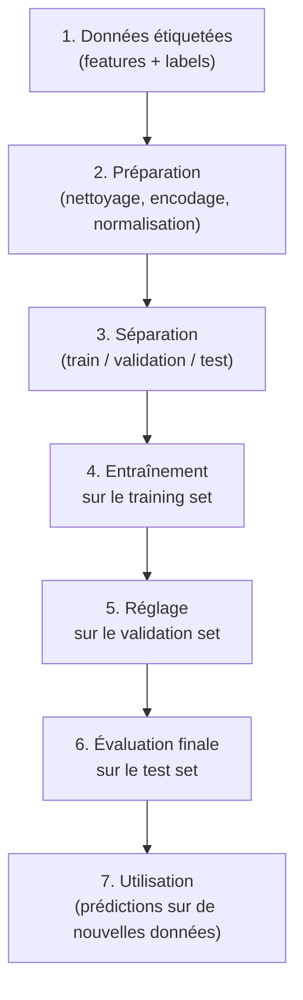

### 7.4 Les trois ensembles de données

Pour être honnête dans l'évaluation, on ne teste jamais un modèle sur les données avec lesquelles il a appris. On divise donc les données en trois parties. Le projet retient la répartition suivante :

| Ensemble | Terme anglais | Part | Rôle | Analogie scolaire |
|---|---|---|---|---|
| Entraînement | *Training set* | 70 % | Le modèle apprend dessus | Les exercices d'apprentissage en classe |
| Validation | *Validation set* | 15 % | Comparer et régler les modèles | Les devoirs d'entraînement pour vérifier la progression |
| Test | *Test set* | 15 % | Évaluation finale, indépendante | L'examen final, que l'on ne voit qu'une fois |

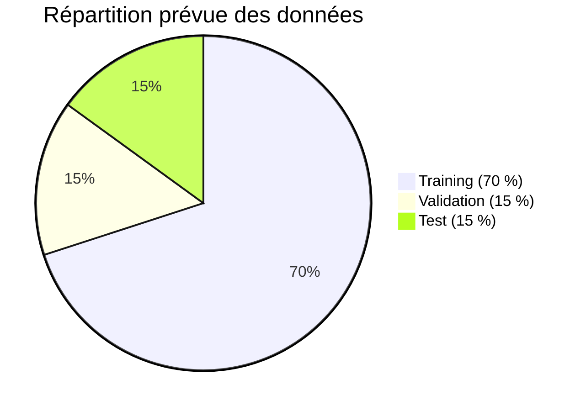

Deux précisions importantes issues du plan :

- La séparation doit être **stratifiée** (*Stratified Splitting*) : chaque ensemble contient les différentes classes **dans des proportions comparables** à l'ensemble d'origine. Sans cela, une classe rare pourrait être absente du test.
- La **fuite de données** (*Data Leakage*) doit être évitée : toute transformation (par exemple la normalisation) doit être **apprise uniquement sur le training set**, puis appliquée telle quelle aux autres ensembles. Autrement, des informations du test « fuitent » vers l'entraînement et les résultats paraissent meilleurs qu'ils ne le sont réellement.

### 7.5 Préparer les données (preprocessing)

Le **preprocessing** (prétraitement) regroupe les opérations qui rendent les données utilisables par un modèle.

| Opération | Terme anglais | Explication simple | Outil prévu |
|---|---|---|---|
| Gestion des valeurs manquantes | *Missing values* | Décider quoi faire des cases vides | Pandas |
| Suppression des doublons | *Duplicates* | Retirer les lignes identiques répétées | Pandas |
| Examen des valeurs aberrantes | *Outliers* | Repérer des valeurs très éloignées des autres, **sans les supprimer automatiquement** (elles peuvent être de vraies attaques) | Pandas, Matplotlib |
| Encodage des catégories | *One-Hot Encoding* | Transformer une catégorie en colonnes 0/1 (ex. « tcp » → une colonne `protocole_tcp` valant 1 ou 0) | Scikit-learn |
| Normalisation / standardisation | *Standardization* (`StandardScaler`) | Mettre les features numériques sur une échelle comparable (moyenne 0, écart-type 1) | Scikit-learn |

**Pourquoi standardiser ?** Imaginons deux features : une durée de 2 secondes et un nombre d'octets de 100 000. Sans mise à l'échelle, certains modèles (en particulier les réseaux de neurones) accordent trop d'importance à la feature aux grands nombres, simplement à cause de son ordre de grandeur.

### 7.6 Le déséquilibre des classes

Dans un trafic réseau, les attaques de certains types sont **rares** par rapport au trafic normal ou aux attaques fréquentes. C'est le **déséquilibre des classes** (*Class Imbalance*).

**Exemple pédagogique** : supposons qu'un jeu de 1 000 observations contienne 990 flux normaux et 10 attaques. Un « modèle » qui répond toujours « normal » obtient **99 % d'exactitude**, mais ne détecte **aucune** attaque. L'Accuracy est donc **trompeuse**.

Le projet prévoit deux stratégies :

| Stratégie | Terme anglais | Principe |
|---|---|---|
| Pondération des classes | *Class Weights* | Pénaliser davantage les erreurs commises sur les classes rares pendant l'entraînement |
| Suréchantillonnage synthétique | *SMOTE* (*Synthetic Minority Over-sampling Technique*) | Créer de nouveaux exemples artificiels des classes rares, **uniquement pour l'entraînement** |

Le **test set** reste, lui, **sans suréchantillonnage**.

### 7.7 Mesurer la performance

Après l'entraînement, il faut quantifier la qualité du modèle. Pour la comprendre, on distingue quatre situations pour une classe donnée (par exemple « attaque ») :

| Situation | Terme anglais | Signification |
|---|---|---|
| Vrai positif | *True Positive* (TP) | Une attaque est correctement détectée |
| Vrai négatif | *True Negative* (TN) | Un flux normal est correctement reconnu comme normal |
| Faux positif | *False Positive* (FP) | Un flux normal est signalé à tort comme attaque (**fausse alerte**) |
| Faux négatif | *False Negative* (FN) | Une attaque n'est **pas** détectée |

À partir de ces quatre quantités, on calcule les métriques utilisées dans le projet :

| Métrique | Terme anglais | Question à laquelle elle répond | Formule |
|---|---|---|---|
| Exactitude | *Accuracy* | Quelle proportion de toutes les prédictions est correcte ? | (TP + TN) / total |
| Précision | *Precision* | Parmi les alertes émises, combien sont de vraies attaques ? | TP / (TP + FP) |
| Rappel | *Recall* | Parmi les vraies attaques, combien ont été détectées ? | TP / (TP + FN) |
| Score F1 | *F1-score* | Compromis entre Precision et Recall | 2 × (Precision × Recall) / (Precision + Recall) |
| F1 macro | *Macro F1* | Moyenne des F1 de **chaque classe**, toutes classes à égalité | Moyenne simple |
| F1 pondéré | *Weighted F1* | Moyenne des F1 pondérée par la taille de chaque classe | Moyenne pondérée |
| Taux de faux positifs | *False Positive Rate* (FPR) | Parmi les flux normaux, combien déclenchent une fausse alerte ? | FP / (FP + TN) |

> **Pourquoi le Macro F1 est-il important ici ?** Parce qu'il donne autant de poids aux classes rares (comme U2R) qu'aux classes fréquentes. Un modèle peut avoir une Accuracy élevée et pourtant un mauvais Recall sur U2R : le Macro F1 révèle ce problème.

La **matrice de confusion** (*Confusion Matrix*) est un tableau qui croise les classes réelles et les classes prédites. Elle permet de voir **quelles attaques sont confondues avec quoi**.

Exemple **illustratif** (valeurs inventées pour la pédagogie) avec deux classes :

| | Prédit : normal | Prédit : attaque |
|---|---|---|
| **Réel : normal** | 90 (TN) | 10 (FP) |
| **Réel : attaque** | 5 (FN) | 95 (TP) |

### 7.8 Les notions clés de l'entraînement

| Notion | Terme anglais | Explication simple |
|---|---|---|
| Paramètres | *Parameters* | Valeurs internes que le modèle **ajuste lui-même** pendant l'entraînement |
| Hyperparamètres | *Hyperparameters* | Réglages **choisis par nous avant** l'entraînement (ex. nombre d'arbres, taux d'apprentissage) |
| Époque | *Epoch* | Un passage complet sur toutes les données d'entraînement |
| Taille de lot | *Batch Size* | Nombre d'observations traitées avant chaque mise à jour du modèle |
| Taux d'apprentissage | *Learning Rate* | Taille des « pas » effectués lors de l'apprentissage |
| Surapprentissage | *Overfitting* | Le modèle **mémorise** le training set et généralise mal à de nouvelles données |
| Sous-apprentissage | *Underfitting* | Le modèle n'a **pas assez appris**, même sur le training set |
| Arrêt anticipé | *Early Stopping* | Arrêter l'entraînement quand la performance sur la validation cesse de s'améliorer |
| Point de sauvegarde | *Model Checkpoint* | Sauvegarder automatiquement la meilleure version du modèle pendant l'entraînement |

**Analogie du surapprentissage** : un étudiant qui apprend par cœur les corrigés d'un examen blanc obtient 20/20 dessus, mais échoue à l'examen réel dont les questions diffèrent. Le modèle en surapprentissage a de très bons résultats sur le training set, mais de mauvais sur de nouvelles données.


### 7.9 Prédiction (inférence)

Une fois le modèle **entraîné**, il peut être utilisé pour la **prédiction** (aussi appelée **inférence**) : on lui présente une **nouvelle observation** dont il ne connaît pas le label, et il propose une catégorie.


Point crucial du plan : **le preprocessing doit être strictement identique** pendant l'entraînement et pendant la prédiction. C'est pourquoi les encodeurs et le *scaler* sont sauvegardés avec le modèle.

### 7.10 Les cinq catégories de trafic

Le dataset initial envisagé, **NSL-KDD**, est un jeu de données de référence pour la détection d'intrusions. Le plan du projet prévoit de **vérifier les cinq catégories demandées** (Jour 3) et mentionne explicitement les classes **R2L** et **U2R**. Les cinq catégories habituellement associées à ce type de dataset sont décrites ci-dessous ; **leur présence exacte sera confirmée lors de l'audit du dataset**.

| Catégorie | Signification | Description simple |
|---|---|---|
| **Normal** | Trafic légitime | Utilisation habituelle du réseau |
| **DoS** | *Denial of Service* (déni de service) | Saturer un service pour le rendre indisponible |
| **Probe** | Sondage / reconnaissance | Explorer un réseau pour découvrir des machines ou des failles |
| **R2L** | *Remote to Local* | Un attaquant distant tente d'obtenir un accès local à une machine |
| **U2R** | *User to Root* | Un utilisateur ordinaire tente d'obtenir des privilèges d'administrateur |

> D'après le plan du projet, **R2L** et **U2R** sont des classes **minoritaires** qui font l'objet d'une attention spécifique (Jours 15, 18) : ce sont celles pour lesquelles l'Accuracy peut être le plus trompeuse.

---

## 8. Les modèles et techniques utilisés

Le projet compare **trois modèles** (Random Forest, MLP, 1D-CNN) et utilise **SHAP** pour interpréter les décisions.

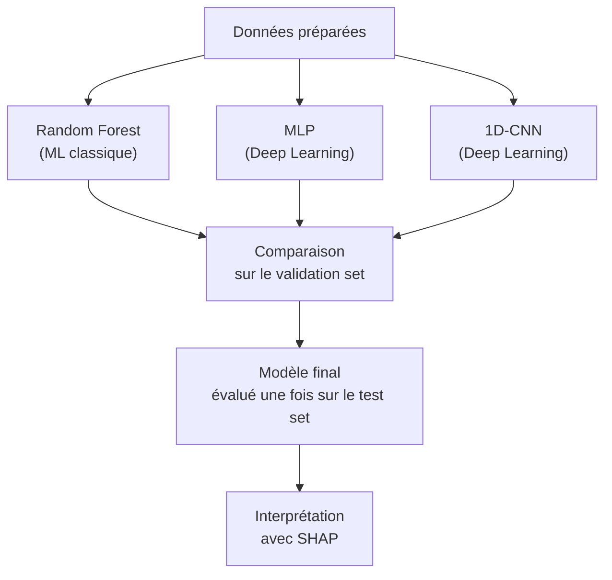

### 8.1 Random Forest (forêt aléatoire)

#### 8.1.1 D'abord, l'arbre de décision

Un **arbre de décision** (*Decision Tree*) est une suite de questions oui/non qui conduit à une décision, comme un organigramme.

**Exemple illustratif** (règles inventées pour la pédagogie) :

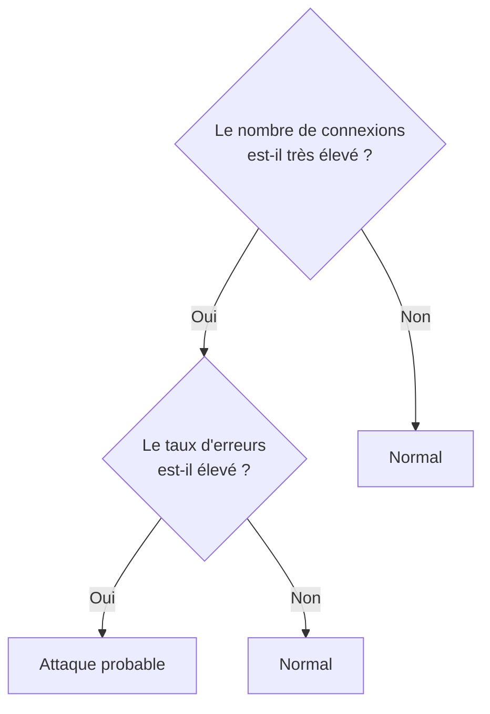

Vocabulaire associé :

| Terme | Terme anglais | Signification |
|---|---|---|
| Nœud | *Node* | Une question posée sur une feature |
| Branche | *Branch* | Une réponse possible à la question |
| Feuille | *Leaf* | La décision finale (la classe prédite) |

#### 8.1.2 Du seul arbre à la forêt

Un arbre isolé peut se tromper ou mémoriser les données. Le **Random Forest** entraîne **de nombreux arbres**, chacun sur une version légèrement différente des données, puis les fait **voter** : la classe la plus choisie l'emporte.

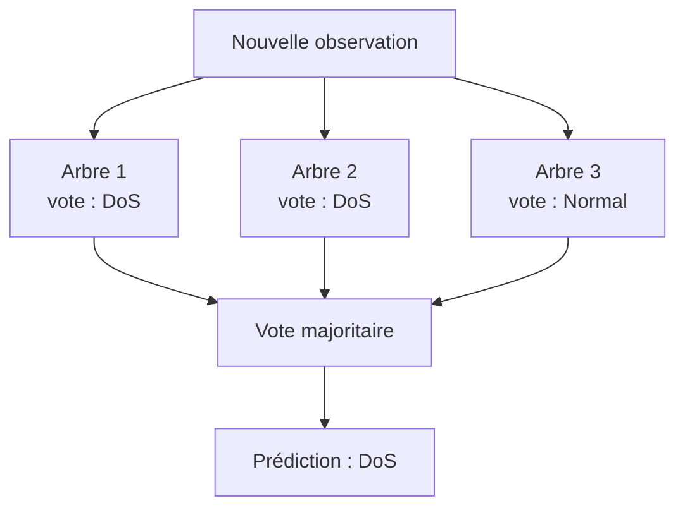

**Analogie** : demander l'avis de plusieurs experts plutôt que d'un seul. Les erreurs individuelles se compensent souvent.

#### 8.1.3 Rôle dans le projet

| Aspect | Détail |
|---|---|
| Rôle | **Modèle de référence** (*baseline*) : première performance servant de point de comparaison |
| Bibliothèque | Scikit-learn |
| Paramètres à explorer | Les paramètres du Random Forest seront testés lors de l'optimisation comparative (Jour 17) ; ils sont à documenter |

> Un **modèle de référence** est un modèle simple et reconnu, entraîné en premier, qui permet de savoir si des modèles plus complexes apportent réellement une amélioration.

### 8.2 MLP (*Multi-Layer Perceptron*, perceptron multicouche)

#### 8.2.1 Le neurone artificiel

Un **neurone artificiel** est une petite unité de calcul inspirée, de façon très simplifiée, du neurone biologique. Il :

1. reçoit plusieurs nombres en entrée ;
2. multiplie chacun par un **poids** (*weight*), qui indique son importance ;
3. additionne le tout et ajoute un **biais** (*bias*), un réglage de décalage ;
4. applique une **fonction d'activation** (*activation function*) qui transforme le résultat.

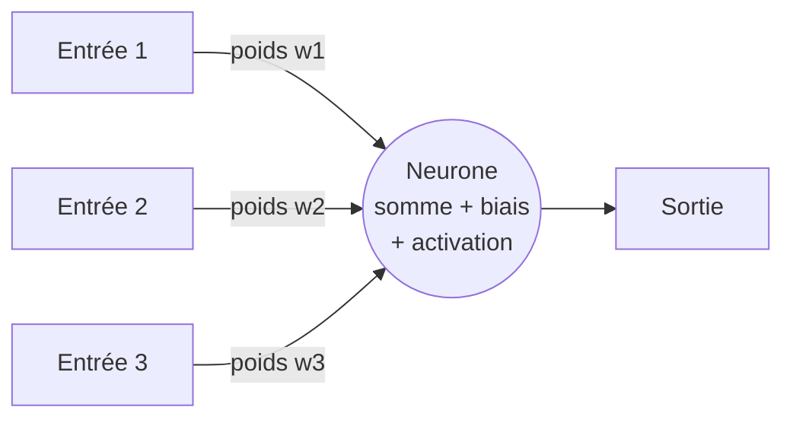

Fonctions d'activation citées dans le plan :

| Fonction | Rôle simple |
|---|---|
| **ReLU** (*Rectified Linear Unit*) | Laisse passer les valeurs positives et met les valeurs négatives à zéro. Utilisée dans les couches cachées |
| **Softmax** | Transforme les sorties en **probabilités** de somme égale à 1 (une probabilité par classe). Utilisée dans la couche de sortie |

#### 8.2.2 Un réseau de neurones

En organisant les neurones en **couches** (*layers*), on obtient un réseau :

- **couche d'entrée** (*Input Layer*) : reçoit les features ;
- **couches cachées** (*Hidden Layers*) : transforment progressivement l'information ;
- **couche de sortie** (*Output Layer*) : fournit la prédiction.

Une couche où chaque neurone est relié à tous les neurones de la couche précédente est dite **dense** (*fully connected*).

#### 8.2.3 Comment le réseau apprend

| Étape / notion | Terme anglais | Explication simple |
|---|---|---|
| Propagation avant | *Forward Propagation* | Les données traversent le réseau, de l'entrée à la sortie, pour produire une prédiction |
| Fonction de perte | *Loss Function* | Mesure **l'écart** entre la prédiction et la bonne réponse. Plus elle est faible, mieux c'est |
| Optimiseur | *Optimizer* | Algorithme qui **ajuste les poids** pour réduire la perte |
| Dropout | *Dropout* | Technique qui « éteint » au hasard une fraction des neurones pendant l'entraînement pour limiter le surapprentissage |

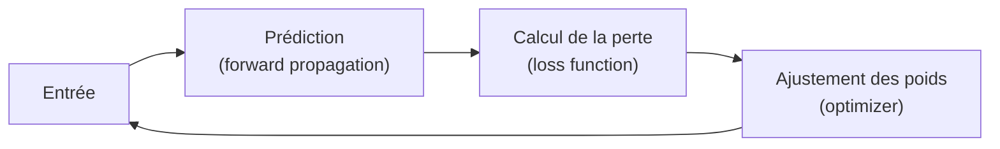

Ce cycle se répète sur de nombreuses époques jusqu'à ce que le réseau progresse suffisamment.

#### 8.2.4 Architecture initiale retenue dans le projet

Le plan fixe l'architecture initiale suivante :

| Ordre | Couche | Détail |
|---|---|---|
| 1 | Input Layer | Reçoit les features préparées |
| 2 | Dense | 128 neurones, activation ReLU |
| 3 | Dropout | Taux 0.3 (30 % des neurones désactivés à chaque étape d'entraînement) |
| 4 | Dense | 64 neurones, activation ReLU |
| 5 | Dropout | Taux 0.2 |
| 6 | Output Layer | Activation Softmax (une probabilité par classe) |

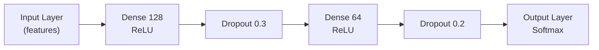

> Cette architecture est un **point de départ** : le plan prévoit ensuite une optimisation (Jours 12 et 17) portant notamment sur les configurations, les *learning rates* et les *batch sizes*, avec *Early Stopping* et *Model Checkpoint*.

### 8.3 CNN et 1D-CNN (réseaux de neurones convolutifs)

#### 8.3.1 Le principe de la convolution

Un **CNN** (*Convolutional Neural Network*, réseau de neurones convolutif) est un type de réseau initialement connu pour l'analyse d'images. Son idée centrale est la **convolution** : un petit « détecteur » glisse sur les données et repère des **motifs locaux**.

| Terme | Terme anglais | Explication simple |
|---|---|---|
| Convolution | *Convolution* | Opération où un petit filtre parcourt les données pour détecter un motif |
| Noyau | *Kernel* | La petite fenêtre qui glisse sur les données ; sa taille définit combien de valeurs voisines elle regarde à la fois |
| Filtres | *Filters* | Ensemble de détecteurs de motifs différents appris par le réseau |
| Pooling | *Pooling* | Réduction de la taille des données en ne gardant que l'information principale (ex. la valeur maximale d'une zone) |

**Analogie** : regarder un texte avec une loupe que l'on déplace mot après mot pour repérer des expressions particulières.

#### 8.3.2 Le 1D-CNN

Un **1D-CNN** applique la convolution **dans une seule dimension**, c'est-à-dire le long d'une **séquence de valeurs**. Dans ce projet, les features tabulaires seront présentées au réseau comme une **séquence de colonnes**.

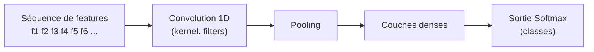

> **Précaution méthodologique importante (issue du plan)** : les caractéristiques d'un tableau de données n'ont **pas naturellement de structure spatiale** (l'ordre des colonnes n'a pas de signification physique, contrairement aux pixels d'une image). Le projet traite donc les features comme une séquence de colonnes **sans prétendre** qu'il existe une telle structure. Cette réserve sera à mentionner dans le rapport.

#### 8.3.4 Comparaison MLP et 1D-CNN

| Critère | MLP | 1D-CNN |
|---|---|---|
| Type de connexion | Chaque neurone relié à tous ceux de la couche précédente | Filtres qui parcourent des **groupes voisins** de features |
| Idée principale | Combiner toutes les features simultanément | Détecter des **motifs locaux** dans la séquence de features |
| Rôle dans le projet | Modèle Deep Learning principal | Modèle Deep Learning comparé au MLP |

#### 8.3.5 À propos du LSTM

Le **LSTM** (*Long Short-Term Memory*, réseau à mémoire à long et court terme) est un réseau conçu pour des **séquences temporelles**. Le plan le classe comme **facultatif** : il ne sera développé que si les modèles principaux sont terminés et si son usage est **méthodologiquement justifié**.

### 8.4 SHAP (explicabilité)

#### 8.4.1 Pourquoi expliquer un modèle ?

Un modèle de Deep Learning est souvent perçu comme une **boîte noire** : il donne une réponse sans indiquer ses raisons. En cybersécurité, comprendre pourquoi un flux est classé comme attaque est essentiel pour **faire confiance** à l'alerte, **détecter des biais** et **vérifier que le modèle s'appuie sur des informations pertinentes**. Ce domaine s'appelle l'**IA explicable** (*Explainable AI*, XAI).

#### 8.4.2 Feature Importance

L'**importance des features** (*Feature Importance*) indique **quelles features influencent le plus** les décisions du modèle, de manière globale. Exemple : « la feature X est celle qui pèse le plus dans la détection des attaques DoS ».

#### 8.4.3 SHAP

**SHAP** (*SHapley Additive exPlanations*) est une méthode d'explication qui attribue à **chaque feature** une **contribution** à la prédiction, pour un exemple particulier ou globalement. Son principe s'inspire d'une idée de la théorie des jeux : répartir équitablement le « mérite » d'un résultat entre les « joueurs » (ici, les features).

| Niveau d'explication | Question | Utilisation prévue |
|---|---|---|
| Global | Quelles features comptent le plus **en général** ? | Visualiser les features importantes |
| Local | Pourquoi **cette** prédiction précise ? | Étudier quelques prédictions individuelles |

> Le plan précise que les explications SHAP seront produites **si elles sont réalisables** : c'est un objectif de la Semaine 3 (Jour 19), non une garantie.

### 8.5 Tableau de synthèse des modèles et techniques

| Élément | Famille | Idée clé | Rôle dans le projet |
|---|---|---|---|
| **Random Forest** | Machine Learning classique | Vote de nombreux arbres de décision | Modèle de référence |
| **MLP** | Deep Learning | Couches denses de neurones (128 → 64 → sortie Softmax) | Modèle principal de Deep Learning |
| **1D-CNN** | Deep Learning | Convolution sur une séquence de features | Comparaison avec le MLP |
| **SHAP** | Explicabilité | Contribution de chaque feature à une prédiction | Interpréter les décisions |
| **LSTM** | Deep Learning (séquences) | Mémoire sur des séquences | Facultatif, sous conditions |

---

## 9. Les outils du projet

### 9.1 Vue d'ensemble

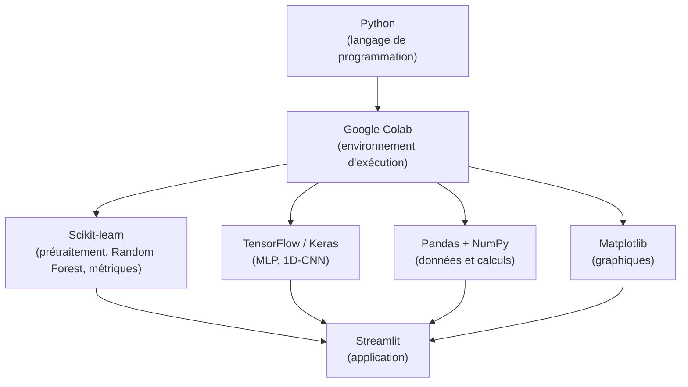

### 9.2 Description de chaque outil

| Outil | Nature | Définition simple | Usage dans le projet |
|---|---|---|---|
| **Python** | Langage de programmation | Langage lisible et très utilisé en science des données et en IA | Langage unique du projet |
| **Google Colab** | Environnement en ligne | Service qui permet d'écrire et d'exécuter du code Python dans un navigateur, sous forme de **notebooks** (documents mêlant code, résultats et texte), sans installation complexe | Développement des notebooks : exploration, entraînement, évaluation |
| **Pandas** | Bibliothèque Python | Outil de manipulation de **tableaux de données** (*DataFrames*) : lecture de CSV, filtrage, statistiques | Chargement, audit, nettoyage des données |
| **NumPy** | Bibliothèque Python | Outil de **calcul numérique** sur des tableaux de nombres | Calculs sur les données numériques |
| **Scikit-learn** | Bibliothèque Python | Bibliothèque de Machine Learning classique : modèles, prétraitement, séparation des données, métriques | `StandardScaler`, One-Hot Encoding, séparation des ensembles, Random Forest, métriques |
| **TensorFlow / Keras** | Bibliothèques Python | **TensorFlow** est une plateforme de calcul pour le Deep Learning ; **Keras** est son interface de haut niveau permettant de construire des réseaux de neurones facilement | Construction et entraînement du MLP et du 1D-CNN |
| **Matplotlib** | Bibliothèque Python | Outil de création de **graphiques** (histogrammes, courbes, etc.) | Graphiques de distribution, courbes d'apprentissage, visualisations |
| **Streamlit** | Bibliothèque Python | Outil permettant de créer une **application web interactive** en Python, sans développement web complexe | Interface : import CSV, analyse, résultats, statistiques |

### 9.3 Quelques notions autour des outils

| Notion | Terme anglais | Explication simple |
|---|---|---|
| Notebook | *Notebook* | Document interactif composé de **cellules** de code et de texte, exécutables une à une |
| Cellule de code | *Code cell* | Bloc de code que l'on exécute pour voir immédiatement son résultat |
| DataFrame | *DataFrame* | Structure Pandas représentant un tableau (lignes, colonnes, types de données) |
| Fichier CSV | *Comma-Separated Values* | Fichier texte représentant un tableau, dont les valeurs sont séparées par des virgules |
| Bibliothèque | *Library* | Ensemble de fonctions déjà écrites, que l'on importe pour ne pas tout reprogrammer |

### 9.4 Exemple minimal illustratif

L'exemple ci-dessous est **purement pédagogique** : il montre l'allure d'un code Python utilisant ces outils. Il n'est pas le code final du projet ; les noms de fichiers et de colonnes sont fictifs.

```python
# Importer les bibliothèques
import pandas as pd

# Charger un fichier CSV dans un DataFrame (nom de fichier fictif)
df = pd.read_csv("mon_fichier.csv")

# Afficher les premières lignes, les dimensions et les valeurs manquantes
print(df.head())
print(df.shape)
print(df.isnull().sum())
```

Ces trois opérations correspondent exactement à ce que le plan prévoit au Jour 2 : charger un CSV, afficher les premières lignes, examiner dimensions, colonnes et valeurs manquantes.

### 9.5 Où chaque outil intervient dans le temps

| Semaine | Outils principalement utilisés |
|---|---|
| 1 | Google Colab, Python, Pandas, NumPy, Scikit-learn, Matplotlib |
| 2 | Scikit-learn (Random Forest), TensorFlow/Keras (MLP, 1D-CNN), Matplotlib (courbes) |
| 3 | Scikit-learn (métriques), Matplotlib (matrices de confusion), SHAP (explicabilité) |
| 4 | Streamlit, modèle sauvegardé, Pandas, Matplotlib |

---

## Annexe : glossaire

| Terme | Définition courte |
|---|---|
| **Accuracy** (exactitude) | Proportion de prédictions correctes sur l'ensemble des prédictions |
| **Batch Size** | Nombre d'observations traitées avant une mise à jour du modèle |
| **Class Imbalance** | Déséquilibre entre le nombre d'exemples de chaque classe |
| **Class Weights** | Pondération donnant plus d'importance aux classes rares pendant l'entraînement |
| **Classification** | Prédiction d'une catégorie |
| **Confusion Matrix** | Tableau croisant classes réelles et classes prédites |
| **Data Leakage** | Fuite d'information du test vers l'entraînement, faussant les résultats |
| **Dataset** | Jeu de données |
| **Decision Tree** | Arbre de décision : suite de questions menant à une classe |
| **Deep Learning** | Apprentissage avec réseaux de neurones à plusieurs couches |
| **Dropout** | Désactivation aléatoire de neurones pour limiter le surapprentissage |
| **Early Stopping** | Arrêt anticipé de l'entraînement |
| **Epoch** | Passage complet sur les données d'entraînement |
| **Feature** | Caractéristique décrivant une observation |
| **F1-score** | Moyenne harmonique de Precision et Recall |
| **Hyperparameter** | Réglage choisi avant l'entraînement |
| **Inference** | Utilisation d'un modèle entraîné pour prédire |
| **Label** | Réponse à prédire |
| **Learning Rate** | Taille des pas d'apprentissage |
| **Loss Function** | Mesure de l'erreur du modèle |
| **Machine Learning** | Apprentissage automatique à partir d'exemples |
| **Macro F1** | Moyenne des F1 par classe, classes à égalité |
| **MLP** | Perceptron multicouche |
| **NIDS** | Système de détection d'intrusions réseau |
| **Overfitting** | Surapprentissage : le modèle mémorise au lieu de généraliser |
| **Precision** | Part de vraies attaques parmi les alertes émises |
| **Random Forest** | Forêt d'arbres de décision votant ensemble |
| **Recall** | Part des vraies attaques effectivement détectées |
| **SHAP** | Méthode d'explication de la contribution de chaque feature |
| **SMOTE** | Création d'exemples synthétiques pour les classes rares |
| **Stratified Splitting** | Séparation conservant les proportions de classes |
| **Test set** | Ensemble d'évaluation finale, indépendant |
| **Training set** | Ensemble sur lequel le modèle apprend |
| **Underfitting** | Sous-apprentissage |
| **Validation set** | Ensemble utilisé pour comparer et régler les modèles |

---

*Fin du document 01 — Présentation et fondements.*
