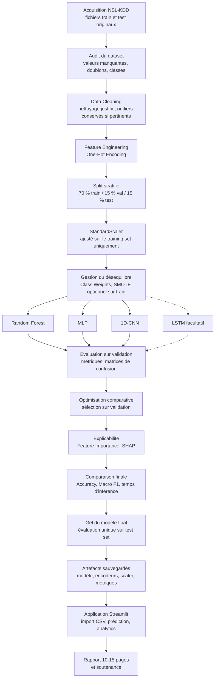
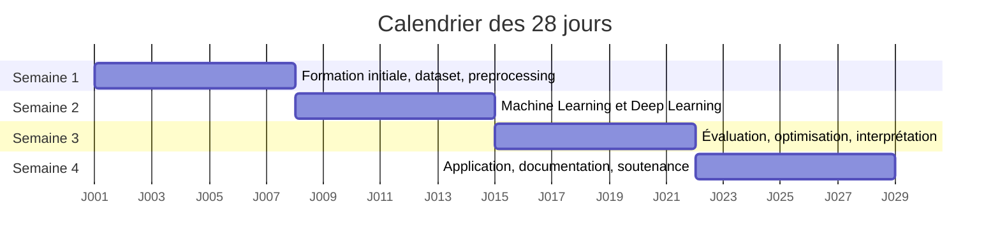
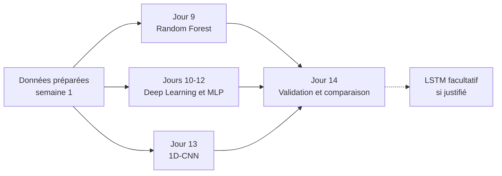
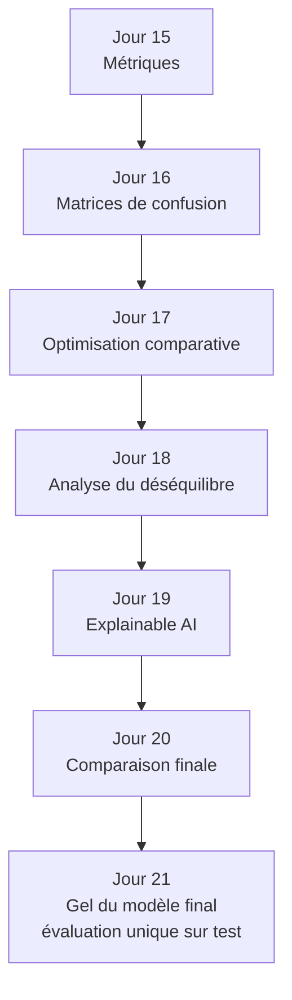

# 02 — Plan de développement sur 4 semaines (28 jours)

> **Projet** : système de détection d'intrusions réseau par Machine Learning et Deep Learning (jeu de données initial envisagé : NSL-KDD).
> **Durée** : 4 semaines, soit 28 jours, dans l'ordre exact de la roadmap source.
> **Statut du document** : guide quotidien de réalisation. Toutes les performances mentionnées sont des **objectifs ou des résultats attendus à vérifier**, jamais des résultats déjà obtenus.

---

## 1. Présentation de la méthodologie globale

### 1.1 Principe directeur

Le projet suit une progression en quatre phases, chacune produisant des livrables vérifiables avant de passer à la suivante :

| Semaine | Phase | Question centrale | Sortie principale |
|---|---|---|---|
| 1 | Formation initiale, dataset et preprocessing | « Mes données sont-elles fiables et prêtes ? » | Trois ensembles Training / Validation / Testing |
| 2 | Machine Learning et Deep Learning | « Comment entraîner plusieurs modèles ? » | Random Forest, MLP, 1D-CNN entraînés |
| 3 | Évaluation scientifique, optimisation, interprétation | « Le modèle est-il réellement performant, et pourquoi ? » | Modèle final gelé et tableau comparatif |
| 4 | Application, documentation, soutenance | « Comment démontrer et défendre le travail ? » | Application Streamlit, rapport, présentation |

### 1.2 Règles méthodologiques non négociables

Ces règles, issues de la roadmap source, s'appliquent chaque jour :

1. **Les données d'abord** : une mauvaise préparation rend tous les résultats suivants inutiles (semaine 1).
2. **Aucune fuite d'information** : les transformations sont ajustées uniquement sur le *training set* ; le *test set* reste indépendant.
3. **Aucune sélection sur le test set** : les modèles et hyperparamètres sont choisis avec la validation uniquement.
4. **Ne pas supprimer automatiquement les valeurs extrêmes** : certaines représentent de véritables comportements d'attaque.
5. **Ne pas se fier à l'Accuracy seule** : les attaques rares (R2L, U2R) exigent Precision, Recall, F1 et Macro F1.
6. **Honnêteté expérimentale** : les cases du tableau comparatif restent « à mesurer » tant que les expériences ne sont pas faites.
7. **Documenter chaque décision** : un choix non justifié par écrit est un choix non défendable en soutenance.

### 1.3 Gabarit quotidien (rythme conseillé)

| Moment | Activité |
|---|---|
| Début de journée | Lire l'objectif pédagogique et les notions du jour |
| Cœur de journée | Travail pratique dans le notebook |
| Fin de journée | Vérifier les critères de validation, sauvegarder, noter les décisions |

### 1.4 Conventions du document

- **Outils** : ceux nommés dans la source sont : Google Colab, Python, Pandas, NumPy, Scikit-learn, Keras, StandardScaler, SMOTE, SHAP, Streamlit. Les outils marqués **(†)** sont des **compléments proposés** par ce plan (par exemple Matplotlib, Seaborn, imbalanced-learn, joblib) : ils ne modifient aucun choix technique, ils matérialisent des étapes déjà prévues.
- **Remarques de cohérence** : signalées par le symbole ⚠️. Elles précisent un point sans changer la roadmap.
- **Durées** : aucune durée horaire n'étant imposée par la source, elles ne sont pas fixées ici.

### 1.5 Choix techniques conservés (récapitulatif)

| Élément | Choix de la source |
|---|---|
| Dataset | NSL-KDD (initial envisagé), cinq catégories |
| Découpage | 70 % training, 15 % validation, 15 % testing, stratifié |
| Prétraitement | One-Hot Encoding, StandardScaler |
| Déséquilibre | Class Weights, comparaison éventuelle avec SMOTE (jamais sur le test set) |
| Modèle 1 | Random Forest (modèle de référence) |
| Modèle 2 | MLP : Input, Dense 128 + ReLU, Dropout 0.3, Dense 64 + ReLU, Dropout 0.2, Output Softmax |
| Modèle 3 | 1D-CNN (colonnes traitées comme une séquence, sans prétendre à une structure spatiale naturelle) |
| Modèle facultatif | LSTM, seulement si les modèles principaux sont terminés et si son usage est méthodologiquement justifié |
| Interprétation | Feature Importance, SHAP |
| Application | Streamlit |
| Rapport | 10 à 15 pages, selon la fiche officielle |

---

## 2. Architecture du pipeline ML

### Lecture du schéma

- Le trait **plein** représente le chemin obligatoire ; le trait **pointillé** représente la branche facultative (LSTM).
- Le **scaler est ajusté après le découpage** : c'est ce qui évite la fuite de données (voir jour 5).
- Le **test set n'intervient qu'une fois**, au jour 21.

### Vue calendaire

> Les dates du diagramme sont fictives : seul l'enchaînement de 4 blocs de 7 jours est significatif.

---

# 3. SEMAINE 1 — Formation initiale, dataset et preprocessing

**Objectif de la semaine** : obtenir des données prêtes pour l'entraînement.
Cette semaine est fondamentale : une mauvaise préparation des données peut rendre tous les résultats suivants inutiles.

---

## Jour 1 — Introduction au Machine Learning

**Objectif pédagogique** : acquérir le vocabulaire de base du ML et prendre en main l'environnement de travail.

**Notions théoriques à apprendre**
- Intelligence artificielle, Machine Learning et Deep Learning.
- Apprentissage supervisé et non supervisé.
- Classification et régression.
- Dataset, Features et Labels.
- Modèle, entraînement et prédiction.

**Explications accessibles**
- **IA, ML, DL** : ce sont des poupées russes. L'IA est le domaine général ; le Machine Learning en est une partie où la machine apprend à partir d'exemples ; le Deep Learning est une partie du ML qui utilise des réseaux de neurones à plusieurs couches.
- **Supervisé / non supervisé** : en supervisé, chaque exemple est fourni avec sa bonne réponse (« ce flux est une attaque DoS ») ; en non supervisé, il n'y a pas de réponse et l'algorithme cherche des regroupements. Notre projet est **supervisé**.
- **Classification / régression** : la classification prédit une *catégorie* (Normal, DoS, Probe, R2L, U2R) ; la régression prédit une *valeur numérique*. Notre problème est une **classification**.
- **Features et Labels** : les *features* sont les mesures décrivant un flux réseau (durée, protocole, octets…) ; le *label* est la réponse à prédire (la catégorie).
- **Modèle, entraînement, prédiction** : le modèle est une « formule » dont les réglages sont ajustés pendant l'entraînement ; la prédiction est son application à de nouvelles données.

**Travail pratique détaillé**
1. Créer un compte Google Colab et un premier notebook.
2. Exécuter un premier programme Python (par exemple un `print` et une addition).
3. Comprendre la différence entre cellule de code et cellule de texte, et lire les résultats affichés.
4. Rédiger la fiche de vocabulaire ML (définitions personnelles des 5 notions ci-dessus).

**Outils utilisés** : Google Colab, Python, Obsidian (pour la fiche).

**Résultat attendu** : environnement fonctionnel et vocabulaire de base maîtrisé.

**Livrable concret** : premier notebook fonctionnel + fiche de vocabulaire ML.

**Critères de validation**
- [ ] Le notebook s'exécute sans erreur de la première à la dernière cellule.
- [ ] Je sais expliquer à l'oral la différence entre supervisé et non supervisé, et entre classification et régression.
- [ ] Je sais citer les features et le label de mon futur projet.

---

## Jour 2 — Python et manipulation des données

**Objectif pédagogique** : savoir charger, parcourir et décrire un fichier de données tabulaires.

**Notions théoriques à apprendre**
- Variables, listes, fonctions et boucles.
- Tableaux et DataFrames.
- Fichiers CSV.
- Lignes, colonnes et types de données.

**Explications accessibles**
- **DataFrame** : un tableau Excel en mémoire, où chaque ligne est un exemple (un flux réseau) et chaque colonne une caractéristique.
- **CSV** : un fichier texte où les colonnes sont séparées par des virgules ; c'est le format d'échange le plus courant.
- **Types de données** : numérique (entier, décimal) ou catégoriel (texte comme `tcp`, `udp`). Cette distinction guidera tout le prétraitement.
- **Valeur manquante** : une case vide ; elle doit être repérée avant tout calcul.

**Travail pratique détaillé**
1. Importer Pandas et NumPy.
2. Charger un fichier CSV dans un DataFrame.
3. Afficher les premières lignes (`head`).
4. Examiner les dimensions (nombre de lignes et de colonnes), la liste des colonnes, les types et les valeurs manquantes.
5. S'entraîner avec quelques fonctions et boucles simples.

**Outils utilisés** : Google Colab, Pandas, NumPy.

**Résultat attendu** : capacité à décrire un jeu de données inconnu en quelques instructions.

**Livrable concret** : notebook d'exploration des données.

**Critères de validation**
- [ ] Le CSV est chargé et ses dimensions sont notées.
- [ ] Les types de colonnes et le nombre de valeurs manquantes par colonne sont affichés.
- [ ] Je sais distinguer une colonne numérique d'une colonne catégorielle.

---

## Jour 3 — Acquisition et audit du dataset

**Objectif pédagogique** : obtenir les données originales et en établir un diagnostic complet avant toute modification.

**Notions théoriques à apprendre**
- Provenance et fiabilité d'un dataset.
- Fichiers d'entraînement et de test.
- Valeurs manquantes et doublons.
- Distribution des classes.
- Colonnes numériques et catégorielles.

**Explications accessibles**
- **Dataset initial envisagé : NSL-KDD.** Il décrit des connexions réseau, chacune étiquetée comme trafic normal ou comme attaque. Les attaques sont regroupées en **quatre familles** : DoS (déni de service), Probe (balayage et reconnaissance), R2L (accès distant non autorisé) et U2R (élévation de privilèges). Avec la classe Normal, cela donne les **cinq catégories** à vérifier.
- **Audit** : examen sans modification. On constate l'état des données, on ne les corrige pas encore.
- **Distribution des classes** : le nombre d'exemples par catégorie. Un déséquilibre fort est attendu pour R2L et U2R, mais **il faut le mesurer, pas le supposer**.
- **Doublons** : lignes identiques qui peuvent biaiser l'évaluation si elles se retrouvent à la fois en entraînement et en test.

**Travail pratique détaillé**
1. Télécharger les données originales depuis la source officielle.
2. Identifier les fichiers d'entraînement et de test.
3. Vérifier la présence des cinq catégories demandées (et documenter le regroupement des attaques en catégories).
4. Identifier les valeurs manquantes et les doublons.
5. Examiner la distribution des classes (tableau et graphique).
6. Identifier les colonnes numériques et catégorielles.
7. Rédiger le rapport d'audit.

**Outils utilisés** : Pandas, NumPy, Matplotlib / Seaborn (†), Google Colab.

**Résultat attendu** : connaissance précise de la structure et des défauts du dataset.

**Livrable concret** : rapport d'audit du dataset.

**Critères de validation**
- [ ] Les fichiers train et test sont clairement identifiés et leur source est notée.
- [ ] Les cinq catégories sont vérifiées, avec leurs effectifs.
- [ ] Le nombre de valeurs manquantes et de doublons est chiffré (même s'il est nul).
- [ ] La liste des colonnes numériques et catégorielles est établie.

---

## Jour 4 — Data Cleaning et Feature Engineering

**Objectif pédagogique** : concevoir une transformation des données justifiée et documentée.

**Notions théoriques à apprendre**
- Pourquoi nettoyer les données ?
- Valeurs manquantes.
- Doublons.
- Valeurs aberrantes (outliers).
- Encodage des catégories.
- Normalisation et standardisation.

**Explications accessibles**
- **Pourquoi nettoyer** : un modèle apprend ce qu'on lui montre, y compris les erreurs.
- **Outlier** : valeur très éloignée des autres. ⚠️ **Dans un contexte de sécurité, un outlier est parfois justement l'attaque.** On ne supprime donc pas automatiquement les valeurs extrêmes : chaque suppression doit être justifiée.
- **One-Hot Encoding** : un modèle ne comprend que des nombres. Une colonne `protocole` contenant `tcp`, `udp`, `icmp` devient trois colonnes 0/1 (`protocole_tcp`, `protocole_udp`, `protocole_icmp`). On évite ainsi d'inventer un ordre artificiel (tcp = 1, udp = 2…).
- **StandardScaler (standardisation)** : chaque colonne est recentrée (moyenne 0) et réduite (écart-type 1). Sans cela, une colonne en millions d'octets écraserait une colonne comprise entre 0 et 1, ce qui pénalise notamment les réseaux de neurones.

**Travail pratique détaillé**
1. Appliquer un nettoyage justifié (traiter doublons et valeurs manquantes constatés au jour 3, en consignant la raison).
2. Examiner les outliers sans suppression automatique ; décider au cas par cas et documenter.
3. Appliquer le One-Hot Encoding aux colonnes catégorielles.
4. Définir le StandardScaler pour les colonnes numériques.
5. Vérifier les transformations (dimensions avant/après, absence de valeurs manquantes, moyenne et écart-type attendus).

⚠️ **Remarque de cohérence** : le jour 4 *conçoit et teste* les transformations ; le jour 5 impose que les transformations soient **ajustées (fit) uniquement sur le training set**. Il faut donc construire le pipeline de façon qu'il puisse être réajusté sur le seul training set au jour 5.

**Outils utilisés** : Pandas, NumPy, Scikit-learn (One-Hot Encoding, StandardScaler, Pipeline (†)).

**Résultat attendu** : pipeline de preprocessing clair, reproductible et justifié.

**Livrable concret** : pipeline de preprocessing documenté.

**Critères de validation**
- [ ] Chaque opération de nettoyage est accompagnée d'une justification écrite.
- [ ] Aucune valeur extrême n'a été supprimée sans justification.
- [ ] Les colonnes catégorielles sont encodées, les colonnes numériques sont standardisables.
- [ ] Les transformations ont été contrôlées (dimensions, valeurs).

---

## Jour 5 — Data Splitting et Data Leakage

**Objectif pédagogique** : séparer correctement les données et comprendre comment éviter la fuite d'information.

**Notions théoriques à apprendre**
- Training set.
- Validation set.
- Test set.
- Stratified splitting.
- Data Leakage.

**Explications accessibles**
- **Trois ensembles** : le *training set* sert à apprendre ; le *validation set* sert à comparer et régler les modèles ; le *test set* sert à l'évaluation finale. Analogie : cours (training), examens blancs (validation), examen officiel (test).
- **Stratified splitting** : le découpage conserve dans chaque partie les mêmes proportions de classes. Sans cela, une classe rare comme U2R pourrait disparaître de la validation ou du test.
- **Data Leakage** : information du test qui « fuit » vers l'entraînement. Exemple typique : calculer la moyenne du scaler sur *toutes* les données avant de découper. Le modèle connaît alors indirectement le test, et les résultats sont trop optimistes.

**Travail pratique détaillé**
1. Préparer le découpage **70 % training, 15 % validation, 15 % testing**, de manière stratifiée.
2. Ajuster les transformations (encodage, scaler) **uniquement sur le training set**, puis les appliquer aux deux autres ensembles.
3. Conserver un test set indépendant, à ne pas toucher avant le jour 21.
4. Vérifier que les classes sont représentées dans chaque partition (tableau des effectifs et des pourcentages).
5. Fixer une graine aléatoire (`random_state`) pour la reproductibilité (†).

**Outils utilisés** : Scikit-learn (`train_test_split` avec stratification), Pandas.

**Résultat attendu** : trois ensembles cohérents, sans fuite d'information.

**Livrable concret** : trois ensembles de données prêts à utiliser.

**Critères de validation**
- [ ] Les proportions sont proches de 70 / 15 / 15.
- [ ] Chacune des cinq classes est présente dans chaque ensemble, avec des proportions comparables.
- [ ] Le scaler et l'encodeur n'ont été ajustés (fit) que sur le training set.
- [ ] Le test set n'a été utilisé pour aucun réglage.

---

## Jour 6 — Class Imbalance

**Objectif pédagogique** : mesurer le déséquilibre des classes et tester des stratégies de correction.

**Notions théoriques à apprendre**
- Pourquoi certaines attaques sont rares ?
- Pourquoi l'Accuracy peut être trompeuse ?
- Class Weights.
- SMOTE.

**Explications accessibles**
- **Rareté de certaines attaques** : dans un réseau réel, le trafic normal domine et certaines attaques sont peu fréquentes ; le dataset reflète cette réalité.
- **Accuracy trompeuse** : si 99 % des flux sont normaux, un modèle qui répond toujours « normal » a 99 % d'Accuracy tout en ne détectant aucune attaque.
- **Class Weights** : on demande au modèle de « pénaliser » davantage les erreurs sur les classes rares, sans modifier les données.
- **SMOTE** : technique de suréchantillonnage qui **fabrique des exemples synthétiques** de la classe rare en interpolant entre des voisins réels. Elle améliore parfois le Recall mais peut créer des exemples irréalistes : à comparer, pas à adopter d'office.

**Travail pratique détaillé**
1. Mesurer le déséquilibre (effectifs et ratios par classe).
2. Tester une stratégie de pondération des classes.
3. Comparer éventuellement avec SMOTE (tâche optionnelle, conservée).
4. Appliquer tout rééquilibrage **uniquement au training set** ; **garder le test set sans suréchantillonnage** (⚠️ par prudence, il en va de même pour le validation set, qui doit refléter la distribution réelle).
5. Produire les graphiques de distribution avant et après traitement.

**Outils utilisés** : Scikit-learn (class weights), imbalanced-learn / SMOTE (†), Matplotlib / Seaborn (†).

**Résultat attendu** : stratégie de gestion du déséquilibre choisie et justifiée, à confirmer par les résultats de la semaine 3.

**Livrable concret** : comparaison des distributions avant et après traitement.

**Critères de validation**
- [ ] Le ratio entre la classe la plus fréquente et la plus rare est chiffré.
- [ ] La stratégie retenue est décrite et justifiée par écrit.
- [ ] Le test set n'a subi aucun suréchantillonnage.
- [ ] Les graphiques avant/après sont lisibles et sauvegardés.

---

## Jour 7 — Validation de la semaine 1

**Objectif pédagogique** : consolider et vérifier que tout le pipeline de données est solide.

**Notions théoriques à revoir**
- Ensemble des concepts des jours 1 à 6 (vocabulaire ML, DataFrames, audit, nettoyage, encodage, standardisation, découpage, fuite de données, déséquilibre).

**Explications accessibles**
- Une semaine de préparation n'a de valeur que si elle est **reproductible** : quelqu'un d'autre (ou vous-même dans un mois) doit pouvoir relancer le notebook et obtenir les mêmes ensembles.

**Travail pratique détaillé**
1. Revoir les concepts avec la fiche de vocabulaire.
2. Vérifier le pipeline (ordre des étapes, absence de fuite).
3. **Exécuter le notebook de zéro à la fin** (redémarrer l'environnement puis tout relancer).
4. Documenter les décisions prises (journal de décisions : choix, raison, alternative écartée).
5. Préparer la semaine 2 (lister les questions restantes).

**Outils utilisés** : Google Colab, Obsidian, Pandas, Scikit-learn.

**Résultat attendu** : socle de données validé et documenté.

**Livrable concret** : notebook complet réexécuté, journal de décisions, bilan de semaine 1.

**Critères de validation**
- [ ] Le notebook s'exécute de bout en bout sans erreur après redémarrage.
- [ ] Toutes les décisions importantes sont consignées.
- [ ] Les livrables de la semaine sont tous présents (voir bilan ci-dessous).

---

## Bilan de la semaine 1

### Objectifs atteints (à cocher une fois réalisés)
- [ ] Dataset identifié, téléchargé et audité.
- [ ] Données explorées et comprises.
- [ ] Pipeline de preprocessing conçu et documenté.
- [ ] Données séparées en Training / Validation / Testing sans fuite.
- [ ] Déséquilibre des classes mesuré et stratégie définie.

### Compétences acquises (visées)
| Domaine | Compétence |
|---|---|
| Vocabulaire | Définir IA, ML, DL, features, labels, modèle |
| Python | Utiliser Pandas et NumPy, manipuler des DataFrames |
| Données | Auditer un dataset, nettoyer avec justification |
| Prétraitement | One-Hot Encoding, standardisation |
| Méthodologie | Découpage stratifié, prévention du Data Leakage |
| Déséquilibre | Class Weights, SMOTE, limites de l'Accuracy |

### Liste des livrables
| # | Livrable | Jour |
|---|---|---|
| 1 | Premier notebook fonctionnel + fiche de vocabulaire ML | 1 |
| 2 | Notebook d'exploration des données | 2 |
| 3 | Rapport d'audit du dataset | 3 |
| 4 | Pipeline de preprocessing documenté | 4 |
| 5 | Trois ensembles Training / Validation / Testing | 5 |
| 6 | Comparaison des distributions avant et après traitement | 6 |
| 7 | Notebook réexécuté et journal de décisions | 7 |

Livrables de synthèse de la semaine : dataset identifié et audité, analyse exploratoire (EDA), graphiques de distribution, pipeline de preprocessing, séparation Training / Validation / Testing, stratégie de gestion du déséquilibre.

### Checklist de validation avant de poursuivre
- [ ] Le notebook tourne de zéro à la fin.
- [ ] Aucun ajustement (fit) n'a utilisé le validation set ou le test set.
- [ ] Les cinq classes sont présentes dans les trois ensembles.
- [ ] Le test set est intact et mis de côté.
- [ ] Les décisions et justifications sont écrites.
- [ ] Les données préparées sont sauvegardées pour la semaine 2.

---

# 4. SEMAINE 2 — Machine Learning et Deep Learning

**Objectif de la semaine** : comprendre et entraîner plusieurs modèles.
C'est la semaine où l'on apprend réellement à entraîner une IA.

---

## Jour 8 — Comprendre le fonctionnement d'un modèle

**Objectif pédagogique** : comprendre ce qu'est un modèle avant d'écrire du code d'entraînement.

**Notions théoriques à apprendre**
- Qu'est-ce qu'un algorithme ?
- Qu'est-ce qu'un modèle entraîné ?
- Comment un modèle apprend à partir d'exemples ?
- Qu'est-ce qu'une prédiction ?
- Qu'est-ce qu'un hyperparamètre ?

**Explications accessibles**
- **Algorithme** : une recette qui décrit *comment* apprendre (par exemple « construire des arbres de décision »).
- **Modèle entraîné** : le *résultat* de l'application de la recette à des données ; c'est un objet qui sait transformer des features en une catégorie.
- **Apprentissage à partir d'exemples** : le modèle compare ses réponses aux bonnes réponses du training set et corrige ses réglages internes pour réduire l'erreur.
- **Prédiction** : application du modèle à une nouvelle ligne jamais vue.
- **Hyperparamètre** : réglage fixé **avant** l'entraînement par la personne qui conçoit (nombre d'arbres, taux d'apprentissage…), à distinguer des *paramètres* appris par le modèle lui-même.

**Travail pratique détaillé**
1. Premier entraînement avec Scikit-learn sur un **petit exemple** (jeu de données jouet, par exemple quelques dizaines de lignes).
2. Séparer entraînement et prédiction : `fit` puis `predict`.
3. Modifier un hyperparamètre et observer la différence.
4. Noter par écrit, avec ses propres mots, les cinq définitions.

**Outils utilisés** : Scikit-learn, Pandas, Google Colab.

**Résultat attendu** : compréhension du cycle « données → entraînement → modèle → prédiction ».

**Livrable concret** : notebook d'initiation à l'entraînement + fiche de définitions.

**Critères de validation**
- [ ] Un modèle simple a été entraîné et a produit des prédictions.
- [ ] Je distingue paramètre et hyperparamètre.
- [ ] Je peux expliquer ce qu'est un modèle entraîné sans jargon.

---

## Jour 9 — Random Forest

**Objectif pédagogique** : entraîner le premier modèle de référence du projet.

**Notions théoriques à apprendre**
- Decision Tree.
- Nœuds, branches et feuilles.
- Random Forest.
- Vote entre plusieurs arbres.
- Paramètres du modèle.

**Explications accessibles**
- **Arbre de décision** : une suite de questions oui/non (« durée > 10 ? », « protocole = tcp ? ») qui mène à une réponse.
- **Nœud / branche / feuille** : le nœud pose une question, la branche est une réponse possible, la feuille contient la décision finale.
- **Random Forest** : une « forêt » de nombreux arbres entraînés chacun sur des variantes des données et des colonnes. Chaque arbre vote et la catégorie majoritaire l'emporte : la décision collective est plus stable que celle d'un arbre isolé.
- **Paramètres du modèle** (en réalité des hyperparamètres) : nombre d'arbres, profondeur maximale, nombre minimal d'exemples par feuille, pondération des classes.

**Travail pratique détaillé**
1. Charger les ensembles préparés en semaine 1.
2. Entraîner un Random Forest sur le training set (avec la stratégie de déséquilibre définie au jour 6).
3. Effectuer les prédictions sur le validation set.
4. Mesurer les premières performances (Accuracy, rapport par classe).
5. Sauvegarder le modèle de référence.

**Outils utilisés** : Scikit-learn (`RandomForestClassifier`), Pandas, joblib (†).

**Résultat attendu** : un point de comparaison pour les modèles suivants. Les valeurs obtenues seront **mesurées**, pas présumées.

**Livrable concret** : premier modèle de référence (Random Forest).

**Critères de validation**
- [ ] Le modèle est entraîné uniquement sur le training set.
- [ ] Les performances sont calculées sur le validation set (pas le test set).
- [ ] Les hyperparamètres utilisés sont consignés.
- [ ] Le modèle est sauvegardé et rechargeable.

---

## Jour 10 — Introduction au Deep Learning

**Objectif pédagogique** : comprendre l'anatomie d'un réseau de neurones et en construire un très petit.

**Notions théoriques à apprendre**
- Neurone artificiel.
- Poids et biais.
- Fonction d'activation.
- Couches d'un réseau.
- Forward Propagation.
- Loss Function.
- Optimizer.

**Explications accessibles**
- **Neurone artificiel** : il additionne ses entrées multipliées par des **poids** (importance de chaque entrée), ajoute un **biais** (seuil de réglage), puis applique une **fonction d'activation**.
- **Fonction d'activation** : introduit de la non-linéarité ; sans elle, empiler des couches équivaudrait à une seule opération simple. **ReLU** met à zéro les valeurs négatives ; **Softmax** transforme les sorties finales en probabilités dont la somme vaut 1.
- **Couches** : entrée (les features), couches cachées (calculs intermédiaires), sortie (une probabilité par catégorie).
- **Forward Propagation** : passage des données de l'entrée à la sortie pour obtenir une prédiction.
- **Loss Function** : mesure l'écart entre prédiction et vérité (plus elle est faible, mieux c'est).
- **Optimizer** : algorithme qui ajuste poids et biais pour réduire la loss (descente de gradient et ses variantes).

**Travail pratique détaillé**
1. Construire un premier petit réseau de neurones avec Keras.
2. Identifier son entrée (nombre de features), ses couches et sa sortie (nombre de classes).
3. Afficher le résumé du modèle et compter les paramètres.
4. Lancer un entraînement court pour observer la baisse de la loss.

**Outils utilisés** : Keras (avec TensorFlow (†)), Google Colab.

**Résultat attendu** : compréhension du rôle de chaque élément d'un réseau.

**Livrable concret** : petit réseau Keras fonctionnel et fiche récapitulative des termes du Deep Learning.

**Critères de validation**
- [ ] Le réseau se compile et s'entraîne sans erreur.
- [ ] Je peux dessiner le réseau et nommer entrée, couches et sortie.
- [ ] Je sais expliquer loss, optimizer et activation en une phrase chacun.

---

## Jour 11 — MLP

**Objectif pédagogique** : entraîner le Perceptron Multicouche du projet et lire ses courbes d'apprentissage.

**Notions théoriques à apprendre**
- Architecture MLP.
- Epoch, Batch Size et Learning Rate.
- Courbes d'apprentissage.

**Architecture initiale (conservée telle que proposée)**

| Couche | Configuration |
|---|---|
| Entrée | Input Layer |
| 1 | Dense 128 + ReLU |
| 2 | Dropout 0.3 |
| 3 | Dense 64 + ReLU |
| 4 | Dropout 0.2 |
| Sortie | Output Layer avec Softmax |

**Explications accessibles**
- **MLP** : réseau où chaque neurone d'une couche est relié à tous ceux de la suivante (couches « Dense »).
- **Dropout** : pendant l'entraînement, une fraction des neurones (30 %, puis 20 %) est désactivée au hasard à chaque étape, ce qui force le réseau à ne pas dépendre de quelques neurones et réduit le surapprentissage.
- **Epoch** : un passage complet sur le training set. **Batch Size** : nombre d'exemples traités avant chaque mise à jour des poids. **Learning Rate** : taille du pas de correction (trop grand, l'apprentissage diverge ; trop petit, il est très lent).
- **Courbes d'apprentissage** : graphiques de la loss (et de la métrique) par epoch, sur training et validation. Un écart croissant entre les deux courbes signale un surapprentissage.

**Travail pratique détaillé**
1. Construire le MLP selon l'architecture ci-dessus (la dimension de sortie correspond aux 5 classes).
2. L'entraîner avec la stratégie de déséquilibre retenue.
3. Observer et sauvegarder les courbes d'apprentissage.
4. Expérimenter l'effet d'Epoch, Batch Size et Learning Rate, en notant chaque essai.

**Outils utilisés** : Keras, TensorFlow (†), Matplotlib (†).

**Résultat attendu** : un MLP entraîné et des courbes interprétables. Les performances seront mesurées.

**Livrable concret** : modèle MLP entraîné.

**Critères de validation**
- [ ] L'architecture correspond exactement à la spécification.
- [ ] Les courbes training et validation sont tracées.
- [ ] Les valeurs d'epochs, batch size et learning rate sont consignées.
- [ ] Le modèle est sauvegardé.

---

## Jour 12 — Optimisation du MLP

**Objectif pédagogique** : améliorer le MLP de manière rigoureuse, sans surapprentissage.

**Notions théoriques à apprendre**
- Overfitting.
- Underfitting.
- Early Stopping.
- Dropout.
- Model Checkpoint.
- Hyperparameter Tuning.

**Explications accessibles**
- **Overfitting (surapprentissage)** : le modèle « apprend par cœur » le training set et généralise mal. Signe : bonne performance en entraînement, mauvaise en validation.
- **Underfitting (sous-apprentissage)** : le modèle est trop simple ou trop peu entraîné ; il est mauvais partout.
- **Early Stopping** : arrêt automatique de l'entraînement quand la validation cesse de s'améliorer.
- **Model Checkpoint** : sauvegarde automatique du meilleur modèle observé (selon la validation).
- **Hyperparameter Tuning** : essai méthodique de configurations (taux de dropout, taille des couches, learning rate…) comparées **sur la validation**.

**Travail pratique détaillé**
1. Ajouter Early Stopping et Model Checkpoint.
2. Tester différentes configurations (en gardant l'architecture initiale comme référence).
3. Comparer les résultats de validation dans un tableau d'essais.
4. Sauvegarder le meilleur modèle.

**Outils utilisés** : Keras (callbacks), Matplotlib (†), Pandas pour le tableau d'essais.

**Résultat attendu** : un MLP optimisé, avec traçabilité des essais.

**Livrable concret** : MLP optimisé et tableau des configurations testées.

**Critères de validation**
- [ ] Chaque configuration testée est consignée avec son résultat de validation.
- [ ] Aucune décision n'a été prise à partir du test set.
- [ ] Le meilleur modèle est sauvegardé.
- [ ] Les signes d'overfitting ou d'underfitting sont analysés par écrit.

---

## Jour 13 — 1D-CNN

**Objectif pédagogique** : comprendre la convolution et entraîner un 1D-CNN, puis le comparer au MLP.

**Notions théoriques à apprendre**
- Convolution.
- Kernel.
- Filters.
- Pooling.
- Différences entre CNN et MLP.

**Explications accessibles**
- **Convolution 1D** : une petite fenêtre glisse le long d'une séquence de valeurs et calcule, à chaque position, une combinaison pondérée.
- **Kernel** : la fenêtre elle-même (sa taille et ses poids). **Filters** : le nombre de kernels différents appris ; chaque filtre détecte un motif particulier.
- **Pooling** : réduction de la taille de la sortie en gardant l'information dominante (par exemple le maximum sur une fenêtre).
- **CNN vs MLP** : le MLP relie tout à tout ; le CNN réutilise les mêmes petits filtres sur différentes positions, avec moins de paramètres.
- ⚠️ **Précaution méthodologique (conservée)** : les caractéristiques tabulaires sont traitées **comme une séquence de colonnes, sans prétendre qu'elles ont naturellement une structure spatiale**. L'ordre des colonnes est conventionnel ; il faut le dire explicitement dans le rapport.

**Travail pratique détaillé**
1. Remodeler les données en séquence (nombre de features × 1 canal).
2. Construire un 1D-CNN avec Keras (convolution, pooling, couches denses, sortie Softmax).
3. L'entraîner avec les mêmes données et la même stratégie de déséquilibre.
4. Comparer ses résultats avec le MLP (validation).

**Outils utilisés** : Keras, TensorFlow (†), NumPy.

**Résultat attendu** : un 1D-CNN entraîné et une première comparaison honnête avec le MLP. Aucun avantage n'est supposé a priori.

**Livrable concret** : modèle 1D-CNN entraîné et note de comparaison CNN / MLP.

**Critères de validation**
- [ ] Le remodelage des données est correct (dimensions vérifiées).
- [ ] La précaution sur la structure non spatiale figure dans les notes.
- [ ] Le 1D-CNN est entraîné et sauvegardé.
- [ ] La comparaison avec le MLP est faite sur la validation.

---

## Jour 14 — Validation des modèles

**Objectif pédagogique** : vérifier et comparer les trois modèles avant l'évaluation scientifique.

**Notions théoriques à revoir**
- Concepts des jours 8 à 13 (hyperparamètres, Random Forest, MLP, Dropout, Early Stopping, 1D-CNN).

**Explications accessibles**
- Comparer, c'est utiliser **les mêmes données, les mêmes métriques et le même protocole** pour tous les modèles, sinon la comparaison n'a pas de sens.
- **LSTM (facultatif, conservé)** : réseau conçu pour des séquences ordonnées dans le temps. Il ne sera développé **que si les modèles principaux sont terminés et si son utilisation est méthodologiquement justifiée** (les flux NSL-KDD sont des lignes indépendantes, sans ordre temporel naturel : la justification devra être solide).

**Travail pratique détaillé**
1. Vérifier les entraînements (aucune erreur, résultats reproductibles).
2. Comparer Random Forest, MLP et 1D-CNN sur le validation set.
3. Examiner les courbes d'apprentissage des réseaux.
4. Sauvegarder les modèles.
5. Documenter les hyperparamètres de chacun (tableau récapitulatif).
6. Décider, avec justification écrite, de développer ou non le LSTM.

**Outils utilisés** : Scikit-learn, Keras, Pandas, Matplotlib (†), joblib (†).

**Résultat attendu** : trois modèles opérationnels, documentés et comparés de façon préliminaire.

**Livrable concret** : tableau de comparaison préliminaire + hyperparamètres documentés + modèles sauvegardés.

**Critères de validation**
- [ ] Les trois modèles sont sauvegardés et rechargeables.
- [ ] Tous les hyperparamètres sont consignés.
- [ ] La comparaison utilise le même jeu de validation pour tous.
- [ ] La décision sur le LSTM est documentée.

---

## Bilan de la semaine 2

### Objectifs atteints (à cocher une fois réalisés)
- [ ] Principe général d'un modèle compris.
- [ ] Random Forest entraîné.
- [ ] MLP entraîné et optimisé.
- [ ] 1D-CNN entraîné.
- [ ] Comparaison préliminaire des trois modèles.

### Compétences acquises (visées)
| Domaine | Compétence |
|---|---|
| ML classique | Entraîner et prédire avec Scikit-learn, comprendre arbres et forêts |
| Deep Learning | Neurone, couches, activation, loss, optimizer |
| Keras | Construire, compiler, entraîner un MLP et un 1D-CNN |
| Régularisation | Dropout, Early Stopping, Model Checkpoint |
| Diagnostic | Lire des courbes, repérer over/underfitting |
| Rigueur | Documenter les hyperparamètres |

### Liste des livrables
| # | Livrable | Jour |
|---|---|---|
| 1 | Notebook d'initiation + fiche de définitions | 8 |
| 2 | Random Forest entraîné (modèle de référence) | 9 |
| 3 | Petit réseau Keras + fiche Deep Learning | 10 |
| 4 | MLP entraîné | 11 |
| 5 | MLP optimisé + tableau des configurations | 12 |
| 6 | 1D-CNN entraîné | 13 |
| 7 | Comparaison préliminaire, modèles sauvegardés | 14 |

Livrables de synthèse : Random Forest, MLP et 1D-CNN entraînés, courbes d'entraînement, hyperparamètres documentés, première comparaison des performances.

### Checklist de validation avant de poursuivre
- [ ] Les trois modèles se rechargent et produisent des prédictions.
- [ ] Aucun choix n'a utilisé le test set.
- [ ] Les courbes d'apprentissage sont sauvegardées.
- [ ] Les hyperparamètres sont écrits.
- [ ] Le statut du LSTM (réalisé ou non, avec justification) est noté.
- [ ] Le journal de décisions est à jour.

---

# 5. SEMAINE 3 — Évaluation scientifique, optimisation et interprétation

**Objectif de la semaine** : démontrer que le modèle est réellement performant.
Cette semaine est particulièrement importante, car la rubrique **Modeling & Results représente 7 points**.

---

## Jour 15 — Comprendre les métriques

**Objectif pédagogique** : maîtriser les métriques de classification et comprendre leurs limites.

**Notions théoriques à apprendre**
- Accuracy.
- Precision.
- Recall.
- F1-score.
- Macro F1.
- Weighted F1.
- False Positive Rate.

**Explications accessibles**

| Métrique | Question posée | Lecture en détection d'intrusions |
|---|---|---|
| Accuracy | Quelle part de toutes les prédictions est correcte ? | Trompeuse si une classe domine |
| Precision | Parmi les alertes lancées pour une classe, combien sont justes ? | Faible Precision = beaucoup de fausses alertes |
| Recall | Parmi les vraies attaques d'une classe, combien sont détectées ? | Faible Recall = attaques manquées |
| F1-score | Moyenne harmonique de Precision et Recall | Équilibre les deux |
| Macro F1 | Moyenne des F1 de chaque classe, **toutes classes à égalité** | Révèle les faiblesses sur R2L et U2R |
| Weighted F1 | Moyenne des F1 pondérée par la taille des classes | Reflète surtout les grandes classes |
| False Positive Rate | Part des flux normaux déclarés malveillants | Mesure la charge de fausses alertes |

- **Pourquoi une Accuracy élevée peut cacher un mauvais Recall sur U2R** : la classe U2R étant très petite, l'ignorer presque totalement coûte très peu d'Accuracy, alors que presque aucune attaque U2R n'est détectée. C'est exactement ce que Macro F1 et Recall par classe révèlent.

**Travail pratique détaillé**
1. Calculer Accuracy, Precision, Recall et F1 **pour chaque classe** et pour chaque modèle (validation).
2. Calculer Macro F1, Weighted F1 et le False Positive Rate.
3. Mettre en évidence, sur un exemple chiffré, un cas où l'Accuracy est élevée mais le Recall U2R mauvais (si les mesures le confirment).
4. Rédiger une fiche d'interprétation.

**Outils utilisés** : Scikit-learn (`classification_report`, métriques), Pandas.

**Résultat attendu** : tableau de métriques par classe et par modèle, lu correctement.

**Livrable concret** : tableau de métriques + fiche d'interprétation.

**Critères de validation**
- [ ] Les métriques sont calculées par classe et globalement pour chaque modèle.
- [ ] Je sais expliquer Macro F1 versus Weighted F1.
- [ ] La limite de l'Accuracy est illustrée par les données du projet.

---

## Jour 16 — Confusion Matrix

**Objectif pédagogique** : analyser les types d'erreurs de chaque modèle.

**Notions théoriques à apprendre**
- True Positive.
- True Negative.
- False Positive.
- False Negative.

**Explications accessibles**
Pour une classe donnée (par exemple DoS) :

| | Prédit « DoS » | Prédit « pas DoS » |
|---|---|---|
| **Réellement DoS** | True Positive (détection correcte) | False Negative (attaque manquée) |
| **Réellement pas DoS** | False Positive (fausse alerte) | True Negative (rejet correct) |

- Dans la **matrice de confusion multiclasse**, les lignes représentent les vraies classes, les colonnes les classes prédites. La diagonale contient les bonnes prédictions ; tout ce qui est hors diagonale est une erreur, et sa position indique **quelle classe est confondue avec laquelle**.
- En sécurité, un False Negative (attaque non vue) et un False Positive (fausse alerte) n'ont pas le même coût : il faut les analyser séparément.

**Travail pratique détaillé**
1. Générer une matrice de confusion pour **chaque modèle** (brute et normalisée par ligne).
2. Identifier les attaques mal classifiées (quelles classes sont confondues).
3. Comparer les erreurs entre les classes et entre les modèles.
4. Commenter les résultats par écrit.

**Outils utilisés** : Scikit-learn (`confusion_matrix`), Matplotlib / Seaborn (†).

**Résultat attendu** : cartographie des erreurs par modèle.

**Livrable concret** : matrices de confusion de chaque modèle avec commentaire.

**Critères de validation**
- [ ] Une matrice par modèle, lisible, avec les noms de classes.
- [ ] Les principales confusions sont identifiées et commentées.
- [ ] Je sais lire TP, TN, FP et FN pour n'importe quelle classe.

---

## Jour 17 — Optimisation comparative

**Objectif pédagogique** : comparer méthodiquement des configurations et sélectionner les meilleures **avec la validation uniquement**.

**Notions théoriques à apprendre**
- Hyperparamètres influents (learning rate, batch size, paramètres du Random Forest).
- Comparaison équitable de configurations.
- Sélection de modèle sur validation.

**Explications accessibles**
- **Comparaison équitable** : on ne fait varier qu'un facteur à la fois, ou l'on suit un plan d'expériences explicite, et l'on garde les mêmes données et la même graine.
- **Règle absolue (conservée)** : *nous ne sélectionnerons jamais un modèle en regardant les résultats du test set.* Sinon le test devient un second jeu de validation et ne mesure plus la généralisation réelle.

**Travail pratique détaillé**
1. Comparer plusieurs Learning Rates.
2. Comparer plusieurs Batch Sizes.
3. Tester les paramètres du Random Forest (nombre d'arbres, profondeur, etc.).
4. Comparer les configurations du MLP.
5. Sélectionner les meilleures configurations à l'aide de la validation.
6. Tenir un tableau des expériences (configuration, Macro F1 validation, observations).

**Outils utilisés** : Scikit-learn, Keras, Pandas.

**Résultat attendu** : une configuration retenue par modèle, justifiée par des mesures de validation.

**Livrable concret** : tableau des expériences d'optimisation et configurations retenues.

**Critères de validation**
- [ ] Toutes les expériences sont tracées.
- [ ] Le test set n'a servi à aucune sélection.
- [ ] Le critère de choix (par exemple Macro F1 de validation) est explicite.

---

## Jour 18 — Analyse du déséquilibre

**Objectif pédagogique** : quantifier l'effet des stratégies de gestion du déséquilibre, en particulier sur R2L et U2R.

**Notions théoriques à revoir**
- Class Weights, SMOTE, Recall des classes minoritaires, compromis Recall / fausses alertes.

**Explications accessibles**
- Augmenter le Recall d'une classe rare implique souvent de déclarer « attaque » plus facilement, donc d'augmenter aussi les fausses alertes. **C'est un compromis, pas une amélioration gratuite** : il faut le chiffrer.

**Travail pratique détaillé**
1. Comparer les performances **avec et sans Class Weights**.
2. Évaluer l'effet de **SMOTE si testé** (tâche facultative conservée).
3. Examiner spécifiquement **R2L et U2R** (Precision, Recall, F1).
4. Mesurer le compromis entre Recall et fausses alertes.
5. Conclure sur la stratégie de déséquilibre à retenir.

**Outils utilisés** : Scikit-learn, imbalanced-learn (†), Pandas, Matplotlib (†).

**Résultat attendu** : conclusion chiffrée sur l'utilité des Class Weights et de SMOTE (à établir par l'expérience).

**Livrable concret** : tableau comparatif « avec / sans » et analyse des classes minoritaires.

**Critères de validation**
- [ ] Les comparaisons utilisent les mêmes données de validation.
- [ ] R2L et U2R sont analysés individuellement.
- [ ] Le compromis Recall / fausses alertes est chiffré.

---

## Jour 19 — Explainable AI

**Objectif pédagogique** : comprendre pourquoi un modèle prend une décision.

**Notions théoriques à apprendre**
- Pourquoi un modèle prend une décision ?
- Feature Importance.
- SHAP.
- Interprétation des caractéristiques importantes.

**Explications accessibles**
- **Explicabilité** : en sécurité, une alerte inexpliquée est difficile à exploiter. Il faut pouvoir dire *quelles caractéristiques* ont conduit à la décision.
- **Feature Importance** : classement global des caractéristiques selon leur contribution moyenne (disponible nativement pour le Random Forest).
- **SHAP** : méthode issue de la théorie des jeux qui attribue à chaque caractéristique une contribution (positive ou négative) à **chaque prédiction individuelle**, ce qui permet aussi une vue globale.
- **Prudence** : une caractéristique importante n'est pas forcément une *cause* ; l'importance décrit le modèle, pas le monde réel.

**Travail pratique détaillé**
1. Identifier les caractéristiques qui influencent les prédictions (Feature Importance).
2. Visualiser les explications (graphiques SHAP, **si réalisables**, selon la livraison de la semaine).
3. Étudier **quelques prédictions individuelles** (une bien classée, une erreur).
4. Interpréter les résultats avec un regard « réseau » (les variables importantes ont-elles un sens ?).

**Outils utilisés** : Scikit-learn (Feature Importance), SHAP, Matplotlib (†).

**Résultat attendu** : compréhension des facteurs de décision du modèle.

**Livrable concret** : graphiques d'importance, explications SHAP si réalisables, notes d'interprétation.

**Critères de validation**
- [ ] Les caractéristiques les plus influentes sont listées et commentées.
- [ ] Au moins quelques prédictions individuelles sont expliquées.
- [ ] Les limites de l'interprétation sont mentionnées.

---

## Jour 20 — Comparaison finale

**Objectif pédagogique** : comparer rigoureusement les modèles et choisir le meilleur compromis.

**Notions théoriques à apprendre**
- Mesure du temps d'inférence.
- Arbitrage multicritère.

**Explications accessibles**
- Le **temps d'inférence** est la durée pour produire une prédiction ; il compte pour une détection en quasi temps réel.
- Le meilleur modèle n'est pas forcément celui du meilleur score unique : il équilibre détection, fausses alertes, rapidité et complexité.

**Tableau expérimental à construire (conservé)**

| Modèle | Accuracy | Macro F1 | Temps d'inférence |
|---|---|---|---|
| Random Forest | *À mesurer* | *À mesurer* | *À mesurer* |
| MLP | *À mesurer* | *À mesurer* | *À mesurer* |
| 1D-CNN | *À mesurer* | *À mesurer* | *À mesurer* |

> **Règle** : les résultats seront remplis **uniquement après les expérimentations**.

**Travail pratique détaillé**
1. Mesurer Accuracy, Macro F1 et temps d'inférence de chaque modèle dans les mêmes conditions (validation).
2. Remplir le tableau avec les valeurs mesurées.
3. Sélectionner le meilleur compromis entre :
   - détection des différentes attaques ;
   - fausses alertes ;
   - temps de prédiction ;
   - complexité du modèle.
4. Rédiger la justification du choix.

**Outils utilisés** : Scikit-learn, Keras, Pandas, module `time` de Python (†).

**Résultat attendu** : un modèle sélectionné et défendable.

**Livrable concret** : tableau comparatif final et note de justification.

**Critères de validation**
- [ ] Toutes les cases reposent sur des mesures réelles.
- [ ] Le choix est justifié sur les quatre critères.
- [ ] La sélection ne s'appuie pas sur le test set.

---

## Jour 21 — Gel du modèle final

**Objectif pédagogique** : figer le modèle final et réaliser l'évaluation définitive.

**Notions théoriques à revoir**
- Reproductibilité, artefacts d'un modèle, évaluation unique sur test.

**Explications accessibles**
- **Gel** : à partir de ce jour, plus aucun réglage. Le test set est utilisé **une seule fois**. Si l'on modifiait le modèle après avoir vu ces résultats, le test serait « contaminé ».
- **Artefacts** : tout ce qu'il faut pour refaire une prédiction à l'identique plus tard : le modèle, les encodeurs, le scaler, la liste ordonnée des colonnes.

**Travail pratique détaillé**
1. **Évaluation définitive sur le test set** (métriques, matrice de confusion, rapport de classification).
2. Sauvegarder le modèle sélectionné.
3. Sauvegarder les encodeurs et le scaler.
4. Exporter les métriques (fichier structuré).
5. Vérifier la reproductibilité (recharger les artefacts dans un notebook neuf et retrouver les mêmes prédictions).

**Outils utilisés** : Scikit-learn, Keras, joblib (†), Pandas.

**Résultat attendu** : modèle final et artefacts sauvegardés, résultats finaux établis.

**Livrable concret** : modèle final, encodeurs, scaler, métriques exportées.

**Critères de validation**
- [ ] Le test set n'a été évalué qu'une fois, après le choix final.
- [ ] Les artefacts se rechargent dans un environnement vierge.
- [ ] Les prédictions rechargées sont identiques à celles d'origine.

---

## Bilan de la semaine 3

### Objectifs atteints (à cocher une fois réalisés)
- [ ] Métriques comprises et calculées par classe.
- [ ] Erreurs analysées via les matrices de confusion.
- [ ] Optimisation comparative réalisée sur validation.
- [ ] Effet du déséquilibre analysé, R2L et U2R inclus.
- [ ] Modèles interprétés (Feature Importance, SHAP si réalisable).
- [ ] Modèle final sélectionné, gelé et évalué une seule fois sur le test set.

### Compétences acquises (visées)
| Domaine | Compétence |
|---|---|
| Évaluation | Choisir et interpréter les bonnes métriques |
| Diagnostic | Lire une matrice de confusion |
| Expérimentation | Comparer des configurations sans fuite de données |
| Déséquilibre | Mesurer le compromis Recall / fausses alertes |
| Explicabilité | Utiliser Feature Importance et SHAP |
| Rigueur scientifique | Geler un modèle, assurer la reproductibilité |

### Liste des livrables
| # | Livrable | Jour |
|---|---|---|
| 1 | Tableau de métriques et fiche d'interprétation | 15 |
| 2 | Matrices de confusion | 16 |
| 3 | Expériences d'optimisation | 17 |
| 4 | Analyse des classes minoritaires | 18 |
| 5 | Explications (Feature Importance, SHAP si réalisables) | 19 |
| 6 | Tableau comparatif final | 20 |
| 7 | Modèle final et artefacts sauvegardés, métriques exportées | 21 |

Livrables de synthèse : tableau comparatif, confusion matrices, classification reports, analyse des classes minoritaires, expériences d'optimisation, explications SHAP si réalisables, modèle final et artefacts sauvegardés.

### Checklist de validation avant de poursuivre
- [ ] Aucun choix de modèle ou d'hyperparamètre n'a reposé sur le test set.
- [ ] Le tableau comparatif ne contient que des valeurs mesurées.
- [ ] Le modèle final, les encodeurs et le scaler sont sauvegardés et rechargeables.
- [ ] Les métriques sont exportées.
- [ ] La reproductibilité est vérifiée.
- [ ] Les limites (classes faibles, fausses alertes) sont identifiées pour le rapport.

---

# 6. SEMAINE 4 — Application, documentation et soutenance

**Objectif de la semaine** : transformer le modèle en produit démontrable.

---

## Jour 22 — Comprendre le déploiement d'un modèle

**Objectif pédagogique** : passer de l'entraînement à l'utilisation du modèle sur de nouvelles données.

**Notions théoriques à apprendre**
- Différence entre entraînement et prédiction.
- Sauvegarde et chargement du modèle.
- Pipeline d'inférence.
- Pourquoi le preprocessing doit être identique pendant l'entraînement et la prédiction.

**Explications accessibles**
- **Entraînement** : étape lourde, faite une fois, qui apprend les poids. **Prédiction (inférence)** : étape légère, répétée, qui applique le modèle figé.
- **Pipeline d'inférence** : chaîne « nouvelles données → mêmes colonnes → même encodage → même scaler → modèle → catégorie prédite ».
- **Preprocessing identique** : si l'on standardise avec d'autres moyennes ou si l'on encode dans un autre ordre, les entrées n'ont plus le sens attendu par le modèle, et les prédictions deviennent fausses sans message d'erreur. D'où l'importance des artefacts sauvegardés au jour 21.

**Travail pratique détaillé**
1. Charger le modèle sauvegardé, les encodeurs et le scaler.
2. Envoyer une **nouvelle ligne de données** au pipeline d'inférence.
3. Obtenir une prédiction et l'afficher lisiblement (nom de la classe et, si disponible, probabilités).
4. Vérifier que le résultat correspond à celui obtenu en notebook d'entraînement.

**Outils utilisés** : Python, joblib (†), Keras, Pandas, Scikit-learn.

**Résultat attendu** : une fonction d'inférence fiable, réutilisable dans l'application.

**Livrable concret** : script ou notebook d'inférence fonctionnel.

**Critères de validation**
- [ ] Le modèle se charge sans réentraînement.
- [ ] Une nouvelle ligne produit une prédiction cohérente.
- [ ] Le preprocessing d'inférence est identique à celui de l'entraînement.

---

## Jour 23 — Interface Streamlit

**Objectif pédagogique** : bâtir l'interface de l'application.

**Notions théoriques à apprendre**
- Principe de Streamlit (script Python qui devient une page web).
- Composants d'interface : téléversement de fichier, bouton, tableau.
- Mise en cache du modèle.

**Explications accessibles**
- **Streamlit** : bibliothèque qui permet de créer une application web à partir d'un script Python, sans écrire de HTML ni de JavaScript.
- À chaque interaction, le script est réexécuté : on charge donc le modèle **une seule fois** grâce à un mécanisme de cache (†) pour éviter des lenteurs.

**Travail pratique détaillé** : construire
1. Page d'accueil.
2. Présentation du système.
3. Import CSV.
4. Bouton d'analyse.
5. Résultats de classification.

**Outils utilisés** : Streamlit, Pandas, pipeline d'inférence du jour 22.

**Résultat attendu** : application qui accepte un CSV et affiche la classification de chaque flux.

**Livrable concret** : première version de l'application Streamlit.

**Critères de validation**
- [ ] L'application se lance localement.
- [ ] Un CSV valide est importé et analysé.
- [ ] Les résultats de classification s'affichent pour chaque ligne.

---

## Jour 24 — Attack Analytics

**Objectif pédagogique** : transformer les prédictions en indicateurs exploitables.

**Notions théoriques à apprendre**
- Agrégation et statistiques descriptives.
- Visualisation synthétique de résultats.

**Explications accessibles**
- Un analyste ne lit pas des milliers de lignes : il a besoin de **chiffres de synthèse** et de **graphiques** (proportion normal / malveillant, répartition par catégorie d'attaque).

**Travail pratique détaillé** : ajouter
1. Nombre de flux analysés.
2. Nombre de flux normaux.
3. Nombre de flux malveillants.
4. Répartition des catégories d'attaques.
5. Graphiques de statistiques.
6. Liste des alertes.

**Outils utilisés** : Streamlit, Pandas, Matplotlib / Plotly (†).

**Résultat attendu** : tableau de bord d'analyse du fichier importé.

**Livrable concret** : module Attack Analytics intégré à l'application.

**Critères de validation**
- [ ] Les comptes sont cohérents (normaux + malveillants = total analysé).
- [ ] Les graphiques correspondent aux données affichées.
- [ ] La liste des alertes est consultable.

---

## Jour 25 — Model Evaluation

**Objectif pédagogique** : exposer dans l'application la qualité du modèle, avec transparence.

**Notions théoriques à revoir**
- Métriques et matrice de confusion (jours 15 et 16), comparaison finale (jour 20).

**Explications accessibles**
- Cette page présente les **résultats expérimentaux réels** du projet (issus de la semaine 3), pas des chiffres inventés ; elle doit aussi rappeler les limites connues.

**Travail pratique détaillé** : ajouter
1. Modèle sélectionné.
2. Métriques.
3. Confusion Matrix.
4. Tableau comparatif.
5. Détails des prédictions.

**Outils utilisés** : Streamlit, Pandas, Matplotlib / Seaborn (†), métriques exportées au jour 21.

**Résultat attendu** : page d'évaluation fidèle aux mesures de la semaine 3.

**Livrable concret** : module Model Evaluation intégré à l'application.

**Critères de validation**
- [ ] Les chiffres affichés correspondent exactement aux métriques exportées.
- [ ] La matrice de confusion et le tableau comparatif sont lisibles.
- [ ] Le modèle sélectionné est clairement identifié.

---

## Jour 26 — Tests et fiabilité

**Objectif pédagogique** : vérifier la robustesse de l'application face aux cas réels et aux erreurs.

**Notions théoriques à apprendre**
- Tests fonctionnels, cas limites, validation des entrées.
- Gestion d'erreurs et messages utilisateur.

**Explications accessibles**
- Un bon logiciel ne plante pas devant un mauvais fichier : il **détecte** le problème et **explique** à l'utilisateur ce qui ne va pas.

**Travail pratique détaillé** : tester
1. Fichier CSV valide.
2. Colonnes manquantes.
3. Données incorrectes.
4. Valeurs manquantes.
5. Prédictions multiples.
6. Cohérence du preprocessing.
7. Fonctionnement hors connexion, si possible.

Consigner chaque test dans un tableau :

| Test | Entrée | Comportement attendu | Résultat observé | Statut |
|---|---|---|---|---|
| CSV valide | Fichier conforme | Classification affichée | *À remplir* | *À remplir* |
| Colonnes manquantes | CSV incomplet | Message d'erreur clair | *À remplir* | *À remplir* |
| Données incorrectes | Texte dans colonne numérique | Rejet ou signalement | *À remplir* | *À remplir* |
| Valeurs manquantes | Cases vides | Traitement défini ou erreur claire | *À remplir* | *À remplir* |
| Prédictions multiples | Plusieurs milliers de lignes | Résultats complets | *À remplir* | *À remplir* |
| Cohérence du preprocessing | Ligne connue | Même prédiction qu'en notebook | *À remplir* | *À remplir* |
| Hors connexion | Sans réseau | Application fonctionnelle | *À remplir* | *À remplir* |

**Outils utilisés** : Streamlit, Pandas, éventuellement `pytest` (†).

**Résultat attendu** : application fiable et erreurs gérées proprement.

**Livrable concret** : tableau de tests de validation complété et corrections appliquées.

**Critères de validation**
- [ ] Tous les cas du tableau sont testés et leur résultat est consigné.
- [ ] Aucun fichier invalide ne fait planter l'application.
- [ ] Le preprocessing d'inférence est cohérent avec celui de l'entraînement.

---

## Jour 27 — Rapport scientifique

**Objectif pédagogique** : rédiger un rapport scientifique complet, fidèle aux expériences réalisées.

**Notions théoriques à apprendre**
- Structure d'un rapport scientifique.
- Présentation honnête des résultats et des limites.

**Explications accessibles**
- Un rapport scientifique raconte une **démarche reproductible** : problème, données, méthode, résultats, discussion, limites. Les affirmations doivent être appuyées par les mesures des semaines 1 à 3.

**Travail pratique détaillé**
1. Rédiger un **rapport de 10 à 15 pages, selon la fiche officielle** (vérifier la fiche pour les exigences exactes de structure et de format).
2. Structure indicative (†, à aligner sur la fiche officielle) :

| Section | Contenu |
|---|---|
| Introduction | Contexte, problème, objectifs |
| Données | NSL-KDD, audit, classes |
| Prétraitement | Nettoyage, encodage, standardisation, découpage |
| Méthodes | Random Forest, MLP, 1D-CNN, gestion du déséquilibre |
| Résultats | Métriques, matrices, comparaison, SHAP |
| Discussion | Interprétation, classes faibles, compromis |
| Limites et perspectives | Dataset, généralisation, pistes d'amélioration |
| Conclusion | Synthèse |

3. Insérer les figures et tableaux issus des expériences.
4. Relire, vérifier les chiffres, exporter en PDF.

**Outils utilisés** : traitement de texte ou LaTeX (†), Obsidian pour le brouillon, Matplotlib (†) pour les figures.

**Résultat attendu** : rapport PDF cohérent avec les résultats réels.

**Livrable concret** : rapport PDF de 10 à 15 pages.

**Critères de validation**
- [ ] La longueur respecte 10 à 15 pages.
- [ ] Chaque chiffre est tracé jusqu'à une expérience réelle.
- [ ] Les limites sont présentées honnêtement.
- [ ] Le plan suit la fiche officielle.

---

## Jour 28 — Soutenance et démonstration

**Objectif pédagogique** : présenter, démontrer et défendre le projet.

**Notions théoriques à revoir**
- Architectures MLP et 1D-CNN, Random Forest, métriques, déséquilibre, limites.

**Explications accessibles**
- Une soutenance réussie explique **pourquoi** chaque choix a été fait, pas seulement **ce qui** a été fait. Prévoir les questions : pourquoi pas l'Accuracy seule ? pourquoi ce découpage ? comment éviter la fuite de données ? pourquoi ne pas supprimer les outliers ?

**Travail pratique détaillé**
1. Préparer les diapositives.
2. Répéter la démonstration (scénario fixé, fichier de démonstration prêt, plan B si la connexion échoue).
3. Expliquer les architectures (MLP, 1D-CNN, Random Forest).
4. Défendre les résultats (en s'appuyant sur les mesures).
5. Présenter les limites et perspectives.
6. Constituer l'archive complète du projet.

**Outils utilisés** : logiciel de présentation, Streamlit, rapport PDF.

**Résultat attendu** : présentation maîtrisée, démonstration fluide.

**Livrable concret** : présentation orale (diapositives), démonstration prête, archive complète du projet.

**Critères de validation**
- [ ] La démonstration a été répétée de bout en bout.
- [ ] Les réponses aux questions probables sont préparées.
- [ ] Les limites et perspectives sont présentées honnêtement.
- [ ] L'archive contient code, modèle, artefacts, application, rapport et présentation.

---

## Bilan de la semaine 4

### Objectifs atteints (à cocher une fois réalisés)
- [ ] Modèle intégré dans une application fonctionnelle.
- [ ] Analyses d'attaques et évaluation du modèle disponibles dans l'interface.
- [ ] Application testée et fiabilisée.
- [ ] Rapport rédigé.
- [ ] Soutenance préparée.

### Compétences acquises (visées)
| Domaine | Compétence |
|---|---|
| Déploiement | Sauvegarder, charger, appliquer un modèle |
| Développement | Construire une application Streamlit |
| Analytique | Produire des indicateurs sur des flux |
| Qualité | Tester et gérer les erreurs |
| Communication | Rédiger un rapport scientifique, soutenir un projet |

### Liste des livrables
| # | Livrable | Jour |
|---|---|---|
| 1 | Pipeline d'inférence fonctionnel | 22 |
| 2 | Interface Streamlit | 23 |
| 3 | Module Attack Analytics | 24 |
| 4 | Module Model Evaluation | 25 |
| 5 | Tests de validation | 26 |
| 6 | Rapport PDF de 10 à 15 pages | 27 |
| 7 | Présentation orale et archive complète | 28 |

Livrables de synthèse : application Streamlit fonctionnelle, modèle intégré, tests de validation, rapport PDF de 10 à 15 pages, présentation orale, archive complète du projet.

### Checklist de validation finale
- [ ] L'application fonctionne sur une machine propre à partir de l'archive.
- [ ] Les chiffres de l'application, du rapport et des diapositives sont identiques.
- [ ] Aucun résultat présenté n'est supposé : tous sont mesurés.
- [ ] Le rapport respecte la fiche officielle.
- [ ] La démonstration a été répétée.

---

# 7. Annexes

## 7.1 Tableau de synthèse des 28 jours

| Jour | Thème | Livrable principal |
|---|---|---|
| 1 | Introduction au Machine Learning | Notebook + fiche de vocabulaire |
| 2 | Python et manipulation des données | Notebook d'exploration |
| 3 | Acquisition et audit du dataset | Rapport d'audit |
| 4 | Data Cleaning et Feature Engineering | Pipeline de preprocessing documenté |
| 5 | Data Splitting et Data Leakage | Trois ensembles de données |
| 6 | Class Imbalance | Comparaison des distributions |
| 7 | Validation de la semaine 1 | Notebook réexécuté, journal de décisions |
| 8 | Fonctionnement d'un modèle | Notebook d'initiation |
| 9 | Random Forest | Modèle de référence |
| 10 | Introduction au Deep Learning | Petit réseau Keras |
| 11 | MLP | MLP entraîné |
| 12 | Optimisation du MLP | MLP optimisé |
| 13 | 1D-CNN | 1D-CNN entraîné |
| 14 | Validation des modèles | Comparaison préliminaire |
| 15 | Métriques | Tableau de métriques |
| 16 | Confusion Matrix | Matrices de confusion |
| 17 | Optimisation comparative | Tableau d'expériences |
| 18 | Analyse du déséquilibre | Analyse des classes minoritaires |
| 19 | Explainable AI | Explications Feature Importance / SHAP |
| 20 | Comparaison finale | Tableau comparatif |
| 21 | Gel du modèle final | Modèle et artefacts sauvegardés |
| 22 | Déploiement d'un modèle | Pipeline d'inférence |
| 23 | Interface Streamlit | Application v1 |
| 24 | Attack Analytics | Module analytique |
| 25 | Model Evaluation | Module d'évaluation |
| 26 | Tests et fiabilité | Tableau de tests |
| 27 | Rapport scientifique | Rapport PDF |
| 28 | Soutenance et démonstration | Présentation et archive |

## 7.2 Points de vigilance signalés (aucun choix technique n'a été modifié)

| Point | Jour | Nature de la remarque |
|---|---|---|
| Ordre « conception du prétraitement » puis « ajustement sur train seul » | 4 et 5 | Précision de cohérence : le pipeline doit être réajustable sur le seul training set |
| Pas de rééquilibrage sur le validation set | 6 | Précaution complémentaire ; la source exige explicitement le test set sans suréchantillonnage |
| Structure non spatiale des features pour le 1D-CNN | 13 | Précaution de la source, à reprendre dans le rapport |
| LSTM facultatif et justification | 14 | Conservé tel quel, conditionnel |
| SHAP « si réalisable » | 19 | Conservé comme tâche conditionnelle |
| Outils marqués (†) | Divers | Compléments proposés, non imposés par la source |

## 7.3 Glossaire minimal

| Terme | Définition courte |
|---|---|
| Feature | Caractéristique décrivant un exemple |
| Label | Réponse à prédire |
| Hyperparamètre | Réglage fixé avant l'entraînement |
| Overfitting | Surapprentissage : bon sur l'entraînement, mauvais sur de nouvelles données |
| Data Leakage | Fuite d'information du test vers l'entraînement |
| Recall | Part des vraies attaques détectées |
| Precision | Part des alertes qui sont justes |
| Macro F1 | Moyenne des F1 par classe, classes à égalité |
| Inférence | Application d'un modèle entraîné à de nouvelles données |
