# 03 — Évaluation, Application et Livraison

> **Projet :** Système de détection d'intrusions réseau par Machine Learning et Deep Learning
> **Dataset initial envisagé :** NSL-KDD (5 catégories : Normal, DoS, Probe, R2L, U2R)
> **Rôle de ce document :** décrire comment évaluer scientifiquement les modèles, construire l'application finale et préparer la livraison universitaire et professionnelle. Il correspond aux **Semaines 3 et 4** de la roadmap de 4 semaines et complète les deux documents précédents (théorie / préparation des données, puis entraînement des modèles). Il reste lisible indépendamment.

---

## Convention de lecture : mesuré ou attendu ?

Ce document distingue strictement trois statuts d'information. **Aucune performance expérimentale n'est inventée** : tous les emplacements de résultats sont volontairement vides.

| Symbole | Signification | Exemple |
|---|---|---|
| 🟦 **[À MESURER]** | Valeur qui sera remplie uniquement après les expériences | Macro F1 du MLP : `[À MESURER]` |
| 🟨 **[ATTENDU]** | Hypothèse ou comportement généralement observé en théorie ; à vérifier | « U2R sera probablement difficile à détecter car très rare » |
| 🟩 **[FICTIF – PÉDAGOGIQUE]** | Chiffres inventés uniquement pour expliquer une formule, jamais des résultats du projet | « Sur 100 flux fictifs… » |

> ⚠️ **Règle d'or :** un chiffre du rapport ou de la soutenance doit provenir d'un notebook exécuté, avec une date et une version du code. Sinon, il n'a pas sa place.

---

## Table des matières

1. [Méthodologie d'évaluation scientifique](#1-méthodologie-dévaluation-scientifique)
2. [Les métriques expliquées](#2-les-métriques-expliquées)
3. [Confusion Matrix et interprétation des erreurs](#3-confusion-matrix-et-interprétation-des-erreurs)
4. [Gestion du déséquilibre des classes](#4-gestion-du-déséquilibre-des-classes)
5. [Optimisation des hyperparamètres](#5-optimisation-des-hyperparamètres)
6. [Explainable AI et SHAP](#6-explainable-ai-et-shap)
7. [Tableau comparatif des modèles](#7-tableau-comparatif-des-modèles)
8. [Sélection et sauvegarde du modèle final](#8-sélection-et-sauvegarde-du-modèle-final)
9. [Architecture de l'application Streamlit](#9-architecture-de-lapplication-streamlit)
10. [Importation CSV et prédictions](#10-importation-csv-et-prédictions)
11. [Attack Analytics et Model Evaluation](#11-attack-analytics-et-model-evaluation)
12. [Tests fonctionnels et validation](#12-tests-fonctionnels-et-validation)
13. [Organisation du projet et du dépôt Git](#13-organisation-professionnelle-du-projet-et-du-dépôt-git)
14. [Rapport scientifique et soutenance](#14-rapport-scientifique-et-préparation-de-la-soutenance)
15. [Checklist finale de livraison](#15-checklist-finale-de-livraison)
16. [Compétences acquises et valorisation](#16-compétences-acquises-et-valorisation-cv--portfolio)
17. [Limites et perspectives](#17-limites-et-perspectives-damélioration)

---

## Vue d'ensemble : où se situe ce document dans le projet


Les semaines concernées :

| Semaine | Objectif | Jours | Ce document |
|---|---|---|---|
| Semaine 3 | Évaluation scientifique, optimisation, interprétation | 15 à 21 | Sections 1 à 8 |
| Semaine 4 | Application, documentation, soutenance | 22 à 28 | Sections 9 à 15 |

> La partie « Modeling & Results » représente **7 points** dans la grille d'évaluation : c'est la semaine la plus décisive pour la note.

---

# 1. Méthodologie d'évaluation scientifique

## 1.1 Pourquoi une méthodologie ?

Entraîner un modèle est facile. **Prouver qu'il est réellement bon** est difficile. Un modèle peut afficher d'excellents chiffres pour de mauvaises raisons : fuite de données, test set utilisé pour choisir le modèle, classes rares ignorées, etc. Une méthodologie rigoureuse protège contre ces erreurs et rend les résultats crédibles.

## 1.2 Les trois ensembles et leur rôle

Selon la roadmap, les données sont séparées en **70 % entraînement, 15 % validation, 15 % test** (découpage stratifié).

| Ensemble | Part | Sert à | Peut-on l'utiliser pour choisir le modèle ? |
|---|---|---|---|
| **Training** | 70 % | Apprendre les paramètres du modèle | Oui (c'est son rôle) |
| **Validation** | 15 % | Comparer des configurations, régler les hyperparamètres, arrêter l'entraînement (Early Stopping) | **Oui** |
| **Test** | 15 % | Mesurer la performance finale, **une seule fois** | **Jamais** |

**Analogie pour débutant :** le training set est le cours, le validation set est l'examen blanc (on peut le refaire et ajuster ses révisions), le test set est l'examen officiel (on le passe une fois, sans connaître les questions à l'avance).

> **Règle de la roadmap :** « Nous ne sélectionnerons jamais un modèle en regardant les résultats du test set. »

## 1.3 Le protocole d'évaluation pas à pas

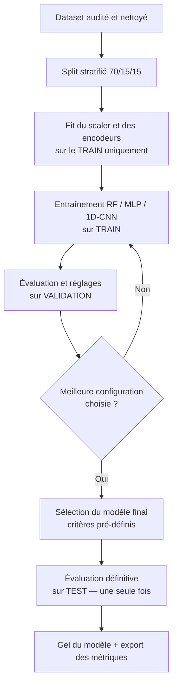

## 1.4 Le piège du Data Leakage (fuite de données)

Le *Data Leakage* se produit quand une information du validation ou du test set « fuite » vers l'entraînement.

| Erreur fréquente | Pourquoi c'est faux | Bonne pratique |
|---|---|---|
| Calculer la moyenne/écart-type du `StandardScaler` sur tout le dataset | Le modèle « voit » indirectement des statistiques du test | `scaler.fit(X_train)` puis `transform` sur val/test |
| Appliquer SMOTE avant le split | Des copies synthétiques proches d'exemples du test se retrouvent dans le train | SMOTE **uniquement sur le train** |
| Choisir le modèle d'après le score test | Le test devient un second validation set | Choisir avec la validation |
| Doublons présents à la fois dans train et test | Le modèle mémorise des lignes identiques | Traiter les doublons avant le split et le documenter |

## 1.5 Reproductibilité

Pour qu'un résultat soit scientifique, un tiers doit pouvoir le reproduire :

- Fixer les **graines aléatoires** (`random_state=42`, `numpy`, `tensorflow`).
- Versionner le code et noter les **versions des bibliothèques** (`requirements.txt`).
- Sauvegarder les **hyperparamètres** de chaque expérience.
- Sauvegarder les **métriques** dans des fichiers (JSON/CSV), pas seulement dans l'affichage du notebook.
- Pouvoir **exécuter le notebook de zéro à la fin** sans erreur (vérification du Jour 7 et du Jour 21).

```python
import random, numpy as np, tensorflow as tf

SEED = 42
random.seed(SEED)
np.random.seed(SEED)
tf.random.set_seed(SEED)
```

> Même avec des graines fixées, les réseaux de neurones peuvent varier légèrement selon le matériel. Si possible, répéter l'entraînement plusieurs fois et rapporter la moyenne et l'écart-type (🟦 **[À MESURER]**).

## 1.5 bis Journal d'expériences

Chaque expérience doit être tracée dans un tableau (CSV ou Markdown) :

| ID | Date | Modèle | Hyperparamètres | Gestion du déséquilibre | Macro F1 (validation) | Remarques |
|---|---|---|---|---|---|---|
| EXP-001 | `[date]` | Random Forest | `[À DOCUMENTER]` | `[aucune / class_weight / SMOTE]` | `[À MESURER]` | |
| EXP-002 | `[date]` | MLP | `[À DOCUMENTER]` | `[...]` | `[À MESURER]` | |
| EXP-003 | `[date]` | 1D-CNN | `[À DOCUMENTER]` | `[...]` | `[À MESURER]` | |

---

# 2. Les métriques expliquées

## 2.1 Le vocabulaire de base (pour une classe donnée)

Pour une classe, par exemple « attaque », on compare la prédiction à la réalité :

| | **Prédit : attaque** | **Prédit : normal** |
|---|---|---|
| **Réel : attaque** | **TP** (vrai positif) : attaque bien détectée | **FN** (faux négatif) : attaque **ratée** ⚠️ |
| **Réel : normal** | **FP** (faux positif) : **fausse alerte** | **TN** (vrai négatif) : trafic normal bien reconnu |

En cybersécurité :
- un **FN** est dangereux (l'attaque passe inaperçue) ;
- un **FP** est coûteux (les analystes perdent du temps, fatigue d'alertes).

## 2.2 Accuracy (exactitude)

**Définition :** proportion de prédictions correctes sur l'ensemble.

```
Accuracy = (TP + TN) / (TP + TN + FP + FN)
```

**Exemple 🟩 [FICTIF – PÉDAGOGIQUE] :** sur 1 000 flux fictifs, 950 sont normaux et 50 sont des attaques. Un modèle qui répond toujours « normal » obtient 950/1000 = 95 % d'Accuracy… sans détecter **aucune** attaque.

> **Conclusion :** l'Accuracy est **trompeuse** quand les classes sont déséquilibrées. C'est exactement le cas de NSL-KDD pour R2L et U2R.

## 2.3 Precision (précision)

**Question :** parmi les flux que le modèle déclare « attaque », combien le sont vraiment ?

```
Precision = TP / (TP + FP)
```

Une Precision faible = beaucoup de **fausses alertes**.

## 2.4 Recall (rappel / sensibilité / taux de détection)

**Question :** parmi les vraies attaques, combien le modèle en détecte-t-il ?

```
Recall = TP / (TP + FN)
```

Un Recall faible = beaucoup d'**attaques manquées**.

## 2.5 F1-score

**Moyenne harmonique** de Precision et Recall. Elle est basse si l'une des deux est basse.

```
F1 = 2 × (Precision × Recall) / (Precision + Recall)
```

**Exemple 🟩 [FICTIF – PÉDAGOGIQUE] :** Precision = 0,90 et Recall = 0,50 → F1 = 2 × 0,45 / 1,40 ≈ 0,64. Le F1 « punit » le déséquilibre entre les deux.

## 2.6 Macro F1 et Weighted F1

Dans un problème **multiclasse** (5 catégories), le F1 est calculé **par classe**, puis agrégé :

| Agrégation | Calcul | Avantage | Inconvénient |
|---|---|---|---|
| **Macro F1** | Moyenne simple des F1 de chaque classe | Chaque classe compte **autant**, y compris U2R | Peut sembler sévère |
| **Weighted F1** | Moyenne pondérée par le nombre d'exemples de chaque classe | Reflète la distribution réelle | Domine par les classes majoritaires, **masque** les classes rares |

**Exemple 🟩 [FICTIF – PÉDAGOGIQUE] :** F1 par classe = {Normal : 0,95 ; DoS : 0,95 ; Probe : 0,90 ; R2L : 0,40 ; U2R : 0,10}.
Macro F1 = (0,95 + 0,95 + 0,90 + 0,40 + 0,10) / 5 = **0,66**. Un Weighted F1 serait bien plus élevé car Normal et DoS sont très nombreux.

> **Pour ce projet :** la **Macro F1 est la métrique principale** de comparaison, car la détection des attaques rares est le cœur du sujet. L'Accuracy et la Weighted F1 sont rapportées à titre complémentaire.

## 2.7 False Positive Rate (FPR)

**Question :** parmi les flux réellement normaux, combien sont déclarés à tort comme attaques ?

```
FPR = FP / (FP + TN)
```

Dans un système de détection d'intrusions, un FPR élevé rend l'outil inutilisable en pratique. On le calcule **par classe** (approche un-contre-tous) et pour « normal contre tout le reste ».

## 2.8 Récapitulatif

| Métrique | Répond à la question | À surveiller pour | Piège |
|---|---|---|---|
| Accuracy | Quelle part des prédictions est correcte ? | Vue d'ensemble | Trompeuse si déséquilibre |
| Precision | Mes alertes sont-elles fiables ? | Limiter les fausses alertes | Ignore les attaques manquées |
| Recall | Quelle part des attaques détecte-t-on ? | Sécurité | Peut grimper en alertant tout |
| F1-score | Compromis Precision/Recall | Une classe | — |
| Macro F1 | Performance moyenne, classes à égalité | **Comparaison principale** | — |
| Weighted F1 | Performance pondérée par les effectifs | Contexte global | Masque U2R/R2L |
| FPR | Taux de fausses alertes sur trafic normal | Exploitabilité réelle | — |

## 2.9 Calcul avec Scikit-learn

```python
from sklearn.metrics import (accuracy_score, precision_recall_fscore_support,
                             f1_score, classification_report)

y_pred = model.predict(X_val)          # ou X_test, UNIQUEMENT pour l'évaluation finale

acc = accuracy_score(y_val, y_pred)
macro_f1 = f1_score(y_val, y_pred, average="macro")
weighted_f1 = f1_score(y_val, y_pred, average="weighted")

print(classification_report(y_val, y_pred, target_names=class_names, digits=4))
```

> Pour un réseau de neurones avec sortie Softmax, `model.predict` retourne des probabilités : utiliser `np.argmax(probas, axis=1)` pour obtenir la classe prédite.

---

# 3. Confusion Matrix et interprétation des erreurs

## 3.1 Qu'est-ce qu'une matrice de confusion ?

C'est un tableau qui croise **la classe réelle** (lignes) et **la classe prédite** (colonnes). La **diagonale** contient les bonnes prédictions ; tout ce qui est hors diagonale est une erreur, et indique **quelles classes sont confondues**.

**Exemple 🟩 [FICTIF – PÉDAGOGIQUE]** (chiffres inventés, pour apprendre à lire) :

| Réel \ Prédit | Normal | DoS | Probe | R2L | U2R |
|---|---|---|---|---|---|
| **Normal** | 90 | 1 | 2 | 6 | 1 |
| **DoS** | 2 | 95 | 3 | 0 | 0 |
| **Probe** | 4 | 5 | 90 | 1 | 0 |
| **R2L** | 40 | 0 | 2 | 55 | 3 |
| **U2R** | 50 | 0 | 0 | 10 | 40 |

**Lecture :**
- Ligne **R2L** : 40 attaques R2L sur 100 sont prises pour du trafic « Normal » → ce sont des **faux négatifs** (attaques ratées).
- Ligne **Normal**, colonne **R2L** : 6 flux normaux déclenchent une alerte R2L → **fausses alertes**.
- Cette lecture montre que le problème n'est pas l'Accuracy globale, mais la confusion **attaque rare → normal**.

## 3.2 Normalisation par ligne

Quand les classes ont des effectifs très différents, une matrice en **pourcentages par ligne** (chaque ligne somme à 100 %) est plus lisible : la diagonale devient directement le **Recall par classe**.

```python
import matplotlib.pyplot as plt
import seaborn as sns
from sklearn.metrics import confusion_matrix

cm = confusion_matrix(y_val, y_pred, labels=range(len(class_names)))
cm_norm = cm.astype(float) / cm.sum(axis=1, keepdims=True)

fig, axes = plt.subplots(1, 2, figsize=(14, 5))
sns.heatmap(cm, annot=True, fmt="d", xticklabels=class_names,
            yticklabels=class_names, ax=axes[0], cmap="Blues")
axes[0].set_title("Matrice de confusion (effectifs)")
sns.heatmap(cm_norm, annot=True, fmt=".2f", xticklabels=class_names,
            yticklabels=class_names, ax=axes[1], cmap="Blues")
axes[1].set_title("Matrice de confusion (normalisée par ligne)")
for ax in axes:
    ax.set_xlabel("Classe prédite"); ax.set_ylabel("Classe réelle")
plt.tight_layout()
plt.savefig("reports/figures/confusion_matrix_<modele>.png", dpi=150)
```

## 3.3 Méthode d'analyse des erreurs (Jour 16)

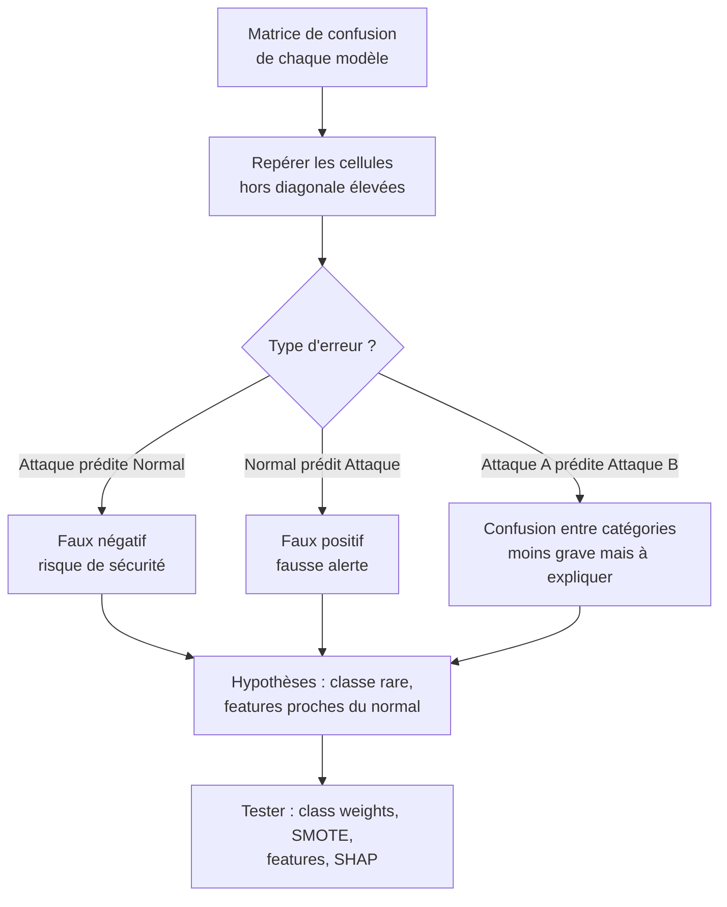

Questions à se poser pour chaque modèle :

1. Quelles classes sont les plus mal reconnues ?
2. Vers quelle classe les erreurs partent-elles ?
3. Les erreurs sont-elles les mêmes pour Random Forest, MLP et 1D-CNN ?
4. Une erreur est-elle plus grave qu'une autre (attaque → normal vs. normal → attaque) ?

🟨 **[ATTENDU]** : en théorie, les classes **R2L** et **U2R** sont les plus difficiles car elles sont rares et leurs caractéristiques peuvent ressembler à du trafic légitime. **À confirmer par les expériences** — ne pas l'écrire comme un résultat sans mesure.

## 3.4 Tableau d'analyse des erreurs à compléter

| Modèle | Classe la plus mal reconnue | Principale confusion | Recall de cette classe | Hypothèse d'explication |
|---|---|---|---|---|
| Random Forest | 🟦 `[À MESURER]` | 🟦 `[À MESURER]` | 🟦 `[À MESURER]` | `[À ANALYSER]` |
| MLP | 🟦 `[À MESURER]` | 🟦 `[À MESURER]` | 🟦 `[À MESURER]` | `[À ANALYSER]` |
| 1D-CNN | 🟦 `[À MESURER]` | 🟦 `[À MESURER]` | 🟦 `[À MESURER]` | `[À ANALYSER]` |

---

# 4. Gestion du déséquilibre des classes

## 4.1 Le problème

Dans NSL-KDD, certaines attaques (notamment **R2L** et **U2R**) sont beaucoup moins fréquentes que le trafic normal ou DoS. Un modèle entraîné naïvement apprend surtout les classes majoritaires : il peut avoir une bonne Accuracy tout en ignorant les attaques rares (voir section 2.2).

> La distribution réelle de **votre** dataset doit être mesurée au Jour 3 / Jour 6 et reportée dans le rapport : 🟦 `[À MESURER : effectif et pourcentage de chaque classe]`.

| Classe | Effectif train | % train | Effectif val | Effectif test |
|---|---|---|---|---|
| Normal | 🟦 | 🟦 | 🟦 | 🟦 |
| DoS | 🟦 | 🟦 | 🟦 | 🟦 |
| Probe | 🟦 | 🟦 | 🟦 | 🟦 |
| R2L | 🟦 | 🟦 | 🟦 | 🟦 |
| U2R | 🟦 | 🟦 | 🟦 | 🟦 |

## 4.2 Stratégies à comparer

| Stratégie | Principe | Avantages | Limites |
|---|---|---|---|
| **Aucune (baseline)** | Entraîner sans correction | Référence de comparaison indispensable | Classes rares probablement négligées |
| **Class Weights** | Pénaliser davantage les erreurs sur les classes rares dans la fonction de perte | Simple, pas de données synthétiques, pas de fuite | Peut augmenter les fausses alertes |
| **SMOTE** | Créer des exemples synthétiques de classes minoritaires par interpolation entre voisins | Enrichit les classes rares | Risque de fuite si mal placé ; exemples artificiels possiblement irréalistes ; appliqué aux features encodées (attention aux variables catégorielles) |

## 4.3 Règles impératives (issues de la roadmap)

1. **Mesurer** le déséquilibre avant toute correction.
2. Tester d'abord les **class weights**, puis comparer **éventuellement** avec SMOTE.
3. Appliquer SMOTE **uniquement sur le training set**.
4. **Garder le validation et le test sets intacts** (jamais de suréchantillonnage).
5. Documenter la distribution **avant et après** traitement.

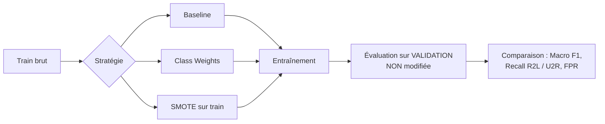

## 4.4 Exemples de code

**Class weights (Scikit-learn) :**

```python
from sklearn.ensemble import RandomForestClassifier
from sklearn.utils.class_weight import compute_class_weight
import numpy as np

classes = np.unique(y_train)
weights = compute_class_weight("balanced", classes=classes, y=y_train)
class_weight_dict = dict(zip(classes, weights))

rf = RandomForestClassifier(n_estimators=200, class_weight=class_weight_dict,
                            random_state=SEED, n_jobs=-1)
rf.fit(X_train, y_train)
```

**Class weights (Keras) :**

```python
history = model.fit(
    X_train, y_train_cat,
    validation_data=(X_val, y_val_cat),
    epochs=EPOCHS, batch_size=BATCH_SIZE,
    class_weight=class_weight_dict,      # dictionnaire {indice_classe: poids}
    callbacks=callbacks
)
```

**SMOTE (si testé) :**

```python
from imblearn.over_sampling import SMOTE

smote = SMOTE(random_state=SEED)
X_train_res, y_train_res = smote.fit_resample(X_train, y_train)  # TRAIN uniquement
# X_val, y_val, X_test, y_test restent inchangés
```

## 4.5 Analyse du compromis (Jour 18)

Améliorer le Recall de R2L/U2R coûte souvent des **fausses alertes** supplémentaires. Il faut mesurer ce compromis, pas seulement le constater.

| Configuration | Macro F1 (val) | Recall R2L | Recall U2R | FPR (Normal→Attaque) |
|---|---|---|---|---|
| Sans traitement | 🟦 | 🟦 | 🟦 | 🟦 |
| Class weights | 🟦 | 🟦 | 🟦 | 🟦 |
| SMOTE (si testé) | 🟦 | 🟦 | 🟦 | 🟦 |

---

# 5. Optimisation des hyperparamètres

## 5.1 Paramètres vs hyperparamètres

| | Paramètres | Hyperparamètres |
|---|---|---|
| Définition | Appris automatiquement pendant l'entraînement | Choisis **par l'humain** avant l'entraînement |
| Exemples | Poids et biais d'un réseau, seuils des arbres | Nombre d'arbres, Learning Rate, Batch Size, Dropout |

L'optimisation consiste à **tester plusieurs combinaisons d'hyperparamètres** et à garder celle qui obtient le meilleur score **sur la validation**.

## 5.2 Hyperparamètres à explorer (Jour 17)

| Modèle | Hyperparamètres | Rôle |
|---|---|---|
| **Random Forest** | `n_estimators`, `max_depth`, `min_samples_split`, `min_samples_leaf`, `class_weight` | Taille et complexité de la forêt, robustesse |
| **MLP** | Learning Rate, Batch Size, nombre de neurones, Dropout, Epochs | Vitesse d'apprentissage, capacité, régularisation |
| **1D-CNN** | Learning Rate, Batch Size, nombre de filtres, taille du kernel, Dropout | Capacité d'extraction de motifs locaux |

**Architecture MLP de départ (source) :** Input → Dense 128 + ReLU → Dropout 0,3 → Dense 64 + ReLU → Dropout 0,2 → Output Softmax. Les variantes testées doivent être documentées par rapport à cette base.

## 5.3 Concepts à comprendre

| Concept | Explication simple | Effet d'un mauvais réglage |
|---|---|---|
| **Learning Rate** | Taille du « pas » de correction à chaque mise à jour | Trop grand : instabilité ; trop petit : apprentissage très lent |
| **Batch Size** | Nombre d'exemples vus avant une mise à jour des poids | Petit : bruité mais précis ; grand : rapide mais parfois moins généralisant |
| **Epoch** | Un passage complet sur le training set | Trop peu : sous-apprentissage ; trop : sur-apprentissage |
| **Dropout** | Désactivation aléatoire de neurones pendant l'entraînement | Trop fort : sous-apprentissage ; absent : risque de sur-apprentissage |
| **Early Stopping** | Arrêt quand la validation ne s'améliore plus | Évite l'overfitting |
| **Model Checkpoint** | Sauvegarde du meilleur modèle selon la validation | Évite de perdre le meilleur état |

## 5.4 Diagnostiquer avec les courbes d'apprentissage

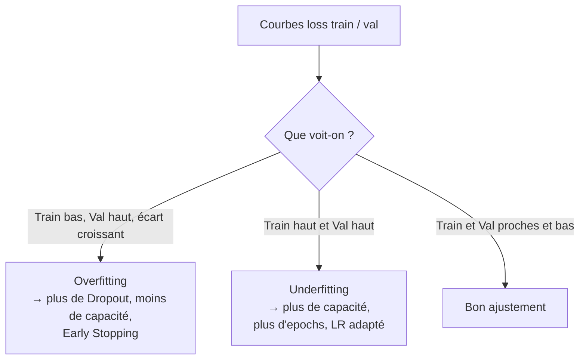

## 5.5 Méthodes de recherche

| Méthode | Principe | Quand l'utiliser |
|---|---|---|
| **Grid Search** | Teste toutes les combinaisons d'une grille | Peu de paramètres, grille petite |
| **Random Search** | Tire des combinaisons au hasard | Beaucoup de paramètres, budget limité |
| **Réglage manuel guidé** | Variation d'un paramètre à la fois, courbes à l'appui | Apprentissage, réseaux (coût élevé) |

Pour un projet de 4 semaines, un **Random Search raisonnable** (Random Forest) et quelques **configurations ciblées** (MLP, 1D-CNN) suffisent, pourvu que la démarche soit **documentée et évaluée sur la validation**.

```python
from sklearn.model_selection import RandomizedSearchCV
from sklearn.ensemble import RandomForestClassifier

param_dist = {
    "n_estimators": [100, 200, 300],
    "max_depth": [None, 10, 20, 30],
    "min_samples_split": [2, 5, 10],
    "min_samples_leaf": [1, 2, 4],
}
search = RandomizedSearchCV(
    RandomForestClassifier(random_state=SEED, n_jobs=-1),
    param_distributions=param_dist, n_iter=10,
    scoring="f1_macro", cv=3, random_state=SEED, n_jobs=-1
)
search.fit(X_train, y_train)      # la validation croisée reste interne au TRAIN
print(search.best_params_)
```

> **Attention :** `cv=3` utilise des sous-ensembles du **train**. Le validation set reste disponible pour confirmer le choix final. Le test set n'est **jamais** impliqué.

```python
from tensorflow.keras.callbacks import EarlyStopping, ModelCheckpoint

callbacks = [
    EarlyStopping(monitor="val_loss", patience=10, restore_best_weights=True),
    ModelCheckpoint("models/mlp_best.keras", monitor="val_loss", save_best_only=True),
]
```

## 5.5 bis Tableau des expériences d'optimisation

| ID | Modèle | Learning Rate | Batch Size | Autres paramètres | Macro F1 (val) | Temps d'entraînement |
|---|---|---|---|---|---|---|
| OPT-01 | MLP | `[valeur]` | `[valeur]` | `[...]` | 🟦 | 🟦 |
| OPT-02 | MLP | `[valeur]` | `[valeur]` | `[...]` | 🟦 | 🟦 |
| OPT-03 | 1D-CNN | `[valeur]` | `[valeur]` | `[...]` | 🟦 | 🟦 |
| OPT-04 | Random Forest | — | — | `[n_estimators, max_depth…]` | 🟦 | 🟦 |

---

# 6. Explainable AI et SHAP

## 6.1 Pourquoi expliquer un modèle ?

Un système de détection d'intrusions qui dit « attaque » sans justification est difficile à **auditer**, à **déboguer** et à **faire accepter** par des analystes. L'IA explicable (*Explainable AI*, XAI) répond à : **pourquoi ce flux est-il classé ainsi ?**

Bénéfices :
- **Confiance** : l'analyste comprend l'alerte.
- **Débogage** : détecter un modèle qui s'appuie sur une caractéristique non pertinente.
- **Science** : relier les résultats à des comportements réseau connus.

## 6.2 Deux niveaux d'explication

| Niveau | Question | Outil |
|---|---|---|
| **Global** | Quelles caractéristiques comptent le plus **en général** ? | Feature Importance, SHAP summary plot |
| **Local** | Pourquoi **cette** prédiction précise ? | SHAP force plot / waterfall |

## 6.3 Feature Importance (Random Forest)

Le Random Forest fournit directement une importance par caractéristique (basée sur la réduction d'impureté).

```python
import pandas as pd

importances = pd.Series(rf.feature_importances_, index=feature_names)
importances.sort_values(ascending=False).head(15).plot(kind="barh")
```

**Limite :** cette importance peut favoriser les variables à nombreuses valeurs et ne dit pas **dans quel sens** la variable pousse la décision.

## 6.4 SHAP

**SHAP** (SHapley Additive exPlanations) attribue à chaque caractéristique une **contribution** à la prédiction, en s'inspirant de la théorie des jeux : combien chaque « joueur » (feature) a contribué au « gain » (la sortie du modèle) ?

**Lecture d'un résultat SHAP :**
- Une valeur SHAP **positive** pour une classe = la caractéristique **pousse** vers cette classe.
- Une valeur **négative** = elle **éloigne** de cette classe.
- Plus la valeur absolue est grande, plus l'influence est forte.

```python
import shap

# Utiliser un sous-échantillon du jeu de VALIDATION (coût de calcul élevé)
X_sample = X_val[:500]

explainer = shap.TreeExplainer(rf)          # adapté aux modèles à arbres
shap_values = explainer.shap_values(X_sample)

shap.summary_plot(shap_values, X_sample, feature_names=feature_names)
```

> Pour les réseaux (MLP, 1D-CNN), `shap.DeepExplainer` ou `shap.KernelExplainer` peuvent être utilisés, mais ils sont plus lents. La roadmap indique **« SHAP si réalisable »** : en cas de contrainte de temps, l'appliquer au Random Forest et le **dire explicitement** dans le rapport.

## 6.5 Précaution : features encodées

Après One-Hot Encoding, une variable catégorielle (ex. `protocol_type`) devient plusieurs colonnes (`protocol_type_tcp`, etc.). Les explications SHAP portent alors sur ces colonnes ; on peut les **regrouper** pour la lisibilité. Conserver la liste `feature_names` issue du preprocessing pour éviter tout décalage.

## 6.6 Protocole d'interprétation (Jour 19)

1. Identifier les caractéristiques globalement influentes (🟦 `[À MESURER]`).
2. Les relier à des **comportements réseau plausibles** (nombre de connexions, erreurs de service, volume d'octets…).
3. Examiner **quelques prédictions individuelles** : une bien classée, une attaque ratée, une fausse alerte.
4. Vérifier qu'aucune caractéristique ne révèle une **fuite** ou un artefact du dataset.
5. Noter les limites : SHAP explique le **modèle**, pas la **réalité causale**.

| Observation à documenter | Résultat |
|---|---|
| Top 5 des caractéristiques (global) | 🟦 `[À MESURER]` |
| Caractéristiques clés pour DoS | 🟦 `[À MESURER]` |
| Caractéristiques clés pour U2R / R2L | 🟦 `[À MESURER]` |
| Exemple d'erreur expliquée | 🟦 `[À ANALYSER]` |

---

# 7. Tableau comparatif des modèles

## 7.1 Tableau principal (format de la roadmap, Jour 20)

> ⚠️ **Toutes les cases ci-dessous sont vides par conception.** Elles ne seront remplies **qu'après** les expérimentations, à partir de fichiers de résultats sauvegardés.

| Modèle | Accuracy | Macro F1 | Temps d'inférence |
|---|---|---|---|
| Random Forest | 🟦 `[À MESURER]` | 🟦 `[À MESURER]` | 🟦 `[À MESURER]` |
| MLP | 🟦 `[À MESURER]` | 🟦 `[À MESURER]` | 🟦 `[À MESURER]` |
| 1D-CNN | 🟦 `[À MESURER]` | 🟦 `[À MESURER]` | 🟦 `[À MESURER]` |

## 7.2 Tableau détaillé recommandé

| Indicateur | Random Forest | MLP | 1D-CNN |
|---|---|---|---|
| Accuracy | 🟦 | 🟦 | 🟦 |
| Macro F1 | 🟦 | 🟦 | 🟦 |
| Weighted F1 | 🟦 | 🟦 | 🟦 |
| Precision (macro) | 🟦 | 🟦 | 🟦 |
| Recall (macro) | 🟦 | 🟦 | 🟦 |
| Recall — Normal | 🟦 | 🟦 | 🟦 |
| Recall — DoS | 🟦 | 🟦 | 🟦 |
| Recall — Probe | 🟦 | 🟦 | 🟦 |
| Recall — R2L | 🟦 | 🟦 | 🟦 |
| Recall — U2R | 🟦 | 🟦 | 🟦 |
| FPR (Normal → Attaque) | 🟦 | 🟦 | 🟦 |
| Temps d'entraînement | 🟦 | 🟦 | 🟦 |
| Temps d'inférence | 🟦 | 🟦 | 🟦 |
| Taille du modèle (Mo) | 🟦 | 🟦 | 🟦 |
| Nombre de paramètres | 🟦 | 🟦 | 🟦 |
| Hyperparamètres retenus | `[À DOCUMENTER]` | `[À DOCUMENTER]` | `[À DOCUMENTER]` |

**Sur quel ensemble ?** Préciser dans chaque colonne si les valeurs viennent de la **validation** (sélection) ou du **test** (évaluation finale, une fois).

## 7.3 Comparaison qualitative (hypothèses 🟨 à vérifier)

| Critère | Random Forest | MLP | 1D-CNN |
|---|---|---|---|
| Type | Machine Learning (ensemble d'arbres) | Deep Learning (réseau dense) | Deep Learning (convolution) |
| Interprétabilité | 🟨 Généralement plus facile (importances, arbres) | 🟨 Plus difficile (SHAP nécessaire) | 🟨 Plus difficile |
| Besoin de normalisation | 🟨 Faible (peu sensible à l'échelle) | 🟨 Important | 🟨 Important |
| Coût d'entraînement | 🟨 Souvent modéré | 🟨 Variable (GPU utile) | 🟨 Souvent plus élevé |
| Rôle dans le projet | Modèle de référence (baseline) | Premier réseau de neurones | Test d'une architecture alternative |

> **Rappel méthodologique sur le 1D-CNN :** les caractéristiques tabulaires sont traitées comme une **séquence de colonnes**, **sans prétendre** qu'elles possèdent naturellement une structure spatiale. Cette réserve doit apparaître dans le rapport. Le **LSTM** reste facultatif et n'est développé que si les modèles principaux sont terminés **et** si son usage est méthodologiquement justifié.

## 7.4 Visualisation de la comparaison

Graphique à produire **après** mesures (illustration de code, sans valeurs) :

```python
import pandas as pd
import matplotlib.pyplot as plt

# results contient les valeurs RÉELLEMENT mesurées, chargées depuis reports/metrics_summary.csv
results = pd.read_csv("reports/metrics_summary.csv", index_col="model")
results[["accuracy", "macro_f1"]].plot(kind="bar")
plt.title("Comparaison des modèles (ensemble de validation)")
plt.ylabel("Score"); plt.ylim(0, 1)
plt.tight_layout(); plt.savefig("reports/figures/model_comparison.png", dpi=150)
```

## 7.5 Mesure du temps d'inférence

```python
import time

n_runs = 5
times = []
for _ in range(n_runs):
    t0 = time.perf_counter()
    _ = model.predict(X_test)           # même matériel, même jeu pour tous les modèles
    times.append(time.perf_counter() - t0)

per_sample_ms = (sum(times) / n_runs) / len(X_test) * 1000
```

Règles : **même machine**, **même jeu de données**, plusieurs répétitions, mention du matériel (CPU/GPU) dans le rapport.

---

# 8. Sélection et sauvegarde du modèle final

## 8.1 Critères de sélection (Jour 20)

Le meilleur modèle n'est pas forcément celui qui a la meilleure Accuracy. Le compromis porte sur :

| Critère | Question |
|---|---|
| Détection des attaques | Les 4 catégories d'attaque, y compris R2L et U2R, sont-elles détectées ? |
| Fausses alertes | Le FPR est-il acceptable ? |
| Temps de prédiction | Compatible avec une démonstration interactive ? |
| Complexité | Facile à déployer, à expliquer, à maintenir ? |

**Bonne pratique :** définir une **grille de décision avant** de regarder les résultats finaux, pour éviter de justifier un choix a posteriori.

| Critère | Poids (à définir) | RF | MLP | 1D-CNN |
|---|---|---|---|---|
| Macro F1 (validation) | `[%]` | 🟦 | 🟦 | 🟦 |
| Recall R2L / U2R | `[%]` | 🟦 | 🟦 | 🟦 |
| FPR | `[%]` | 🟦 | 🟦 | 🟦 |
| Temps d'inférence | `[%]` | 🟦 | 🟦 | 🟦 |
| Simplicité de déploiement | `[%]` | 🟦 | 🟦 | 🟦 |
| **Score pondéré** | 100 % | 🟦 | 🟦 | 🟦 |

## 8.2 Gel du modèle final (Jour 21)

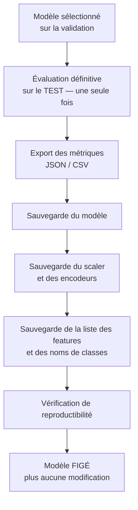

> Une fois le test set utilisé, **on ne retouche plus le modèle**. Toute modification impliquerait de refaire une sélection sur la validation, et le test set aurait perdu son indépendance.

## 8.3 Artefacts à sauvegarder

| Artefact | Contenu | Format typique |
|---|---|---|
| Modèle | Poids / structure | `.joblib` (Random Forest) ou `.keras` (MLP, 1D-CNN) |
| Scaler | Moyennes et écarts-types appris sur le train | `.joblib` |
| Encodeurs | Catégories connues (One-Hot / label) | `.joblib` |
| Liste des features | Ordre exact des colonnes attendues | `.json` |
| Noms des classes | Correspondance indice ↔ catégorie | `.json` |
| Métriques finales | Accuracy, Macro F1, rapport par classe | `.json` / `.csv` |
| Configuration | Hyperparamètres, graine, versions | `.json` / `.yaml` |

```python
import joblib, json

joblib.dump(rf, "models/final_model.joblib")                  # ou model.save("models/final_model.keras")
joblib.dump(scaler, "models/scaler.joblib")
joblib.dump(encoder, "models/encoder.joblib")

with open("models/feature_names.json", "w") as f:
    json.dump(feature_names, f)
with open("models/class_names.json", "w") as f:
    json.dump(class_names, f)
with open("reports/final_metrics.json", "w") as f:
    json.dump(final_metrics, f, indent=2)       # final_metrics = dict de valeurs mesurées
```

## 8.4 Pourquoi sauvegarder le preprocessing ?

Le modèle a appris sur des données **transformées**. En production (l'application Streamlit), les nouvelles données doivent subir **exactement la même transformation**, avec les **mêmes** paramètres appris sur le train. Recalculer un scaler sur le fichier importé fausserait les prédictions.

> **Option recommandée :** regrouper preprocessing + modèle dans un seul `sklearn.pipeline.Pipeline` (ou une fonction `predict_pipeline` unique) pour supprimer le risque de désynchronisation.

## 8.4 bis Vérification de reproductibilité

Checklist du Jour 21 :

- [ ] Le notebook s'exécute de zéro jusqu'à la fin.
- [ ] Les métriques recalculées correspondent aux métriques exportées.
- [ ] Le modèle rechargé donne les **mêmes prédictions** que le modèle en mémoire.
- [ ] Les versions de bibliothèques sont enregistrées.

```python
reloaded = joblib.load("models/final_model.joblib")
assert (reloaded.predict(X_test) == rf.predict(X_test)).all()
```

---

# 9. Architecture de l'application Streamlit

## 9.1 Rôle de l'application

L'application transforme le modèle en **produit démontrable** : un utilisateur importe des flux réseau (CSV), obtient une classification (Normal / DoS / Probe / R2L / U2R) et des statistiques. Elle illustre aussi la différence entre **entraînement** (fait une fois, hors ligne) et **prédiction** (faite à la demande).

## 9.2 Architecture globale

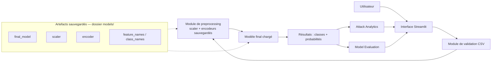

## 9.3 Séparation des responsabilités

| Couche | Fichier suggéré | Responsabilité |
|---|---|---|
| Interface | `app/app.py`, `app/pages/*.py` | Affichage, widgets, navigation |
| Chargement | `src/inference/loader.py` | Charger modèle et artefacts (mis en cache) |
| Validation | `src/inference/validation.py` | Vérifier colonnes, types, valeurs manquantes |
| Preprocessing | `src/inference/preprocess.py` | Appliquer les transformations **identiques** à l'entraînement |
| Prédiction | `src/inference/predict.py` | Produire classes et probabilités |
| Analytique | `src/analytics/stats.py` | Calculer les statistiques d'attaques |

> **Principe :** l'interface ne contient **pas** la logique de ML. Cette séparation facilite les tests, la réutilisation et l'explication en soutenance.

## 9.4 Navigation et pages (selon la roadmap)

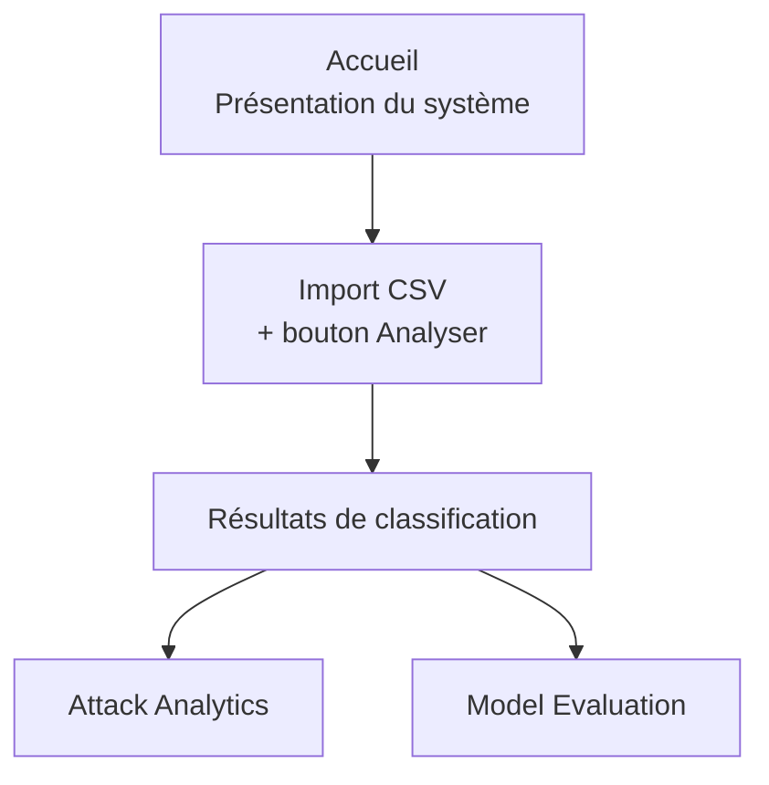

| Page | Contenu (Jours 23 à 25) |
|---|---|
| **Accueil** | Présentation du système, objectif, catégories détectées |
| **Analyse** | Import CSV, bouton d'analyse, résultats de classification |
| **Attack Analytics** | Nombre de flux, normaux, malveillants, répartition, graphiques, liste d'alertes |
| **Model Evaluation** | Modèle sélectionné, métriques, matrice de confusion, tableau comparatif, détails des prédictions |

## 9.5 Squelette de code

```python
# app/app.py
import streamlit as st

st.set_page_config(page_title="Détection d'intrusions ML", layout="wide")

st.title("Système de détection d'intrusions réseau")
st.markdown("""
Cette application classe des flux réseau en cinq catégories :
**Normal, DoS, Probe, R2L, U2R**, à l'aide d'un modèle de Machine Learning
entraîné sur le dataset NSL-KDD.
""")
st.info("Utilisez le menu latéral pour importer un fichier CSV et lancer l'analyse.")
```

```python
# src/inference/loader.py
import joblib, json
import streamlit as st

@st.cache_resource            # chargé une seule fois, pas à chaque interaction
def load_artifacts():
    model = joblib.load("models/final_model.joblib")
    scaler = joblib.load("models/scaler.joblib")
    encoder = joblib.load("models/encoder.joblib")
    feature_names = json.load(open("models/feature_names.json"))
    class_names = json.load(open("models/class_names.json"))
    return model, scaler, encoder, feature_names, class_names
```

> Si le modèle final est un réseau Keras, remplacer le chargement du modèle par `tf.keras.models.load_model("models/final_model.keras")`.

## 9.6 État de session

Streamlit réexécute le script à chaque interaction. Utiliser `st.session_state` pour conserver les résultats entre pages (ex. le tableau de prédictions) afin que *Attack Analytics* et *Model Evaluation* réutilisent la même analyse sans recalcul.

```python
if st.button("Analyser"):
    st.session_state["results"] = run_prediction(df)
```

---

# 10. Importation CSV et prédictions

## 10.1 Flux de traitement

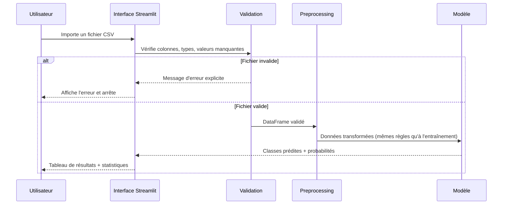

## 10.2 Format d'entrée attendu

Le CSV doit contenir **les mêmes colonnes** que celles utilisées à l'entraînement (liste sauvegardée dans `feature_names.json`), avant ou après encodage selon la conception choisie. **À préciser clairement dans l'interface** (une section « Format attendu » avec un petit exemple et un bouton de téléchargement d'un fichier d'exemple).

| Règle de validation | Comportement attendu |
|---|---|
| Colonnes manquantes | Erreur claire listant les colonnes absentes |
| Colonnes supplémentaires | Ignorées (avec avertissement) ou refusées, selon le choix documenté |
| Types incorrects (texte dans une colonne numérique) | Erreur ou conversion contrôlée, avec message |
| Valeurs manquantes | Politique explicite : rejet, ou imputation identique à celle de l'entraînement |
| Catégorie inconnue (ex. un service jamais vu) | Gérée par l'encodeur (`handle_unknown="ignore"`) + avertissement |
| Fichier vide / trop volumineux | Message d'erreur |

## 10.3 Code de validation et de prédiction

```python
# src/inference/validation.py
def validate_dataframe(df, expected_columns):
    errors = []
    missing = [c for c in expected_columns if c not in df.columns]
    if missing:
        errors.append(f"Colonnes manquantes : {missing}")
    if df.empty:
        errors.append("Le fichier ne contient aucune ligne.")
    return errors
```

```python
# src/inference/predict.py
import numpy as np
import pandas as pd

def run_prediction(df, model, preprocessor, class_names):
    X = preprocessor.transform(df)                 # mêmes transformations que le train
    proba = model.predict_proba(X)                 # Keras : model.predict(X)
    idx = np.argmax(proba, axis=1)
    out = df.copy()
    out["predicted_class"] = [class_names[i] for i in idx]
    out["confidence"] = proba.max(axis=1)
    return out
```

```python
# app/pages/1_Analyse.py
import pandas as pd
import streamlit as st

uploaded = st.file_uploader("Importer un fichier CSV", type=["csv"])
if uploaded is not None:
    try:
        df = pd.read_csv(uploaded)
    except Exception as exc:
        st.error(f"Impossible de lire le fichier : {exc}")
        st.stop()

    errors = validate_dataframe(df, feature_names)
    if errors:
        for e in errors:
            st.error(e)
        st.stop()

    st.write("Aperçu des données :", df.head())
    if st.button("Analyser"):
        with st.spinner("Analyse en cours..."):
            st.session_state["results"] = run_prediction(df, model, preprocessor, class_names)
        st.success("Analyse terminée.")
```

## 10.4 Présentation des résultats

Le tableau de sortie doit contenir au minimum :

| Identifiant du flux | Classe prédite | Confiance | Statut |
|---|---|---|---|
| ligne 0 | Normal | `[calculé par le modèle]` | OK |
| ligne 1 | DoS | `[calculé par le modèle]` | ⚠️ Alerte |

**Bonnes pratiques :**
- Afficher la **confiance** (probabilité) et préciser qu'elle n'est pas une garantie de justesse.
- Permettre le **téléchargement** du tableau de résultats (`st.download_button`).
- Mettre en évidence les alertes (couleur, tri).

## 10.5 Prédiction sur une seule ligne (Jour 22)

Avant d'industrialiser, tester la chaîne complète sur **un seul flux** :

```python
sample = X_test_raw.iloc[[0]]          # une ligne brute, avant preprocessing
pred = run_prediction(sample, model, preprocessor, class_names)
print(pred[["predicted_class", "confidence"]])
```

C'est le test le plus simple pour vérifier que le preprocessing d'inférence est cohérent avec celui de l'entraînement.

## 10.6 Cas des étiquettes dans le CSV importé

Un fichier de test peut contenir une colonne d'étiquettes (`label`). Deux modes possibles :
- **Sans étiquette** : l'app affiche uniquement les prédictions et les analyses.
- **Avec étiquette** : l'app peut en plus calculer des métriques sur le fichier importé (utile pour la démonstration). Préciser que ces métriques portent sur **le fichier importé**, et non sur le test set officiel.

---

# 11. Attack Analytics et Model Evaluation

## 11.1 Attack Analytics (Jour 24)

Cette page répond à : **que contient le trafic analysé ?**

| Élément (roadmap) | Calcul | Visualisation |
|---|---|---|
| Nombre de flux analysés | `len(results)` | Indicateur (`st.metric`) |
| Nombre de flux normaux | `(predicted_class == "Normal").sum()` | Indicateur |
| Nombre de flux malveillants | `(predicted_class != "Normal").sum()` | Indicateur |
| Répartition des catégories d'attaques | `value_counts()` | Diagramme en barres / camembert |
| Statistiques graphiques | Distribution des confiances, tendances | Histogramme |
| Liste des alertes | Lignes classées comme attaque, triées par confiance | Tableau filtrable |

```python
# app/pages/2_Attack_Analytics.py
import streamlit as st
import plotly.express as px

results = st.session_state.get("results")
if results is None:
    st.warning("Aucune analyse disponible. Importez d'abord un fichier CSV.")
    st.stop()

total = len(results)
normal = int((results["predicted_class"] == "Normal").sum())
malicious = total - normal

c1, c2, c3 = st.columns(3)
c1.metric("Flux analysés", total)
c2.metric("Flux normaux", normal)
c3.metric("Flux malveillants", malicious)

attacks = results[results["predicted_class"] != "Normal"]
dist = attacks["predicted_class"].value_counts().reset_index()
dist.columns = ["Catégorie", "Nombre"]
st.plotly_chart(px.bar(dist, x="Catégorie", y="Nombre", title="Répartition des attaques détectées"))

st.subheader("Liste des alertes")
st.dataframe(attacks.sort_values("confidence", ascending=False))
```

**Précaution d'interprétation :** ces statistiques décrivent les **prédictions** du modèle, pas la vérité terrain (sauf si le CSV est étiqueté). À indiquer dans l'interface.

## 11.2 Model Evaluation (Jour 25)

Cette page répond à : **le modèle est-il fiable, et pourquoi ce modèle ?**

| Élément (roadmap) | Source | Remarque |
|---|---|---|
| Modèle sélectionné | `reports/final_metrics.json` / config | Nom, version, date de gel |
| Métriques | Fichier de métriques **mesurées** | Accuracy, Macro F1, rapport par classe |
| Confusion Matrix | Image ou tableau sauvegardé | Normalisée et brute |
| Tableau comparatif | `reports/metrics_summary.csv` | Random Forest, MLP, 1D-CNN |
| Détails des prédictions | Résultats de la session | Filtrables par classe |

```python
# app/pages/3_Model_Evaluation.py
import json, pandas as pd, streamlit as st

metrics = json.load(open("reports/final_metrics.json"))
comparison = pd.read_csv("reports/metrics_summary.csv")

st.header("Modèle sélectionné")
st.write(f"**Modèle :** {metrics['model_name']}")
st.json(metrics)                                   # affiche les valeurs mesurées enregistrées

st.subheader("Comparaison des modèles")
st.dataframe(comparison)

st.subheader("Matrice de confusion (ensemble de test)")
st.image("reports/figures/confusion_matrix_final.png")
```

> **Règle d'intégrité :** cette page **lit** des fichiers produits par les expériences ; elle ne contient **aucune valeur écrite à la main**. Si un fichier manque, l'application affiche un message plutôt qu'un chiffre inventé.

## 11.3 Intégration dans le système global

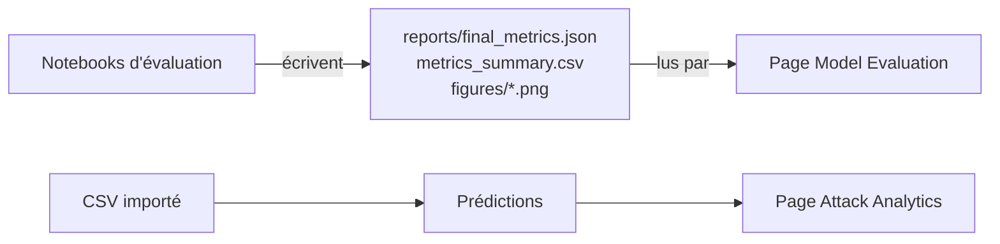

Cette conception montre un principe d'ingénierie : **les résultats scientifiques sont produits une fois (notebooks) et consommés par l'application**, ce qui garantit que la démonstration affiche exactement ce qui est dans le rapport.

---

# 12. Tests fonctionnels et validation

## 12.1 Objectifs (Jour 26)

Vérifier que l'application est **fiable** : elle ne doit pas planter sur un fichier imparfait, et ses prédictions doivent être **cohérentes** avec celles du notebook.

## 12.2 Plan de tests

| # | Cas de test (roadmap) | Entrée | Résultat attendu | Statut |
|---|---|---|---|---|
| T1 | Fichier CSV valide | CSV conforme | Prédictions affichées sans erreur | 🟦 `[À TESTER]` |
| T2 | Colonnes manquantes | CSV sans certaines colonnes | Message d'erreur listant les colonnes | 🟦 |
| T3 | Données incorrectes | Texte dans colonne numérique | Erreur claire, pas de plantage | 🟦 |
| T4 | Valeurs manquantes | Cellules vides | Gestion selon la politique documentée | 🟦 |
| T5 | Prédictions multiples | Plusieurs milliers de lignes | Résultat complet dans un temps raisonnable | 🟦 |
| T6 | Cohérence du preprocessing | Mêmes lignes que dans le notebook | Prédictions **identiques** | 🟦 |
| T7 | Fonctionnement hors connexion (si possible) | Application lancée sans internet | Fonctionne (modèle local, pas d'appel externe) | 🟦 |
| T8 | Fichier vide | CSV sans lignes | Message d'erreur | 🟦 |
| T9 | Mauvais format de fichier | `.txt`, `.xlsx` | Refus ou message | 🟦 |
| T10 | Catégorie inconnue | Valeur jamais vue dans une colonne catégorielle | Pas de plantage, avertissement | 🟦 |

## 12.3 Test de cohérence du preprocessing (T6)

C'est le test le plus important scientifiquement. Principe : prendre un échantillon, le passer à la fois par le pipeline du notebook et par le pipeline de l'application, et vérifier l'égalité.

```python
# tests/test_consistency.py
import numpy as np

def test_app_matches_notebook(raw_sample, notebook_predictions, app_predict):
    app_preds = app_predict(raw_sample)
    assert np.array_equal(app_preds, notebook_predictions)
```

## 12.4 Tests automatisés avec pytest

```python
# tests/test_validation.py
import pandas as pd
from src.inference.validation import validate_dataframe

def test_missing_columns_detected():
    df = pd.DataFrame({"duration": [1, 2]})
    errors = validate_dataframe(df, ["duration", "src_bytes"])
    assert any("src_bytes" in e for e in errors)

def test_empty_dataframe_detected():
    df = pd.DataFrame(columns=["duration"])
    assert validate_dataframe(df, ["duration"])
```

Commande : `pytest tests/ -v`

## 12.5 Validation globale — du notebook à l'application

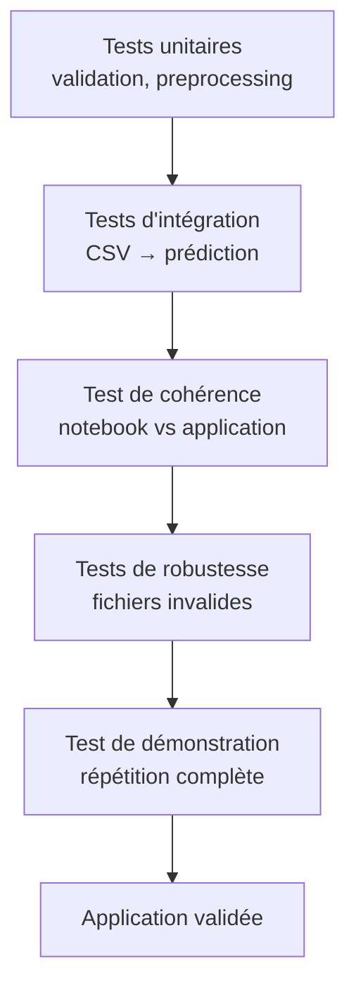

## 12.6 Fiche de test à conserver

Pour le rapport (section « Validation ») : conserver un tableau T1–T10 avec **date, version du code, résultat observé et capture d'écran**. Les cas **échoués** doivent aussi être consignés avec la correction apportée : cela renforce la crédibilité.

---

# 13. Organisation professionnelle du projet et du dépôt Git

## 13.1 Structure de dossiers recommandée

```text
nids-ml-project/
├── README.md
├── requirements.txt
├── .gitignore
├── data/
│   ├── raw/                  # données originales NSL-KDD (non modifiées)
│   ├── processed/            # train / validation / test préparés
│   └── README.md             # origine, licence, instructions de téléchargement
├── notebooks/
│   ├── 01_exploration_audit.ipynb
│   ├── 02_preprocessing_split.ipynb
│   ├── 03_training_models.ipynb
│   ├── 04_evaluation_optimisation.ipynb
│   └── 05_explainability_shap.ipynb
├── src/
│   ├── data/                 # chargement, nettoyage, split
│   ├── models/               # définition des modèles
│   ├── evaluation/           # métriques, matrices de confusion
│   ├── inference/            # loader, validation, preprocess, predict
│   └── analytics/            # statistiques d'attaques
├── app/
│   ├── app.py
│   └── pages/
├── models/                   # modèle final, scaler, encodeurs, JSON
├── reports/
│   ├── figures/
│   ├── final_metrics.json
│   ├── metrics_summary.csv
│   └── rapport_final.pdf
├── tests/
└── docs/                     # diapositives, notes, fiches
```

## 13.2 Fichiers essentiels

| Fichier | Rôle |
|---|---|
| `README.md` | Porte d'entrée du projet : but, installation, lancement, structure, résultats (renvoyant aux fichiers de métriques) |
| `requirements.txt` | Versions des bibliothèques pour reproduire l'environnement |
| `.gitignore` | Exclut gros fichiers, caches, environnements virtuels |
| `data/README.md` | Source et licence du dataset |

**Exemple de `.gitignore` :**

```gitignore
__pycache__/
*.pyc
.ipynb_checkpoints/
.venv/
.env
data/raw/*
!data/raw/.gitkeep
*.h5
.DS_Store
```

> Les gros jeux de données ne se versionnent pas dans Git : documenter **comment les télécharger**. Pour les modèles volumineux, envisager Git LFS ou une release de dépôt.

## 13.3 Squelette de `README.md`

```markdown
# Détection d'intrusions réseau par Machine Learning

## Objectif
Classifier des flux réseau en 5 catégories : Normal, DoS, Probe, R2L, U2R.

## Dataset
NSL-KDD (voir data/README.md pour le téléchargement).

## Installation
python -m venv .venv && source .venv/bin/activate
pip install -r requirements.txt

## Lancer l'application
streamlit run app/app.py

## Modèles évalués
Random Forest, MLP, 1D-CNN (résultats : reports/metrics_summary.csv)

## Structure du projet
(voir arborescence)

## Limites
(voir rapport, section Limites)
```

## 13.4 Workflow Git

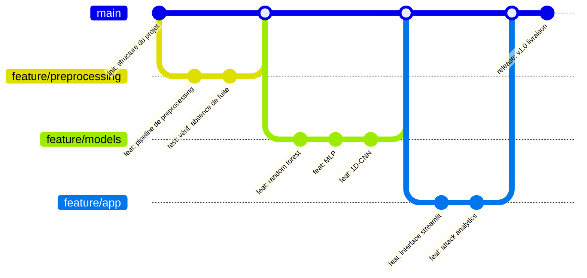

**Conventions de messages de commit** (style *Conventional Commits*) :

| Préfixe | Usage | Exemple |
|---|---|---|
| `feat:` | Nouvelle fonctionnalité | `feat: ajout de la page Attack Analytics` |
| `fix:` | Correction | `fix: gestion des colonnes manquantes` |
| `docs:` | Documentation | `docs: README, instructions de lancement` |
| `test:` | Tests | `test: cohérence du preprocessing` |
| `refactor:` | Réorganisation | `refactor: séparation validation/prédiction` |

**Bonnes pratiques :**
- Commits **petits et fréquents**, avec des messages explicites.
- Une **branche par fonctionnalité**, fusion sur `main` quand c'est validé.
- Un **tag de version** au moment de la livraison : `git tag -a v1.0 -m "Livraison finale"`.
- **Ne jamais** versionner de secrets (clés, mots de passe).

## 13.5 Qualité du code et des notebooks

- Numéroter et nommer les notebooks selon l'ordre logique.
- Une cellule de **titre/objectif** en tête de chaque notebook, et une **conclusion** à la fin.
- Déplacer le code réutilisable (preprocessing, métriques) dans `src/` plutôt que le copier-coller.
- Docstrings courtes sur les fonctions principales.
- Exécuter « Restart & Run All » avant chaque commit important.

## 13.6 Archive complète du projet

Livrable final : une archive (`.zip`) contenant code, notebooks, modèle, application, rapport, diapositives, `README.md` et `requirements.txt`, **testée sur une installation propre** si possible.

---

# 14. Rapport scientifique et préparation de la soutenance

## 14.1 Le rapport (Jour 27)

Rédiger un rapport de **10 à 15 pages** **selon la fiche officielle** (la fiche prévaut sur toute proposition ci-dessous).

### Plan suggéré (à adapter à la fiche officielle)

| Section | Contenu | Pages indicatives |
|---|---|---|
| Page de titre, résumé | Contexte, objectif, méthode, principaux résultats (🟦 mesurés) | 1 |
| 1. Introduction | Problème de détection d'intrusions, objectifs, contributions | 1 |
| 2. Contexte et état de l'art | Détection d'intrusions, ML/DL, travaux liés sur NSL-KDD | 1–2 |
| 3. Données | NSL-KDD, 5 catégories, audit, distribution des classes | 1–2 |
| 4. Méthodologie | Preprocessing, split 70/15/15, déséquilibre, prévention du leakage | 2 |
| 5. Modèles | Random Forest, MLP (architecture), 1D-CNN, hyperparamètres | 1–2 |
| 6. Résultats et discussion | Tableaux, matrices de confusion, analyse R2L/U2R, SHAP | 2–3 |
| 7. Application | Architecture Streamlit, captures d'écran, tests | 1 |
| 8. Limites et perspectives | Voir section 17 | 0,5–1 |
| 9. Conclusion | Synthèse, apports | 0,5 |
| Références | Bibliographie | 0,5–1 |

### Règles de rédaction scientifique

1. **Chaque chiffre** vient d'un fichier de résultats ; citer l'ensemble (validation ou test).
2. **Distinguer** ce qui est observé de ce qui est supposé (« les résultats suggèrent… » plutôt que « prouvent »).
3. **Justifier** chaque choix méthodologique (pourquoi stratifier, pourquoi la Macro F1…).
4. **Reconnaître** les limites sans les cacher.
5. Légender toutes les **figures et tableaux**, et les référencer dans le texte.
6. Citer les **sources** (dataset, bibliothèques, articles) ; ne pas copier de texte sans citation.
7. Relire pour la **cohérence** : mêmes noms de classes, mêmes métriques partout.

### Mise en page du tableau de résultats (modèle)

| Modèle | Accuracy | Macro F1 | Temps d'inférence | Ensemble |
|---|---|---|---|---|
| Random Forest | 🟦 | 🟦 | 🟦 | validation / test |
| MLP | 🟦 | 🟦 | 🟦 | validation / test |
| 1D-CNN | 🟦 | 🟦 | 🟦 | validation / test |

*Légende à inclure :* « Valeurs mesurées sur [ensemble], graine [42], matériel [CPU/GPU] ».

## 14.2 La soutenance (Jour 28)

### Structure type (durée à adapter à la consigne)

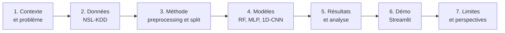

| Diapositive | Message clé |
|---|---|
| 1. Titre | Sujet, auteur, encadrant |
| 2. Problème | Pourquoi détecter les intrusions par ML |
| 3. Dataset | Source, 5 catégories, déséquilibre (chiffres mesurés) |
| 4. Pipeline | Schéma : audit → preprocessing → split → entraînement → évaluation |
| 5. Prévention du leakage | Fit sur train uniquement, test indépendant |
| 6. Modèles | Architectures RF / MLP / 1D-CNN |
| 7. Métriques | Pourquoi Macro F1 plutôt qu'Accuracy |
| 8. Résultats | Tableau comparatif (mesuré) + matrice de confusion |
| 9. Classes rares | R2L / U2R : analyse et compromis fausses alertes |
| 10. Explicabilité | Résultat SHAP principal |
| 11. Application | Architecture + captures |
| 12. Démo en direct | Scénario prévu |
| 13. Limites et perspectives | Honnêteté méthodologique |
| 14. Conclusion | Apports, enseignements |

### Préparer la démonstration

- Préparer un **CSV de démonstration** valide, **et** un fichier volontairement invalide pour montrer la robustesse.
- **Répéter** plusieurs fois, chronométrer.
- Prévoir un **plan B** : captures d'écran et vidéo courte si le réseau, l'ordinateur ou l'application échouent (l'application doit idéalement fonctionner **hors connexion**).
- Lancer l'application et vérifier le chargement du modèle **avant** la séance.

### Questions probables du jury (et pistes de réponse)

| Question | Éléments de réponse |
|---|---|
| Pourquoi la Macro F1 et pas l'Accuracy ? | Classes déséquilibrées ; l'Accuracy masque l'échec sur R2L/U2R |
| Comment avez-vous évité le data leakage ? | Fit du scaler/encodeurs sur le train, test jamais utilisé pour choisir le modèle, SMOTE sur le train uniquement |
| Pourquoi ce modèle final ? | Critères définis à l'avance : détection, fausses alertes, temps, complexité |
| Pourquoi un 1D-CNN sur des données tabulaires ? | Test d'une architecture alternative ; les colonnes sont traitées comme une séquence, sans structure spatiale naturelle |
| Que se passe-t-il sur de nouvelles attaques ? | Limite : le modèle ne connaît que les catégories du dataset (voir section 17) |
| Vos résultats sont-ils généralisables ? | Dataset ancien, un seul dataset : généralisation non démontrée |
| Que feriez-vous avec plus de temps ? | Voir perspectives |

> Se préparer à **expliquer chaque graphique** présenté : si on ne peut pas l'expliquer, il ne doit pas être sur une diapositive.

---

# 15. Checklist finale de livraison

## 15.1 Données et préparation

- [ ] Dataset NSL-KDD identifié, source et licence documentées.
- [ ] Rapport d'audit du dataset (valeurs manquantes, doublons, distribution des classes).
- [ ] Analyse exploratoire (EDA) et graphiques de distribution.
- [ ] Pipeline de preprocessing documenté (nettoyage justifié, One-Hot Encoding, StandardScaler).
- [ ] Valeurs extrêmes **non supprimées automatiquement** (justification écrite).
- [ ] Split Training / Validation / Testing (70/15/15) stratifié, classes présentes dans chaque partition.
- [ ] Transformations ajustées **uniquement** sur le training set.
- [ ] Stratégie de gestion du déséquilibre documentée (distributions avant/après).

## 15.2 Modèles et évaluation

- [ ] Random Forest, MLP et 1D-CNN entraînés.
- [ ] Courbes d'apprentissage et hyperparamètres documentés.
- [ ] Métriques calculées par classe (Accuracy, Precision, Recall, F1, Macro F1, Weighted F1, FPR).
- [ ] Matrice de confusion pour chaque modèle.
- [ ] Classification reports sauvegardés.
- [ ] Expériences d'optimisation tracées dans un journal.
- [ ] Analyse spécifique des classes minoritaires (R2L, U2R).
- [ ] Explications SHAP / Feature Importance (si réalisables) et limites notées.
- [ ] Tableau comparatif rempli **uniquement** avec des valeurs mesurées.
- [ ] Sélection du modèle final avec critères explicites, **sans** regarder le test.
- [ ] Évaluation finale unique sur le test set.

## 15.3 Artefacts et application

- [ ] Modèle final sauvegardé.
- [ ] Scaler et encodeurs sauvegardés.
- [ ] Liste des features et noms de classes sauvegardés.
- [ ] Métriques finales exportées (JSON/CSV).
- [ ] Reproductibilité vérifiée (rechargement + prédictions identiques).
- [ ] Application Streamlit fonctionnelle (accueil, import CSV, résultats).
- [ ] Attack Analytics (flux, normaux, malveillants, répartition, graphiques, alertes).
- [ ] Model Evaluation (modèle, métriques, matrice de confusion, tableau comparatif, détails).
- [ ] Tests T1–T10 exécutés et consignés.
- [ ] Test de cohérence preprocessing notebook ↔ application réussi.

## 15.4 Documentation et dépôt

- [ ] Structure de dossiers claire.
- [ ] `README.md` complet, `requirements.txt` à jour, `.gitignore` en place.
- [ ] Historique Git propre, tag `v1.0`.
- [ ] Notebooks exécutables de zéro à la fin.
- [ ] Aucun secret ni gros fichier inutile dans le dépôt.

## 15.5 Rapport et soutenance

- [ ] Rapport PDF de **10 à 15 pages**, conforme à la **fiche officielle**.
- [ ] Tous les chiffres traçables vers des fichiers de résultats.
- [ ] Limites et perspectives présentes.
- [ ] Références complètes.
- [ ] Diapositives prêtes.
- [ ] Démonstration répétée, plan B préparé.
- [ ] Archive complète du projet créée et testée.

## 15.6 Calendrier de la dernière semaine

| Jour | Tâches |
|---|---|
| 22 | Chargement du modèle, pipeline d'inférence, prédiction sur une ligne |
| 23 | Interface Streamlit : accueil, import CSV, résultats |
| 24 | Attack Analytics |
| 25 | Model Evaluation |
| 26 | Tests et fiabilité |
| 27 | Rapport scientifique |
| 28 | Diapositives, répétition de la démonstration, archive finale |

---

# 16. Compétences acquises et valorisation (CV / Portfolio)

## 16.1 Compétences développées

| Domaine | Compétences |
|---|---|
| **Machine Learning** | Préparation de données, split stratifié, prévention du data leakage, Random Forest, évaluation multiclasse |
| **Deep Learning** | MLP et 1D-CNN avec Keras, Dropout, Early Stopping, courbes d'apprentissage, réglage d'hyperparamètres |
| **Évaluation** | Accuracy, Precision, Recall, F1, Macro/Weighted F1, FPR, matrices de confusion, analyse des erreurs |
| **Données déséquilibrées** | Class Weights, SMOTE, analyse du compromis Recall / fausses alertes |
| **IA explicable** | Feature Importance, SHAP |
| **Cybersécurité** | Détection d'intrusions, catégories d'attaques (DoS, Probe, R2L, U2R) |
| **Ingénierie logicielle** | Application Streamlit, séparation des couches, tests, pipeline d'inférence |
| **Pratiques professionnelles** | Git, structure de projet, reproductibilité, documentation |
| **Communication** | Rapport scientifique, soutenance, démonstration |

## 16.2 Formuler le projet dans un CV

**Principe :** décrire ce qui a été **réellement fait** et **mesuré**. Ne mettre un chiffre que s'il est dans vos fichiers de résultats.

**Modèle de ligne (à compléter avec vos vraies valeurs) :**

> **Système de détection d'intrusions réseau (ML/DL)** — *Projet universitaire, 4 semaines*
> - Audit et préparation du dataset NSL-KDD (5 classes), split stratifié 70/15/15 sans fuite de données.
> - Entraînement et comparaison de **Random Forest, MLP et 1D-CNN** ; sélection du modèle sur la validation, évaluation finale sur un test set indépendant (Macro F1 : `[VALEUR MESURÉE]`).
> - Traitement du déséquilibre des classes (class weights / SMOTE) et analyse des classes rares R2L/U2R.
> - Interprétation des prédictions avec **SHAP**.
> - Développement d'une **application Streamlit** (import CSV, prédictions, analytics) avec tests de validation.
> - Python · Pandas · NumPy · Scikit-learn · Keras/TensorFlow · SHAP · Streamlit · Git

⚠️ Remplacer `[VALEUR MESURÉE]` par le chiffre réel **ou le supprimer**. Éviter les formulations non vérifiables (« modèle ultra-performant »).

## 16.3 Constituer un portfolio

| Élément | Contenu |
|---|---|
| **Dépôt GitHub** | Code propre, `README.md` soigné, structure claire, tag de version |
| **Page de présentation** | Problème, démarche, schéma du pipeline, résultats mesurés, limites |
| **Captures / GIF de l'application** | Import CSV, résultats, Attack Analytics |
| **Rapport PDF** | Lien ou fichier joint |
| **Notebooks** | Exécutés, commentés, avec conclusions |
| **Courte vidéo de démonstration** | 2 à 3 minutes |

## 16.4 Mise en avant à l'oral (entretien)

Structure en 4 temps : **Problème → Démarche → Résultat mesuré → Apprentissage**. Exemple de phrase d'apprentissage : *« J'ai appris qu'une Accuracy élevée peut cacher l'échec sur les attaques rares, d'où le choix de la Macro F1 et l'analyse par classe. »*

---

# 17. Limites et perspectives d'amélioration

## 17.1 Limites à reconnaître dans le rapport

| Limite | Explication | Impact |
|---|---|---|
| **Dataset unique et ancien** | NSL-KDD ne reflète pas nécessairement le trafic et les attaques actuels | Généralisation à un réseau réel non démontrée |
| **Classes rares** | R2L et U2R ont peu d'exemples ; les métriques sur ces classes sont plus instables | Résultats à interpréter avec prudence |
| **Catégories fermées** | Le modèle ne reconnaît que les 5 catégories vues à l'entraînement | Une attaque nouvelle peut être classée à tort comme une catégorie connue ou comme Normal |
| **1D-CNN sur données tabulaires** | Les colonnes n'ont pas d'ordre ou de voisinage naturel | Le gain éventuel de la convolution est à justifier |
| **Un seul split** | Les résultats dépendent d'un découpage unique | Variabilité non estimée (sauf validation croisée/répétitions) |
| **Explicabilité partielle** | SHAP explique le modèle, pas la cause réelle des attaques | Ne pas sur-interpréter |
| **SMOTE** | Génère des exemples synthétiques potentiellement irréalistes | À comparer prudemment aux class weights |
| **Application locale** | Pas de flux temps réel ni de capture réseau | Démonstrateur, non système de production |
| **Ressources de calcul** | Budget limité en temps/matériel | Exploration d'hyperparamètres restreinte |

## 17.2 Perspectives d'amélioration

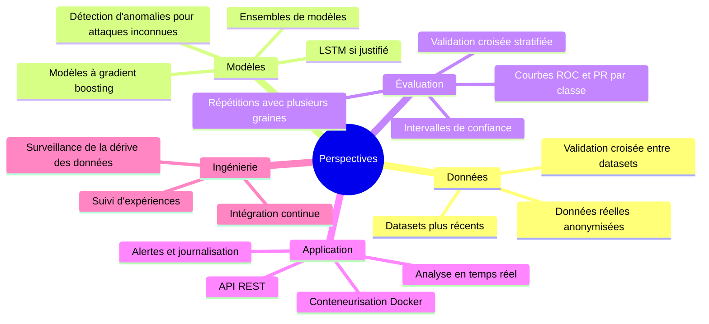

| Axe | Idée | Bénéfice |
|---|---|---|
| Données | Tester sur un dataset plus récent / complémentaire | Mesurer la généralisation |
| Évaluation | Validation croisée stratifiée, plusieurs graines, intervalles de confiance | Résultats plus robustes statistiquement |
| Modèles | LSTM (si méthodologiquement justifié), boosting, ensembles | Comparaison élargie |
| Attaques inconnues | Détection d'anomalies en complément | Couvrir les attaques non vues |
| Déploiement | API, Docker, flux temps réel | Passage vers un usage opérationnel |
| MLOps | Suivi d'expériences, surveillance de la dérive | Maintenance du modèle dans le temps |
| Explicabilité | Explications locales intégrées à l'interface | Aide à l'analyste |

## 17.3 Conclusion du document

Ce document a décrit le **chemin complet de l'évaluation à la livraison** :

1. évaluer **honnêtement** (test set préservé, Macro F1, analyse par classe) ;
2. **expliquer** les décisions du modèle (SHAP) ;
3. **figer** le modèle et son preprocessing ;
4. **intégrer** le tout dans une application testée ;
5. **documenter** et **présenter** avec rigueur, en n'avançant que des résultats mesurés.

> **Rappel final :** la crédibilité d'un projet scientifique repose moins sur un score élevé que sur une **méthodologie transparente, reproductible et honnête sur ses limites**.

---

## Annexe A — Glossaire rapide

| Terme | Définition simple |
|---|---|
| **Accuracy** | Part de prédictions correctes |
| **Precision** | Parmi les alertes, part de vraies attaques |
| **Recall** | Parmi les vraies attaques, part détectée |
| **F1-score** | Compromis harmonique Precision/Recall |
| **Macro F1** | Moyenne des F1 par classe, classes à égalité |
| **Weighted F1** | Moyenne des F1 pondérée par les effectifs |
| **FPR** | Part de trafic normal déclaré à tort comme attaque |
| **Confusion Matrix** | Tableau réel vs prédit |
| **Data Leakage** | Fuite d'information du test/validation vers l'entraînement |
| **Class Weights** | Pénalisation accrue des erreurs sur classes rares |
| **SMOTE** | Création d'exemples synthétiques pour classes minoritaires |
| **Hyperparamètre** | Réglage choisi avant l'entraînement |
| **Early Stopping** | Arrêt quand la validation cesse de s'améliorer |
| **SHAP** | Méthode d'attribution de la contribution de chaque feature |
| **Pipeline d'inférence** | Chaîne preprocessing + modèle utilisée en prédiction |
| **Reproductibilité** | Capacité à retrouver les mêmes résultats |

## Annexe B — Carte des livrables par semaine (selon la roadmap)

| Semaine | Livrables |
|---|---|
| **3** | Tableau comparatif, confusion matrices, classification reports, analyse des classes minoritaires, expériences d'optimisation, explications SHAP si réalisables, modèle final et artefacts sauvegardés |
| **4** | Application Streamlit fonctionnelle, modèle intégré, tests de validation, rapport PDF de 10 à 15 pages, présentation orale, archive complète du projet |

## Annexe C — Fiche de suivi des résultats (à remplir pendant le projet)

| Élément | Fichier source | Date de mesure | Validé ? |
|---|---|---|---|
| Distribution des classes | `reports/class_distribution.csv` | `[ ]` | ☐ |
| Métriques Random Forest | `reports/metrics_rf.json` | `[ ]` | ☐ |
| Métriques MLP | `reports/metrics_mlp.json` | `[ ]` | ☐ |
| Métriques 1D-CNN | `reports/metrics_cnn.json` | `[ ]` | ☐ |
| Tableau comparatif | `reports/metrics_summary.csv` | `[ ]` | ☐ |
| Évaluation finale (test) | `reports/final_metrics.json` | `[ ]` | ☐ |
| Résultats SHAP | `reports/figures/shap_*.png` | `[ ]` | ☐ |
| Tests T1–T10 | `reports/tests_results.md` | `[ ]` | ☐ |
